# Gallery

<!-- generated by python -m dxcad.docsgen gallery: edit the examples' docstrings, not this page -->

What DX-CAD makes, drawn by DX-CAD itself. Each picture is one of the
examples under [examples](examples/README.md), built from its model.py and
rendered in its parts' colours, with their edges, from the isometric view in
the light theme with no window on screen, as `dxcad render` draws; a sheet
part's flat pattern is drawn beside it as the SVG `dxcad flat` writes. Every
part is a script: open one to see the model that made it. The pictures are
made again with the first line below, and the same set in the dark theme,
under gallery/dark, with the second:

```
python -m dxcad.gallery
python -m dxcad.gallery --theme dark
```

and this page with `python -m dxcad.docsgen gallery`, from each example's
docstring: its first line is the heading, the paragraph after it the line
below, and its Tags line the group it is shown in.

## Solids

### A box and its lid, two parts from one model

The box is a block hollowed to one wall thickness with its top left open. The lid is a plate with a lip underneath that drops inside the walls with CLEARANCE to spare all round. They fit because they are made from the same numbers: change WALL and both parts change, and they fit still.

Tags: solid

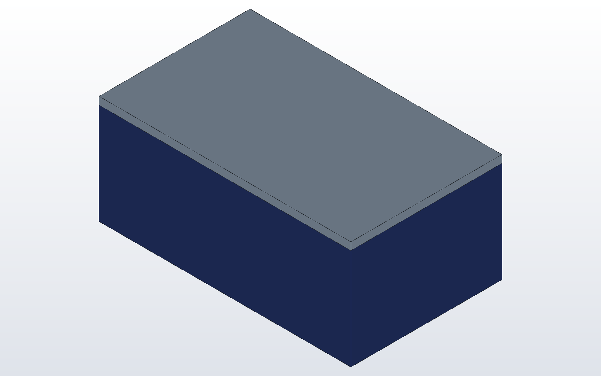

<details markdown="1">
<summary>The script, enclosure.py</summary>

```python
# SPDX-License-Identifier: Apache-2.0
"""A box and its lid, two parts from one model.

The box is a block hollowed to one wall thickness with its top left open. The
lid is a plate with a lip underneath that drops inside the walls with
CLEARANCE to spare all round. They fit because they are made from the same
numbers: change WALL and both parts change, and they fit still.

Tags: solid
"""

LENGTH = 100.0
WIDTH = 60.0
HEIGHT = 40.0
WALL = 2.0
LID = 3.0
LIP = 4.0
CLEARANCE = 0.2

block = make_box(LENGTH, WIDTH, HEIGHT)
(top,) = faces_parallel_to(block, (0, 0, 1))
part("box", hollow(block, WALL, [top]), color="navy")

# The lid is built where it sits when the box is closed: its plate on the
# walls' tops and its lip hanging down inside them.
plate = make_box(LENGTH, WIDTH, LID, origin=(0, 0, HEIGHT))
gap = WALL + CLEARANCE
outer = make_box(LENGTH - 2 * gap, WIDTH - 2 * gap, LIP, origin=(gap, gap, HEIGHT - LIP))
inset = gap + WALL
inner = make_box(LENGTH - 2 * inset, WIDTH - 2 * inset, LIP, origin=(inset, inset, HEIGHT - LIP))
part("lid", fuse(plate, cut(outer, inner)), color="steel")
```

</details>

The file: [enclosure.py](examples/enclosure.py).

### Inline-four DOHC petrol engine, cut away

A 1.8 litre inline-four as a machined-component showcase. The aluminium block is sectioned through the bores on the intake side to show the water jacket, the pistons with their ring grooves and gudgeon pins, the I-beam connecting rods with bolted big-end caps and the crankshaft with its counterweight webs, flywheel ring gear and front pulley. The pistons and rods are placed from CRANK_ANGLE by the exact slider-crank relation, so changing that one number turns the engine over. Above sit the cylinder head with two camshafts, 16 inclined valves with springs, retainers and bucket tappets, the cam bearing caps, sprockets and timing chain, the red cam cover cut open over the front two cylinders, coil-on-plug ignition, swept intake runners into a plenum with port injectors on a fuel rail, and a 4-into-1 heat-blued exhaust header.

Tags: solid, assembly, mates, sketch, showcase

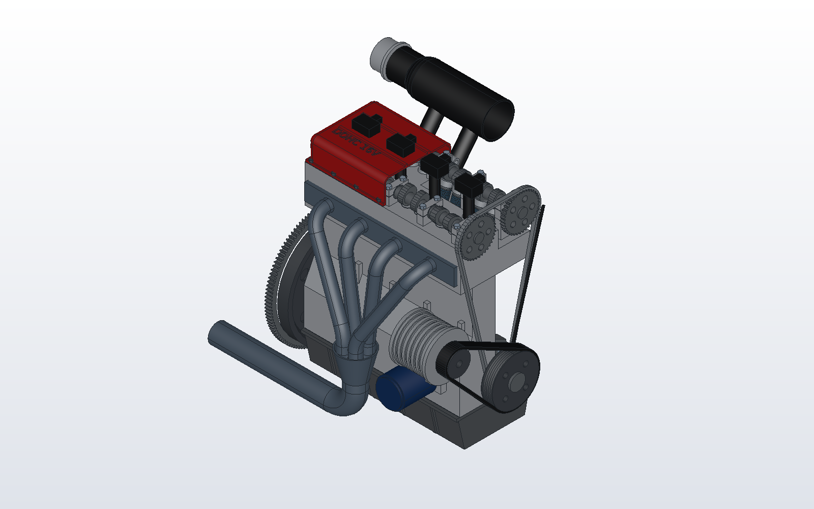

<details markdown="1">
<summary>The script, engine_inline4.py</summary>

```python
# SPDX-License-Identifier: Apache-2.0
"""Inline-four DOHC petrol engine, cut away.

A 1.8 litre inline-four as a machined-component showcase. The aluminium
block is sectioned through the bores on the intake side to show the water
jacket, the pistons with their ring grooves and gudgeon pins, the I-beam
connecting rods with bolted big-end caps and the crankshaft with its
counterweight webs, flywheel ring gear and front pulley. The pistons and
rods are placed from CRANK_ANGLE by the exact slider-crank relation, so
changing that one number turns the engine over. Above sit the cylinder head
with two camshafts, 16 inclined valves with springs, retainers and bucket
tappets, the cam bearing caps, sprockets and timing chain, the red cam cover
cut open over the front two cylinders, coil-on-plug ignition, swept intake
runners into a plenum with port injectors on a fuel rail, and a 4-into-1
heat-blued exhaust header.

DX-CAD features shown: revolved and extruded sketch profiles, swept paths,
booleans and shelling, circular and linear repetition, place() for every
moving and repeated part, mates confirming the pulley and flywheel on the
crankshaft, part numbers and material properties for the bill of materials.

As it opens each cam lobe is drawn with LOBE = 24 straight pieces, so the
model builds quickly; 64 draws the lobes smooth.

Tags: solid, assembly, mates, sketch, showcase
"""

BORE = 81.0  # cylinder bore
STROKE = 86.0  # crank throw x 2
ROD_LENGTH = 143.0  # big-end centre to small-end centre
BORE_PITCH = 91.0  # cylinder centre spacing along the crankshaft
COMP_HEIGHT = 31.0  # gudgeon pin centre to piston crown
CRANK_ANGLE = 40.0  # degrees after top dead centre of cylinder 1
MAIN_R = 26.0  # main journal radius
PIN_R = 22.0  # crankpin radius
VALVE_ANGLE = 20.0  # valve inclination from the bore axis, each side
HEAD_H = 100.0  # cylinder head height, deck to cam carrier
CUTAWAY = True  # section the block, head and cam cover
LOBE = 24  # straight pieces round each cam lobe: 64 draws it smooth, and builds a second slower

ALU = "#B8BCC2"
STEEL = "#6E7378"
PISTON_C = "#D9DCDF"
RED = "#B71C1C"
BLACK = "#1E1F21"
BLUED = "#5D6D7E"
DARK = "#4A4F55"
BRIGHT = "#A9AEB4"

# ------------------------------------------------------------------ derived layout
CR = STROKE / 2
XC = [(i - 1.5) * BORE_PITCH for i in range(4)]
PHASE = [0.0, 180.0, 180.0, 0.0]  # flat-plane crank, firing order 1-3-4-2
MAIN_LEN = 22.0
PIN_LEN = 24.0
WEB = (BORE_PITCH - PIN_LEN - MAIN_LEN) / 2
MAIN_X = [XC[0] - BORE_PITCH / 2 + k * BORE_PITCH for k in range(5)]
SKIRT = 26.0
CW_R = CR + 24
DECK_Z = ROD_LENGTH + CR + COMP_HEIGHT + 1.0
XB0 = MAIN_X[0] - MAIN_LEN / 2 - 14
XB1 = MAIN_X[4] + MAIN_LEN / 2 + 14
LINER_R = max(BORE / 2 + 5, BORE_PITCH / 2 + 1.5)
BW = LINER_R + 14
HW = BORE / 2 + 52
SKIRT_Z = -(CR + 20)
CUT_X = MAIN_X[0]
VX = BORE * 0.21  # valve offset either side of the bore centre, along X
V_OFF = 14.0  # valve axis offset from the bore centre at the deck
S_CAM = 129.0  # cam axis distance along the valve axis
SA, CA = math.sin(math.radians(VALVE_ANGLE)), math.cos(math.radians(VALVE_ANGLE))
YC = V_OFF + S_CAM * SA
ZC = DECK_Z + S_CAM * CA
FRONT = XB1


# ------------------------------------------------------------------ helpers
def x_cyl(r, length, x0, y=0.0, z=0.0):
    return translate(rotate(make_cylinder(r, length), (0, 0, 0), (0, 1, 0), 90), (x0, y, z))


def y_cyl(r, length, x, y0, z):
    return translate(rotate(make_cylinder(r, length), (0, 0, 0), (1, 0, 0), -90), (x, y0, z))


def drill(shape, tools):
    """Cut tools that do not touch one another out of a shape in one cut, not a cut each."""
    return cut(shape, compound(tools))


def join(shape, pieces):
    """Fuse pieces that do not touch one another onto a shape in one fuse."""
    return fuse(shape, compound(pieces))


def x_tube(r_out, r_in, length, x0, y=0.0, z=0.0):
    return cut(x_cyl(r_out, length, x0, y, z), x_cyl(r_in, length + 2, x0 - 1, y, z))


def yz_face(points, x):
    return polygon_face(points, Plane((x, 0, 0), (1, 0, 0), (0, 1, 0)))


def about_x(profile):
    """Revolve an (x, r) profile about the crank axis."""
    return revolve(
        polygon_face(profile, Plane((0, 0, 0), (0, -1, 0), (1, 0, 0))), (0, 0, 0), (1, 0, 0)
    )


def about_z(profile):
    """Revolve an (r, z) profile about the Z axis."""
    return revolve(
        polygon_face(profile, Plane((0, 0, 0), (0, -1, 0), (1, 0, 0))), (0, 0, 0), (0, 0, 1)
    )


def hex_prism(across_flats, h, x, y, z):
    rc = across_flats / math.sqrt(3)
    pts = [
        (x + rc * math.cos(math.radians(30 + 60 * k)), y + rc * math.sin(math.radians(30 + 60 * k)))
        for k in range(6)
    ]
    return extrude(polygon_face(pts, Plane.XY.offset(z)), h)


def bolt(x, y, z_head, r, length, af, head_h, down=False):
    """A hex-head bolt on a vertical axis; the head sits on z_head, the shank runs away from it."""
    if down:
        return fuse(
            hex_prism(af, head_h, x, y, z_head - head_h),
            make_cylinder(r, length, (x, y, z_head - 0.5)),
        )
    return fuse(
        hex_prism(af, head_h, x, y, z_head), make_cylinder(r, length, (x, y, z_head - length + 0.5))
    )


def gear_points(n, r_root, r_tip, cy=0.0, cz=0.0):
    pts = []
    step = 2 * math.pi / n
    for k in range(n):
        a = k * step
        for frac, r in ((-0.30, r_root), (-0.11, r_tip), (0.11, r_tip), (0.30, r_root)):
            pts.append((cy + r * math.cos(a + frac * step), cz + r * math.sin(a + frac * step)))
    return pts


def sprocket(n, r_root, r_tip, r_bore, x0, width, cy=0.0, cz=0.0, holes=0):
    body = extrude(yz_face(gear_points(n, r_root, r_tip, cy, cz), x0), width, (1, 0, 0))
    tools = [x_cyl(r_bore, width + 2, x0 - 1, cy, cz)]
    for k in range(holes):
        a = 2 * math.pi * k / holes
        rr = (r_root + r_bore) / 2
        tools.append(
            x_cyl(
                (r_root - r_bore) * 0.22,
                width + 2,
                x0 - 1,
                cy + rr * math.cos(a),
                cz + rr * math.sin(a),
            )
        )
    return drill(body, tools)


def hull(points):
    pts = sorted(set((round(p[0], 6), round(p[1], 6)) for p in points))

    def turn(o, a, b):
        return (a[0] - o[0]) * (b[1] - o[1]) - (a[1] - o[1]) * (b[0] - o[0])

    lower, upper = [], []
    for p in pts:
        while len(lower) >= 2 and turn(lower[-2], lower[-1], p) <= 0:
            lower.pop()
        lower.append(p)
    for p in reversed(pts):
        while len(upper) >= 2 and turn(upper[-2], upper[-1], p) <= 0:
            upper.pop()
        upper.append(p)
    return lower[:-1] + upper[:-1]


def circle_pts(cy, cz, r, n=48):
    return [
        (cy + r * math.cos(2 * math.pi * k / n), cz + r * math.sin(2 * math.pi * k / n))
        for k in range(n)
    ]


def band(circles, x0, width, inner, outer):
    """A chain or belt: the hull round some (y, z, r) circles, from r + inner to r + outer."""
    out_pts = hull([p for cy, cz, r in circles for p in circle_pts(cy, cz, r + outer)])
    in_pts = hull([p for cy, cz, r in circles for p in circle_pts(cy, cz, r + inner)])
    body = extrude(yz_face(out_pts, x0), width, (1, 0, 0))
    hole = extrude(yz_face(in_pts, x0 - 1), width + 2, (1, 0, 0))
    return cut(body, hole)


def v_add(a, b):
    return (a[0] + b[0], a[1] + b[1], a[2] + b[2])


def v_sub(a, b):
    return (a[0] - b[0], a[1] - b[1], a[2] - b[2])


def v_mul(a, k):
    return (a[0] * k, a[1] * k, a[2] * k)


def v_dot(a, b):
    return a[0] * b[0] + a[1] * b[1] + a[2] * b[2]


def v_unit(a):
    n = math.sqrt(v_dot(a, a))
    return (a[0] / n, a[1] / n, a[2] / n)


def bend_end(p, t, d, radius):
    """Where a circular bend of `radius` leaving p along t ends once it heads along d."""
    c = max(-1.0, min(1.0, v_dot(t, d)))
    th = math.acos(c)
    n = v_unit(v_sub(d, v_mul(t, c)))
    return v_add(p, v_add(v_mul(t, radius * math.sin(th)), v_mul(n, radius * (1 - c))))


def line_edge(p, q):
    return BRepBuilderAPI_MakeEdge(gp_Pnt(*p), gp_Pnt(*q)).Edge()


def arc_edge(p, t, q):
    return BRepBuilderAPI_MakeEdge(
        GC_MakeArcOfCircle(gp_Pnt(*p), gp_Vec(*t), gp_Pnt(*q)).Value()
    ).Edge()


def pipe(path_edges, start, normal, r_out, r_in):
    """Sweep a tube section along a path that starts at `start` heading along `normal`."""
    x_dir = (1, 0, 0) if abs(normal[0]) < 0.9 else (0, 1, 0)
    plane = Plane(start, normal, x_dir)
    face = Sketch(plane).circle((0, 0), r_out).circle((0, 0), r_in).face()
    return sweep(face, make_wire(path_edges))


def put(name, shape, color, at=(0.0, 0.0, 0.0), tilt=0.0, part_number=None, properties=None):
    """Register a copy of `shape` turned `tilt` degrees about X and moved to `at`, in colour."""
    moved = translate(rotate(shape, (0, 0, 0), (1, 0, 0), tilt), at)
    return part(name, moved, color=color, part_number=part_number, properties=properties)


def slider_crank(theta):
    """Crankpin (y, z), gudgeon pin z and rod tilt for crank angle theta (degrees)."""
    t = math.radians(theta)
    yp, zp = -CR * math.sin(t), CR * math.cos(t)
    zpin = zp + math.sqrt(ROD_LENGTH**2 - yp**2)
    return yp, zp, zpin, math.degrees(math.asin(yp / ROD_LENGTH))


# ================================================================== crankshaft
def web(x0, phase):
    pts = [
        (0 + (PIN_R + 9) * math.cos(math.radians(a)), CR + (PIN_R + 9) * math.sin(math.radians(a)))
        for a in range(0, 181, 15)
    ]
    pts += [
        (CW_R * math.sin(math.radians(a)), -CW_R * math.cos(math.radians(a)))
        for a in range(-68, 69, 8)
    ]
    w = extrude(yz_face(pts, x0), WEB, (1, 0, 0))
    return rotate(w, (0, 0, 0), (1, 0, 0), phase)


mains = [x_cyl(MAIN_R, MAIN_LEN + 2, MAIN_X[0] - MAIN_LEN / 2 - 1)]
webs, pins = [], []
for i in range(4):
    xa = XC[i] - PIN_LEN / 2 - WEB
    webs.append(web(xa, PHASE[i]))
    pin = x_cyl(PIN_R, PIN_LEN + 2 * WEB - 4, xa + 2, 0, CR)
    pins.append(rotate(pin, (0, 0, 0), (1, 0, 0), PHASE[i]))
    webs.append(web(XC[i] + PIN_LEN / 2, PHASE[i]))
    mains.append(x_cyl(MAIN_R, MAIN_LEN + 4, MAIN_X[i + 1] - MAIN_LEN / 2 - 2))
mains[4] = fuse_all(
    [
        mains[4],
        x_cyl(MAIN_R - 2, FRONT + 4 - MAIN_X[4], MAIN_X[4]),  # timing journal
        x_cyl(20.0, 60, FRONT),
    ]
)  # snout
mains[0] = fuse_all(
    [
        mains[0],
        x_cyl(MAIN_R, MAIN_X[0] - MAIN_LEN / 2 - XB0 + 8, XB0 - 6),  # rear seal journal
        x_cyl(44.0, 10, XB0 - 16),
    ]
)  # flywheel flange
# the webs stand clear of one another, as do the journals and the pins: one fuse, not twenty
crank = fuse(compound(webs), compound(mains + pins))
oil_holes = [
    rotate(
        make_cylinder(3.5, 2 * PIN_R + 2, (XC[i], 0, CR - PIN_R - 1)), (XC[i], 0, CR), (1, 0, 0), 30
    )
    for i in range(4)
]
crank = drill(crank, [rotate(h, (0, 0, 0), (1, 0, 0), PHASE[i]) for i, h in enumerate(oil_holes)])
crank = rotate(crank, (0, 0, 0), (1, 0, 0), CRANK_ANGLE)
part(
    "crankshaft",
    crank,
    color=STEEL,
    part_number="ENG-110",
    properties={"material": "forged 42CrMo4, induction hardened"},
)

# flywheel, ring gear, crank sprocket, pulley
fw_x = XB0 - 16
flywheel = about_x(
    [
        (fw_x - 30, 20),
        (fw_x, 20),
        (fw_x, 60),
        (fw_x - 14, 70),
        (fw_x - 14, 120),
        (fw_x - 2, 128),
        (fw_x - 2, 140),
        (fw_x - 30, 140),
    ]
)
fw_tools = [
    x_cyl(5.5, 40, fw_x - 35, 34 * math.cos(math.radians(a)), 34 * math.sin(math.radians(a)))
    for a in range(0, 360, 60)
]
fw_tools += [
    x_cyl(13, 20, fw_x - 20, 95 * math.cos(math.radians(a)), 95 * math.sin(math.radians(a)))
    for a in range(30, 360, 60)
]
part(
    "flywheel",
    drill(flywheel, fw_tools),
    color=DARK,
    part_number="ENG-120",
    properties={"material": "nodular cast iron"},
)
ring = extrude(yz_face(gear_points(120, 150, 156), fw_x - 28), 14, (1, 0, 0))
part(
    "ring_gear",
    cut(ring, x_cyl(139, 20, fw_x - 30)),
    color=STEEL,
    part_number="ENG-121",
    properties={"material": "C45 induction hardened"},
)
part("crank_sprocket", sprocket(19, 22, 26, 20, FRONT + 2, 10), color=STEEL, part_number="ENG-131")
pul_x = FRONT + 24
pulley_prof = [(pul_x, 20), (pul_x + 30, 20), (pul_x + 30, 62)]
for k in range(6):
    xg = pul_x + 28 - k * 4.5
    pulley_prof += [(xg, 62), (xg - 2.25, 58.5)]
pulley_prof += [
    (pul_x + 2, 62),
    (pul_x, 62),
    (pul_x, 50),
    (pul_x + 10, 46),
    (pul_x + 10, 32),
    (pul_x, 30),
]
pulley = drill(
    about_x(pulley_prof),
    [
        x_cyl(7, 40, pul_x - 5, 38 * math.cos(math.radians(a)), 38 * math.sin(math.radians(a)))
        for a in range(45, 360, 90)
    ],
)
part(
    "crank_pulley",
    pulley,
    color=DARK,
    part_number="ENG-130",
    properties={"material": "cast iron, rubber damper"},
)

# ================================================================== pistons, pins, rods
R = BORE / 2 - 0.3
CH = COMP_HEIGHT
prof = [(0, CH), (R, CH)]
for top, bot in ((CH - 4.5, CH - 6.5), (CH - 9.0, CH - 11.0), (CH - 13.5, CH - 17.0)):
    prof += [(R, top), (R - 3, top), (R - 3, bot), (R, bot)]
prof += [
    (R, -SKIRT),
    (R - 4, -SKIRT),
    (R - 4, CH - 20),
    (R - 9, CH - 20),
    (R - 9, CH - 8),
    (0, CH - 8),
]
piston = about_z(prof)
boss = common(x_cyl(14, 2 * R, -R), make_cylinder(R - 2, 30, (0, 0, -15)))
piston = fuse(piston, boss)
piston = cut_all(
    piston,
    [
        x_cyl(10, 2 * R + 4, -R - 2),
        make_box(24, 2 * (R - 7), CH - 21 + SKIRT + 1, (-12, -(R - 7), -SKIRT - 1)),
    ]
    + [
        make_cylinder(BORE * 0.19, 3, (sx * VX, sy * (V_OFF + 4), CH - 1.6))
        for sx in (-1, 1)
        for sy in (-1, 1)
    ],
)
gudgeon = x_tube(10, 6.5, 2 * R - 10, -(R - 5))

BE = PIN_R + 7
BOLT_Y = PIN_R + 8
SE_R = 15.5
L = ROD_LENGTH
upper = common(x_cyl(BE, 22, -11), make_box(22, 2 * BE, BE, (-11, -BE, 0)))
upper = fuse_all([upper, make_box(22, 2 * (BOLT_Y + 7), 15, (-11, -BOLT_Y - 7, 0))])
z0, z1 = BE - 4, L - SE_R + 4
shank = extrude(yz_face([(-13, z0), (13, z0), (8, z1), (-8, z1)], -9), 18, (1, 0, 0))
pocket_pts = [(-9, BE + 6), (9, BE + 6), (4.5, L - SE_R - 3), (-4.5, L - SE_R - 3)]
pockets = [
    extrude(yz_face(pocket_pts, 3), 7, (1, 0, 0)),
    extrude(yz_face(pocket_pts, -10), 7, (1, 0, 0)),
]
rod = fuse_all([upper, shank, x_cyl(SE_R, 20, -10, 0, L)])
rod = cut_all(
    rod,
    pockets
    + [x_cyl(PIN_R, 30, -15), x_cyl(10, 30, -15, 0, L)]
    + [make_cylinder(4.3, 40, (0, s * BOLT_Y, -20)) for s in (-1, 1)],
)
cap = common(x_cyl(BE, 22, -11), make_box(22, 2 * BE, BE, (-11, -BE, -BE)))
cap = fuse(cap, make_box(22, 2 * (BOLT_Y + 7), 15, (-11, -BOLT_Y - 7, -15)))
cap = cut_all(
    cap, [x_cyl(PIN_R, 30, -15)] + [make_cylinder(4.3, 40, (0, s * BOLT_Y, -20)) for s in (-1, 1)]
)
rod_bolt = bolt(0, 0, -15, 4.0, 34, 12, 6, down=True)

for i in range(4):
    yp, zp, zpin, tilt = slider_crank(CRANK_ANGLE + PHASE[i])
    n = i + 1
    put(
        f"piston_{n}",
        piston,
        PISTON_C,
        (XC[i], 0, zpin),
        0,
        "ENG-150",
        {"material": "AlSi12CuNiMg, forged"},
    )
    put(
        f"gudgeon_pin_{n}",
        gudgeon,
        BRIGHT,
        (XC[i], 0, zpin),
        0,
        "ENG-151",
        {"material": "case-hardened 16MnCr5"},
    )
    put(
        f"conrod_{n}",
        rod,
        STEEL,
        (XC[i], yp, zp),
        tilt,
        "ENG-140",
        {"material": "forged C70S6, fracture-split"},
    )
    put(f"rod_cap_{n}", cap, STEEL, (XC[i], yp, zp), tilt, "ENG-141", {"material": "forged C70S6"})
    for s, side in ((-1, "a"), (1, "b")):
        put(
            f"rod_bolt_{n}{side}",
            translate(rod_bolt, (0, s * BOLT_Y, 0)),
            DARK,
            (XC[i], yp, zp),
            tilt,
            "ENG-143",
            {"material": "12.9 alloy steel"},
        )

# ================================================================== block
prof = [
    (-95, SKIRT_Z),
    (95, SKIRT_Z),
    (95, 35),
    (BW, 105),
    (BW, DECK_Z),
    (-BW, DECK_Z),
    (-BW, 105),
    (-95, 35),
]
block = extrude(yz_face(prof, XB0), XB1 - XB0, (1, 0, 0))
ribs = [make_box(10, 12, 90, (MAIN_X[k] - 5, -BW - 9, 40)) for k in range(5)]
ribs.append(make_box(70, 30, 70, (XC[3] - 35, -110, -20)))  # oil filter boss
block = join(block, ribs)
jacket_out = fuse_all([make_cylinder(LINER_R + 8, 111, (x, 0, DECK_Z - 110)) for x in XC])
jacket_in = fuse_all([make_cylinder(LINER_R, 113, (x, 0, DECK_Z - 111)) for x in XC])
# the water jacket and the four crank bays stand clear of one another, as do the bores
# and the main bearing bore
block = drill(
    block,
    [cut(jacket_out, jacket_in)]
    + [
        make_box(
            BORE_PITCH - MAIN_LEN + 4,
            2 * (CW_R + 6),
            40 - SKIRT_Z + 1,
            (MAIN_X[k] + MAIN_LEN / 2 - 2, -CW_R - 6, SKIRT_Z - 1),
        )
        for k in range(4)
    ],
)
block = drill(
    block,
    [make_cylinder(BORE / 2, DECK_Z - 29, (x, 0, 30)) for x in XC]
    + [x_cyl(MAIN_R + 0.5, XB1 - XB0 + 2, XB0 - 1)],
)
block = cut_all(
    block,
    [
        make_box(
            MAIN_X[4] - MAIN_X[0] + MAIN_LEN - 4,
            104,
            -SKIRT_Z + 1,
            (MAIN_X[0] - MAIN_LEN / 2 + 2, -52, SKIRT_Z - 1),
        ),
        make_cylinder(9, 30, (XC[3], 0, -45)),
    ],
)
block = cut(block, y_cyl(22, 40, XC[3], -125, 15))
if CUTAWAY:
    block = cut(
        block, make_box(XB1 - CUT_X + 2, 200, DECK_Z - SKIRT_Z + 2, (CUT_X, 0, SKIRT_Z - 1))
    )
part(
    "cylinder_block",
    block,
    color=ALU,
    part_number="ENG-100",
    properties={"material": "A319 aluminium, cast-in iron liners"},
)

main_cap = cut(
    make_box(MAIN_LEN - 4, 100, 40, (-(MAIN_LEN - 4) / 2, -50, -40)), x_cyl(MAIN_R + 0.5, 30, -15)
)
cap_bolt = bolt(0, 0, -40, 5.0, 60, 14, 7, down=True)
for k in range(5):
    put(
        f"main_cap_{k + 1}",
        main_cap,
        DARK,
        (MAIN_X[k], 0, 0),
        0,
        "ENG-105",
        {"material": "nodular cast iron"},
    )
    for s, lr in ((-1, "a"), (1, "b")):
        place(f"main_cap_bolt_{k + 1}{lr}", cap_bolt, at=(MAIN_X[k], s * 38, 0))
        identity(
            f"main_cap_bolt_{k + 1}{lr}",
            part_number="ENG-106",
            properties={"material": "10.9 steel"},
        )


# ================================================================== cylinder head
def along_valve(shape, x, side):
    """Put a shape built on +Z at the valve seat of the intake (+1) or exhaust (-1) valve at x."""
    return translate(
        rotate(shape, (0, 0, 0), (1, 0, 0), -side * VALVE_ANGLE), (x, side * V_OFF, DECK_Z)
    )


head = make_box(XB1 - XB0, 2 * HW, HEAD_H, (XB0, -HW, DECK_Z))
towers = [
    make_box(16, 52, ZC - DECK_Z - HEAD_H + 3, (MAIN_X[k] - 8, s * YC - 26, DECK_Z + HEAD_H - 2))
    for k in range(5)
    for s in (-1, 1)
]
head = join(head, towers)
# each line's tools stand clear of one another, so each line is one cut
head = drill(
    head,
    [make_cylinder(BORE / 2 - 1, 5, (x, 0, DECK_Z - 1)) for x in XC]  # chambers
    + [make_cylinder(12.5, HEAD_H, (x, 0, DECK_Z + 30)) for x in XC],
)  # plug wells
head = drill(
    head,
    [
        along_valve(make_cylinder(14.6, 120, (0, 0, 56)), x + sx * VX, side)  # tappet bores
        for x in XC
        for sx in (-1, 1)
        for side in (-1, 1)
    ],
)
head = drill(
    head,
    [x_cyl(14.5, XB1 - XB0 + 2, XB0 - 1, s * YC, ZC) for s in (-1, 1)]  # cam bores
    + [make_cylinder(7.5, HEAD_H + 5, (x, 0, DECK_Z - 1)) for x in XC],
)  # plug holes
head = drill(
    head,
    [y_cyl(15, 45, x, HW - 44, DECK_Z + 36) for x in XC]  # intake ports
    + [y_cyl(14, 45, x, -HW - 1, DECK_Z + 40) for x in XC],
)  # exhaust ports
if CUTAWAY:
    # open the intake side over the front two cylinders, leaving the cam bearing bulkheads standing
    window = make_box(XB1 + 2, HW, ZC - DECK_Z - 20, (0, 8, DECK_Z + 56))
    window = cut_all(
        window,
        [
            make_box(16, 52, ZC - DECK_Z, (MAIN_X[k] - 8, YC - 26, DECK_Z + 40))
            for k in range(5)
            if MAIN_X[k] > -9
        ],
    )
    head = cut(head, window)
part(
    "cylinder_head",
    head,
    color=ALU,
    part_number="ENG-200",
    properties={"material": "A356-T6 aluminium"},
)


# valvetrain: built once on +Z, placed along each inclined valve axis
def valve(r_head):
    return about_z([(0, -2), (r_head, -2), (r_head, -0.5), (4, 7), (3, 10), (3, 104), (0, 104)])


spring_prof = [(8.5, 58)]
z = 58.0
while z < 90:
    spring_prof += [(12.0, z + 1.2), (12.0, z + 2.4), (9.6, z + 3.4)]
    z += 3.4
spring_prof += [(12.0, z + 1), (12.0, z + 2), (8.5, z + 2)]
spring = about_z(spring_prof)
s_top = z + 2
retainer = about_z(
    [(3.2, s_top), (11.5, s_top), (11.5, s_top + 1.5), (6, s_top + 6), (3.2, s_top + 6)]
)
tappet = cut(make_cylinder(14, 12, (0, 0, 100)), make_cylinder(12, 9, (0, 0, 100)))
v_in, v_ex = valve(15.0), valve(13.0)
for i, x in enumerate(XC):
    for side, kind in ((1, "intake"), (-1, "exhaust")):
        for sx, lr in ((-1, "a"), (1, "b")):
            tag = f"{i + 1}{lr}"
            spot = dict(at=(x + sx * VX, side * V_OFF, DECK_Z), tilt=-side * VALVE_ANGLE)
            put(
                f"{kind}_valve_{tag}",
                v_in if side > 0 else v_ex,
                BRIGHT,
                **spot,
                part_number="ENG-210" if side > 0 else "ENG-211",
                properties={
                    "material": "X45CrSi9-3" if side > 0 else "X53CrMnNiN21-9, Stellite seat"
                },
            )
            put(
                f"{kind}_spring_{tag}",
                spring,
                "#3B6E8F",
                **spot,
                part_number="ENG-212",
                properties={"material": "Si-Cr spring steel"},
            )
            put(f"{kind}_retainer_{tag}", retainer, STEEL, **spot, part_number="ENG-213")
            put(f"{kind}_tappet_{tag}", tappet, BRIGHT, **spot, part_number="ENG-214")


# camshafts: base circle 17, lobe lift 8; half crank speed
def lobe_face(x0, yc, zc, ang):
    pts = []
    for k in range(LOBE):
        phi = 2 * math.pi * k / LOBE
        c = math.cos(phi)
        r = 17 + (8 * c**3 if c > 0 else 0)
        a = phi + math.radians(ang)
        pts.append((yc + r * math.cos(a), zc + r * math.sin(a)))
    return yz_face(pts, x0)


CAM_PHASE = [0.0, 270.0, 90.0, 180.0]
for side, kind in ((1, "intake"), (-1, "exhaust")):
    yc = side * YC
    bits = [x_cyl(12, FRONT + 16 - XB0 + 8, XB0 - 8, yc, ZC)]
    bits += [x_cyl(14, 16, MAIN_X[k] - 8, yc, ZC) for k in range(5)]
    base = -CRANK_ANGLE / 2 + (90 if side > 0 else -20)
    for i, x in enumerate(XC):
        for sx in (-1, 1):
            bits.append(
                extrude(lobe_face(x + sx * VX - 7, yc, ZC, base + CAM_PHASE[i]), 14, (1, 0, 0))
            )
    bits.append(x_cyl(16, 10, FRONT - 2, yc, ZC))
    part(
        f"{kind}_camshaft",
        join(bits[0], bits[1:]),
        color=STEEL,
        part_number=f"ENG-22{0 if side > 0 else 1}",
        properties={"material": "chilled cast iron, ground lobes"},
    )
    part(
        f"{kind}_cam_sprocket",
        sprocket(38, 44, 48, 12, FRONT + 2, 10, yc, ZC, holes=5),
        color=STEEL,
        part_number="ENG-225",
    )
    cam_cap = cut(make_box(16, 52, 15, (-8, -26, 0)), x_cyl(14.5, 20, -10))
    cap_b = bolt(0, 0, 15, 4.0, 40, 11, 5)
    for k in range(5):
        put(
            f"{kind}_cam_cap_{k + 1}",
            cam_cap,
            ALU,
            (MAIN_X[k], yc, ZC),
            0,
            "ENG-226",
            {"material": "A356-T6 aluminium"},
        )
        for s, lr in ((-1, "a"), (1, "b")):
            place(f"{kind}_cam_cap_bolt_{k + 1}{lr}", cap_b, at=(MAIN_X[k], yc + s * 19, ZC))
            identity(
                f"{kind}_cam_cap_bolt_{k + 1}{lr}",
                part_number="ENG-227",
                properties={"material": "10.9 steel, zinc flake"},
            )

chain = band([(YC, ZC, 46), (-YC, ZC, 46), (0, 0, 24)], FRONT + 2.5, 9, 0.5, 6)
part(
    "timing_chain",
    chain,
    color="#8E949A",
    part_number="ENG-230",
    properties={"material": "simplex roller chain 3/8 in"},
)
guide = extrude(
    yz_face([(YC + 52, ZC - 10), (YC + 57, ZC - 10), (31, 40), (26, 40)], FRONT + 13), 4, (1, 0, 0)
)
part(
    "chain_guide",
    guide,
    color=BLACK,
    part_number="ENG-231",
    properties={"material": "PA46 on steel"},
)

# cam cover, spark plugs, coils
cz0 = DECK_Z + HEAD_H
cov_h = 62.0
cover = make_box(XB1 - XB0 - 6, 2 * (HW - 4), cov_h, (XB0 + 3, -(HW - 4), cz0))
try:
    cover = fillet(cover, 14, [e for e in edges(cover) if bounding_box(e)[1][2] > cz0 + 1])
except FilletError:
    pass
try:
    cover = hollow_facing(cover, 4.0, [(0, 0, -1)])
except HollowError:
    cover = cut(
        cover, make_box(XB1 - XB0 - 14, 2 * (HW - 8), cov_h - 4, (XB0 + 7, -(HW - 8), cz0 - 1))
    )
lip = cut(
    make_box(XB1 - XB0 - 2, 2 * (HW - 1), 6, (XB0 + 1, -(HW - 1), cz0)),
    make_box(XB1 - XB0 - 12, 2 * (HW - 7), 8, (XB0 + 6, -(HW - 7), cz0 - 1)),
)
cover = fuse(cover, lip)
for s in (-1, 1):
    cover = fuse(cover, make_box(XB1 - XB0 - 60, 6, 5, (XB0 + 30, s * 30 - 3, cz0 + cov_h - 1)))
cover = drill(cover, [make_cylinder(13, cov_h + 10, (x, 0, cz0)) for x in XC])
try:
    cover = fuse(
        cover,
        text3d(
            "DOHC 16V",
            16,
            2,
            plane=Plane.XY.offset(cz0 + cov_h - 0.5),
            at=(XB0 + 30, -50),
            align="left",
        ),
    )
except Exception:
    pass
if CUTAWAY:
    cover = cut(cover, make_box(XB1 + 20, 2 * HW + 40, cov_h + 20, (0, -HW - 20, cz0 - 5)))
part(
    "cam_cover",
    cover,
    color=RED,
    part_number="ENG-240",
    properties={"material": "die-cast magnesium, powder coat"},
)
cb = bolt(0, 0, cz0 + 6, 3.0, 12, 10, 5)
for s, lr in ((-1, "a"), (1, "b")):
    for k, b in enumerate(
        linear_pattern(translate(cb, (XB0 + 14, s * (HW - 4), 0)), (60, 0, 0), 7)
    ):
        if CUTAWAY and XB0 + 14 + 60 * k > -4:
            continue
        part(f"cover_bolt_{lr}{k + 1}", b, color=DARK, part_number="ENG-241")

plug = fuse_all(
    [
        make_cylinder(7, 24, (0, 0, 2)),
        hex_prism(16, 12, 0, 0, 25.5),
        make_cylinder(9.5, 3, (0, 0, 37)),
    ]
)
insulator = fuse(make_cylinder(6, 50, (0, 0, 36)), make_cone(6, 3.5, 8, (0, 0, 85.5)))
coil = fuse_all(
    [
        make_cylinder(11, cz0 + cov_h - DECK_Z - 84, (0, 0, 86)),
        make_box(46, 30, 24, (-23, -15, cz0 + cov_h - DECK_Z - 4)),
        make_box(16, 22, 14, (-8, 15 - 2, cz0 + cov_h - DECK_Z + 2)),
    ]
)
for i, x in enumerate(XC):
    put(
        f"spark_plug_{i + 1}",
        plug,
        BRIGHT,
        (x, 0, DECK_Z),
        0,
        "ENG-250",
        {"material": "nickel-plated steel, iridium tip"},
    )
    put(
        f"plug_insulator_{i + 1}",
        insulator,
        "#F2F0EA",
        (x, 0, DECK_Z),
        0,
        "ENG-250",
        {"material": "alumina ceramic"},
    )
    put(
        f"ignition_coil_{i + 1}",
        coil,
        BLACK,
        (x, 0, DECK_Z),
        0,
        "ENG-251",
        {"material": "PBT-GF30 housing"},
    )

# ================================================================== oil sump
SD = 82.0
sp = [
    (-95, SKIRT_Z + 1),
    (95, SKIRT_Z + 1),
    (95, SKIRT_Z - 14),
    (80, SKIRT_Z - SD),
    (-80, SKIRT_Z - SD),
    (-95, SKIRT_Z - 14),
]
sump = extrude(yz_face(sp, XB0 + 2), XB1 - XB0 - 4, (1, 0, 0))
sump = fuse(sump, make_box(XB1 - XB0, 206, 7, (XB0, -103, SKIRT_Z - 7)))
spi = [
    (-89, SKIRT_Z + 2),
    (89, SKIRT_Z + 2),
    (89, SKIRT_Z - 14),
    (75, SKIRT_Z - SD + 5),
    (-75, SKIRT_Z - SD + 5),
    (-89, SKIRT_Z - 14),
]
sump = cut(sump, extrude(yz_face(spi, XB0 + 7), XB1 - XB0 - 14, (1, 0, 0)))
sump_ribs = [make_box(6, 150, 7, (x - 3, -75, SKIRT_Z - SD - 6)) for x in (-120, -40, 40, 120)]
for s in (-1, 1):
    rib = [
        (s * 94, SKIRT_Z - 8),
        (s * 101, SKIRT_Z - 8),
        (s * 86, SKIRT_Z - SD + 6),
        (s * 79, SKIRT_Z - SD + 6),
    ]
    sump_ribs += [extrude(yz_face(rib, x - 3), 6, (1, 0, 0)) for x in XC]
sump = join(sump, sump_ribs)
part(
    "oil_sump",
    sump,
    color="#5F6368",
    part_number="ENG-300",
    properties={"material": "die-cast aluminium, painted"},
)
part(
    "drain_plug",
    bolt(60, 30, SKIRT_Z - SD, 7, 14, 17, 7, down=True),
    color=STEEL,
    part_number="ENG-301",
)
part(
    "oil_filter",
    fuse(y_cyl(38, 86, XC[3], -125 - 86 + 2, 15), y_cyl(34, 6, XC[3], -125 - 86 - 3, 15)),
    color="#1A3A6B",
    part_number="ENG-310",
    properties={"material": "spin-on cartridge"},
)

# ============================================================== intake: swept runners into a plenum
# With CUTAWAY the front quarter (x > 0, intake side) of the manifold is taken away with
# the head
# section, so the front two cylinders' valves show.
zp = DECK_Z + 36
A = math.radians(52)
RR = 45.0
p1 = (HW + 14, zp)
cen = (p1[0], zp + RR)
p2 = (cen[0] + RR * math.sin(A), cen[1] - RR * math.cos(A))
pm = (cen[0] + RR * math.sin(A / 2), cen[1] - RR * math.cos(A / 2))
p3 = (p2[0] + 95 * math.cos(A), p2[1] + 95 * math.sin(A))
PY, PZ = p3[0] + 22 * math.cos(A), p3[1] + 22 * math.sin(A)
quarter = make_box(XB1 + 200, 600, 600, (0, 0, -200))
flange_in = cut_all(
    make_box(XB1 - XB0 - 16, 10, 42, (XB0 + 8, HW - 1, DECK_Z + 14)),
    [y_cyl(14, 14, x, HW - 3, zp) for x in XC],
)
part(
    "intake_flange",
    cut(flange_in, quarter) if CUTAWAY else flange_in,
    color=BLACK,
    part_number="ENG-400",
)
for i, x in enumerate(XC):
    if CUTAWAY and x > 0:
        continue
    sk = Sketch(Plane((x, 0, 0), (1, 0, 0), (0, 1, 0)))
    path = sk.move_to((HW - 4, zp)).line_to(p1).arc_via(pm, p2).line_to(p3).path()
    face = (
        Sketch(Plane((x, HW - 4, zp), (0, 1, 0), (1, 0, 0)))
        .circle((0, 0), 17)
        .circle((0, 0), 13.5)
        .face()
    )
    part(
        f"intake_runner_{i + 1}",
        sweep(face, path),
        color=BLACK,
        part_number="ENG-401",
        properties={"material": "PA6-GF30"},
    )
PX0, PX1 = XC[0] - 50, XC[3] + 50


def plenum_profile(r, r_neck, x_end, x_neck):
    """(x, r) half-section of the plenum: a drum whose domed end runs into the throttle neck."""
    a_end = math.degrees(math.asin(r_neck / r))
    dome = [
        (PX0 - r * math.sin(math.radians(a)), r * math.cos(math.radians(a)))
        for a in range(0, 91, 10)
        if math.cos(math.radians(a)) * r > r_neck
    ]
    return (
        [(x_end, 0), (x_end, r)]
        + dome
        + [(PX0 - r * math.cos(math.radians(a_end)), r_neck), (x_neck, r_neck), (x_neck, 0)]
    )


# with CUTAWAY the plenum stops, open, at the section plane; otherwise it is closed by a flat end
xe_out, xe_in = (0.0, 1.0) if CUTAWAY else (PX1 + 4, PX1)
plen = cut(
    about_x(plenum_profile(44, 36, xe_out, PX0 - 76)),
    about_x(plenum_profile(40, 28, xe_in, PX0 - 80)),
)
part(
    "intake_plenum",
    translate(plen, (0, PY, PZ)),
    color=BLACK,
    part_number="ENG-402",
    properties={"material": "PA6-GF30"},
)
tb = fuse_all([x_tube(34, 26, 40, PX0 - 120, PY, PZ), x_cyl(40, 6, PX0 - 86, PY, PZ)])
tb = cut(tb, x_cyl(26, 60, PX0 - 125, PY, PZ))
part(
    "throttle_body",
    tb,
    color=ALU,
    part_number="ENG-405",
    properties={"material": "die-cast aluminium"},
)
part(
    "throttle_plate",
    rotate(x_cyl(25.5, 1.5, PX0 - 101, PY, PZ), (PX0 - 100, PY, PZ), (0, 0, 1), 60),
    color=BRIGHT,
    part_number="ENG-406",
)

# port fuel injection: one injector in the top of each runner, fed from a common rail
YI, ZI = HW + 16, zp + 15
injector = fuse_all(
    [
        make_cylinder(5, 12, (0, 0, -6)),
        make_cylinder(8, 22, (0, 0, 5)),
        make_cylinder(6.5, 14, (0, 0, 26)),
        make_box(14, 16, 10, (-7, 4, 12)),
    ]
)
injector = cut(injector, make_box(20, 2, 2, (-10, -9, 18)))
rail_x0 = XB0 + 24
rail_x1 = -6.0 if CUTAWAY else XC[3] + 40
rail_z = ZI + 46
for i, x in enumerate(XC):
    if CUTAWAY and x > 0:
        continue
    put(
        f"fuel_injector_{i + 1}",
        injector,
        "#2E4A62",
        (x, YI, ZI),
        0,
        "ENG-410",
        {"material": "multi-hole solenoid injector"},
    )
rail = cut(
    x_cyl(10, rail_x1 - rail_x0, rail_x0, YI, rail_z),
    x_cyl(6, rail_x1 - rail_x0 + 2, rail_x0 - 1, YI, rail_z),
)
end_fitting = about_x(
    [
        (rail_x0 - 12, 0),
        (rail_x0 + 1, 0),
        (rail_x0 + 1, 10),
        (rail_x0 - 4, 10),
        (rail_x0 - 4, 7),
        (rail_x0 - 12, 7),
    ]
)
rail = fuse(rail, translate(end_fitting, (0, YI, rail_z)))
part(
    "fuel_rail",
    rail,
    color=BRIGHT,
    part_number="ENG-411",
    properties={"material": "304 stainless, brazed cups"},
)
for k, xb in enumerate([XC[0] - 45, XC[1] - 45] + ([] if CUTAWAY else [XC[2] - 45, XC[3] + 45])):
    br = cut(
        make_box(12, YI - HW + 4, 16, (xb - 6, HW, rail_z - 8)), x_cyl(10.2, 14, xb - 7, YI, rail_z)
    )
    part(
        f"rail_bracket_{k + 1}",
        br,
        color=DARK,
        part_number="ENG-412",
        properties={"material": "S355 steel, zinc"},
    )

# ================================================================== exhaust: 4-into-1 header
zx = DECK_Z + 40
part(
    "exhaust_flange",
    cut_all(
        make_box(XB1 - XB0 - 16, 10, 44, (XB0 + 8, -HW - 9, zx - 22)),
        [y_cyl(15.5, 14, x, -HW - 12, zx) for x in XC],
    ),
    color=BLUED,
    part_number="ENG-500",
)
XCOL, YCOL, ZQ = 0.0, -HW - 72, 40.0
offsets = [(-16, -16), (-16, 16), (16, 16), (16, -16)]
down = (0.0, 0.0, -1.0)
for i, x in enumerate(XC):
    t0 = (0.0, -1.0, 0.0)
    p_0 = (x, -HW + 4, zx)
    p_1 = v_add(p_0, v_mul(t0, 22))
    q = (XCOL + offsets[i][0], YCOL + offsets[i][1], ZQ)
    d = v_unit(v_sub(q, p_1))
    for _ in range(12):
        p_2 = bend_end(p_1, t0, d, 40)
        p_3 = v_sub(q, v_sub(bend_end((0, 0, 0), d, down, 70), (0, 0, 0)))
        d = v_unit(v_sub(p_3, p_2))
    q2 = v_add(q, (0, 0, -18))
    path = [
        line_edge(p_0, p_1),
        arc_edge(p_1, t0, p_2),
        line_edge(p_2, p_3),
        arc_edge(p_3, d, q),
        line_edge(q, q2),
    ]
    try:
        primary = pipe(path, p_0, t0, 15, 12.5)
    except Exception:
        pts = [p_0, p_1, p_2, p_3, q, q2]
        segs = []
        for a, b in zip(pts, pts[1:], strict=False):
            seg_len = math.sqrt(v_dot(v_sub(b, a), v_sub(b, a)))
            dd = v_unit(v_sub(b, a))
            cyl = make_cylinder(15, seg_len)
            ang = math.degrees(math.acos(max(-1, min(1, dd[2]))))
            if abs(ang) > 1e-6 and abs(ang - 180) > 1e-6:
                cyl = rotate(cyl, (0, 0, 0), v_unit((-dd[1], dd[0], 0)), ang)
            segs.append(fuse(translate(cyl, a), make_sphere(15, b)))
        primary = fuse_all(segs)
    part(
        f"exhaust_primary_{i + 1}",
        primary,
        color=BLUED,
        part_number="ENG-501",
        properties={"material": "304 stainless, 38 x 2.5 mm"},
    )
coll = cut(
    make_cone(44, 27, 70, (XCOL, YCOL, ZQ - 80)), make_cone(41, 24, 72, (XCOL, YCOL, ZQ - 81))
)
coll = rotate(coll, (XCOL, YCOL, ZQ - 45), (1, 0, 0), 180)
part(
    "exhaust_collector",
    coll,
    color=BLUED,
    part_number="ENG-502",
    properties={"material": "304 stainless"},
)
c0 = (XCOL, YCOL, ZQ - 78)
c1 = (XCOL, YCOL, ZQ - 100)
c2 = bend_end(c1, down, (-1.0, 0.0, 0.0), 60)
c3 = (XB0 - 160, YCOL, c2[2])
down_pipe = pipe([line_edge(c0, c1), arc_edge(c1, down, c2), line_edge(c2, c3)], c0, down, 26, 23)
part(
    "exhaust_downpipe",
    down_pipe,
    color=BLUED,
    part_number="ENG-503",
    properties={"material": "409 stainless"},
)

# ================================================================== accessory drive
AY, AZ = -150.0, 115.0
alt = fuse_all(
    [
        x_cyl(56, 96, FRONT - 74, AY, AZ),
        x_cyl(59, 8, FRONT - 74, AY, AZ),
        x_cyl(59, 8, FRONT + 14, AY, AZ),
        x_cyl(16, 14, FRONT + 20, AY, AZ),
    ]
)
alt = cut_all(alt, [x_tube(62, 53, 5, FRONT - 60 + 12 * k, AY, AZ) for k in range(6)])
part(
    "alternator",
    alt,
    color=BRIGHT,
    part_number="ENG-600",
    properties={"material": "die-cast aluminium"},
)
apul = about_x([(pul_x, 8), (pul_x + 30, 8), (pul_x + 30, 30), (pul_x, 30)])
part("alternator_pulley", translate(apul, (0, AY, AZ)), color=DARK, part_number="ENG-601")
part(
    "alternator_bracket",
    make_box(40, -AY - BW + 30, 50, (FRONT - 60, AY, 30)),
    color=ALU,
    part_number="ENG-602",
)
part(
    "drive_belt",
    band([(0, 0, 62), (AY, AZ, 30)], pul_x + 2, 26, -1, 5),
    color=BLACK,
    part_number="ENG-610",
    properties={"material": "EPDM 6PK poly-V"},
)

# ================================================= mates: the pulley and flywheel ride on the crank
for args in (
    ("crank_pulley", "hole 1", "crankshaft", "cylinder 1", "concentric"),
    ("flywheel", ">X", "crankshaft", "<X", "coincident"),
):
    try:
        mate(*args)
    except Exception:
        pass
```

</details>

The file: [engine_inline4.py](examples/engine_inline4.py).

### A pipe flange with a bolt circle

A disc with a bore through its middle and BOLTS holes on a pitch circle. One drill is made and circular_pattern turns it about the axis, so the count is a number like any other: change it and every hole moves to suit.

Tags: solid

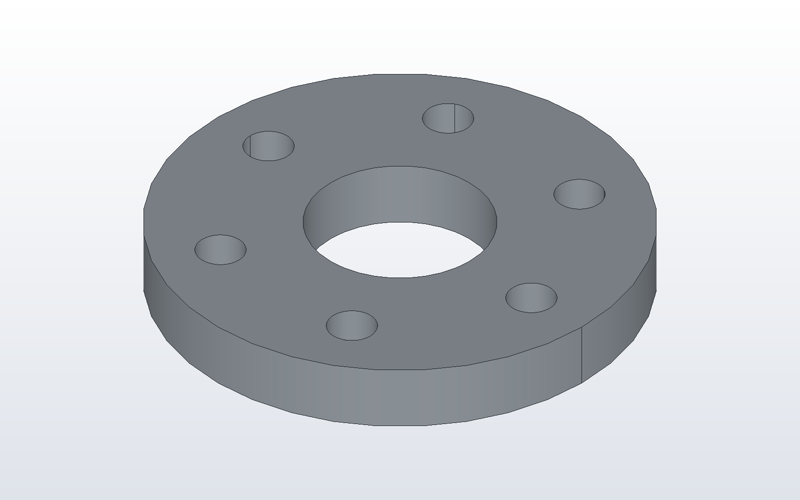

<details markdown="1">
<summary>The script, flange.py</summary>

```python
# SPDX-License-Identifier: Apache-2.0
"""A pipe flange with a bolt circle.

A disc with a bore through its middle and BOLTS holes on a pitch circle. One
drill is made and circular_pattern turns it about the axis, so the count is a
number like any other: change it and every hole moves to suit.

Tags: solid
"""

DIAMETER = 90.0
THICKNESS = 12.0
BORE = 34.0
PITCH_CIRCLE = 65.0
BOLT = 9.0
BOLTS = 6

disc = make_cylinder(DIAMETER / 2, THICKNESS)
bore = make_cylinder(BORE / 2, THICKNESS)
drill = make_cylinder(BOLT / 2, THICKNESS, origin=(PITCH_CIRCLE / 2, 0, 0))
drills = circular_pattern(drill, (0, 0, 0), (0, 0, 1), BOLTS)

part("flange", cut_all(disc, [bore, *drills]), color="galvanised")
```

</details>

The file: [flange.py](examples/flange.py).

### A two-stage helical speed reducer, its cover cut away to show the gear train

A machine-shop showcase: a painted cast-iron housing split at the shaft centres, with ribs, feet, a bolted joint flange, eye bolts, an inspection cover with breather, an oil sight glass and a drain plug. Inside, an input pinion shaft, an intermediate shaft carrying a gear and a pinion, and an output shaft with its large gear, all helical, each tooth an involute outline lofted between two twisted sections, meshing at the true centre distance m * (z1 + z2) / 2. Keys sit in keyways, the shafts run in ball and taper roller bearings behind bolted caps with oil seals, and a flanged coupling sits on the output shaft.

Tags: solid, assembly, text, showcase

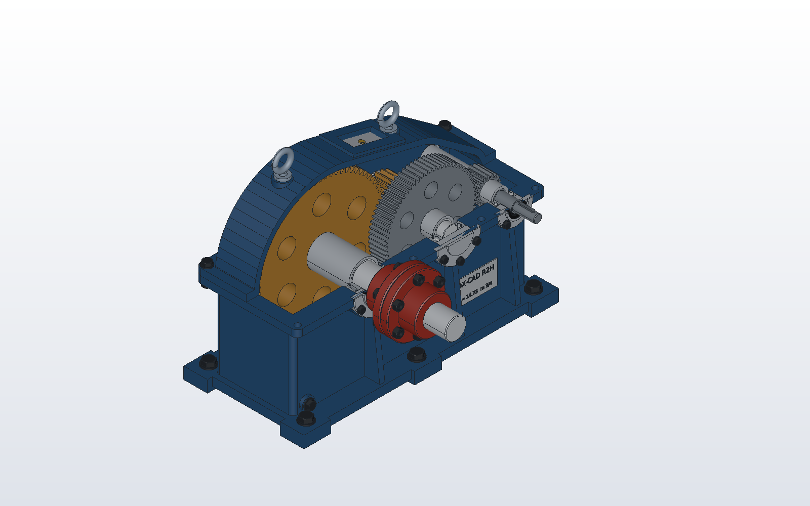

<details markdown="1">
<summary>The script, gearbox.py</summary>

```python
# SPDX-License-Identifier: Apache-2.0
"""A two-stage helical speed reducer, its cover cut away to show the gear train.

A machine-shop showcase: a painted cast-iron housing split at the shaft
centres, with ribs, feet, a bolted joint flange, eye bolts, an inspection
cover with breather, an oil sight glass and a drain plug. Inside, an input
pinion shaft, an intermediate shaft carrying a gear and a pinion, and an
output shaft with its large gear, all helical, each tooth an involute
outline lofted between two twisted sections, meshing at the true centre
distance m * (z1 + z2) / 2. Keys sit in keyways, the shafts run in ball and
taper roller bearings behind bolted caps with oil seals, and a flanged
coupling sits on the output shaft.

DX-CAD features shown: loft of involute outlines, revolved turned parts,
convex-hull cover profile extruded and shelled by booleans, circular
patterns of balls, rollers and bolts, place() for the eye bolts,
part numbers and properties on each part, and 3D text on the nameplate.
Change a module or a tooth count and the centre distances, housing, cover
and bearings follow; CUTAWAY = False closes the cover.

As it opens the teeth are drawn with straight flanks and the two big gears
with flat faces, so the model builds in a few seconds. FLANK = 4 draws each
involute and WEB = 0.34 recesses the big gears down to a web, for about four
times the build.

Tags: solid, assembly, text, showcase
"""

# ---------------------------------------------------------------- gearing
M1 = 3.0  # stage 1 normal module
Z1 = 18  # input pinion teeth
Z2 = 69  # stage 1 gear teeth
B1 = 40.0  # stage 1 face width
M2 = 4.0  # stage 2 normal module
Z3 = 19  # intermediate pinion teeth
Z4 = 73  # output gear teeth
B2 = 55.0  # stage 2 face width
HELIX = 12.0  # helix angle, degrees
PRESSURE = 20.0  # normal pressure angle, degrees
FLANK = (
    1  # straight pieces along each tooth flank: 4 draws the involute, and builds twice as slowly
)
WEB = 1.0  # the web of the two big gears, as a share of their face width: 0.34 recesses both faces

# -------------------------------------------------------------- bearings (bore, outside dia, width)
BRG_IN = (25.0, 52.0, 15.0)  # 6205
BRG_MID = (35.0, 72.0, 17.0)  # 6207
BRG_OUT = (55.0, 90.0, 23.0)  # 32011 taper roller

# ---------------------------------------------------------------- housing
WALL = 12.0  # cast wall
CLEAR = 10.0  # gear tip to wall
INNER = 80.0  # half the inside width (shafts run along Y)
BOSS_OUT = 20.0  # bearing bosses stand this far out of the walls
FLANGE_T = 16.0  # each half of the split flange
FLANGE_W = 28.0  # flange beyond the walls
BASE_T = 28.0  # base and feet
FOOT_W = 42.0  # feet beyond the walls
SUMP = 45.0  # oil below the output gear
CAP_T = 10.0  # bearing cap flange
INPUT_EXT = 50.0  # input shaft extension
OUTPUT_EXT = 65.0  # output shaft extension, into the coupling
CUTAWAY = True
TURN = -90.0  # the whole reducer is turned about Z so its cut-away faces the viewer
CUT_Y = 0.0  # the cover is cut away in front of this plane

# ---------------------------------------------------------------- colours
PAINT = "#2F5D8A"
MACHINED = "#C3C9D0"
SHAFT = "#D9DDE2"
STAGE1 = "#8C959E"
STAGE2 = "#C08A3A"
BEARING = "#B7BEC6"
BALL = "#ECEFF2"
ROLLER = "#9AA2AB"
BOLT = "#2E3238"
SEAL = "#1D1D1F"
BRASS = "#C9A23A"
GLASS = "#8FD3F0"
COUPLING = "#B23A2E"
KEY = "#757D86"

# ---------------------------------------------------------------- derived layout
BETA = math.radians(HELIX)


def transverse(mn):
    return mn / math.cos(BETA)


def pitch_r(mn, z):
    return transverse(mn) * z / 2


def tip_r(mn, z):
    return pitch_r(mn, z) + mn


A1 = transverse(M1) * (Z1 + Z2) / 2  # centre distances
A2 = transverse(M2) * (Z3 + Z4) / 2
X0, X1, X2 = 0.0, A1, A1 + A2  # shaft positions along X
RATIO = (Z2 / Z1) * (Z4 / Z3)

ZC = BASE_T + tip_r(M2, Z4) + SUMP  # shaft centres = joint plane
OUTER = INNER + WALL
BOSS_Y = OUTER + BOSS_OUT
SEAT = INNER + 4  # inner face of each bearing
Y_S1 = (15.0, 15.0 + B1)  # stage 1 plane (front)
Y_S2 = (-15.0 - B2, -15.0)  # stage 2 plane (back)

R_IN = [tip_r(M1, Z1) + CLEAR, tip_r(M1, Z2) + CLEAR, tip_r(M2, Z4) + CLEAR]
R_IN[0] = max(R_IN[0], BRG_IN[1] / 2 + 6)
XLI, XRI = X0 - R_IN[0] - 4, X2 + R_IN[2]
XLO, XRO = XLI - WALL, XRI + WALL
SHAFTS = [(X0, BRG_IN), (X1, BRG_MID), (X2, BRG_OUT)]


def boss_r(brg):
    return brg[1] / 2 + 18


def body_r(brg):
    return brg[0] / 2 + 3


# ---------------------------------------------------------------- helpers
def y_cyl(r, y0, y1, x, z=None):
    """A cylinder along +Y from y0 to y1 on the axis (x, z)."""
    z = ZC if z is None else z
    return translate(rotate(make_cylinder(r, y1 - y0), (0, 0, 0), (1, 0, 0), -90), (x, y0, z))


def z_cyl(r, z0, z1, x, y):
    return make_cylinder(r, z1 - z0, (x, y, z0))


def turned(profile, x, z=None):
    """A turned part: (radius, y) profile revolved about the shaft axis at (x, z)."""
    z = ZC if z is None else z
    face = polygon_face(profile, Plane((x, 0, z), (0, 0, 1), (1, 0, 0)))
    return revolve(face, (x, 0, z), (0, 1, 0))


def ring(ro, ri, y0, y1, x, z=None):
    return turned([(ri, y0), (ro, y0), (ro, y1), (ri, y1)], x, z)


def xz_prism(points, y0, y1):
    """A prism of an (x, z) outline, from y0 to y1."""
    return extrude(
        polygon_face(points, Plane((0, y0, 0), (0, -1, 0), (1, 0, 0))), y1 - y0, (0, 1, 0)
    )


def yz_prism(points, x0, x1):
    """A prism of a (y, z) outline, from x0 to x1."""
    return extrude(
        polygon_face(points, Plane((x0, 0, 0), (1, 0, 0), (0, 1, 0))), x1 - x0, (1, 0, 0)
    )


def mirror_y(shape):
    return mirror(shape, (0, 0, 0), (0, 1, 0))


def hull(points):
    """Convex hull, counter-clockwise (monotone chain)."""
    pts = sorted(set((round(x, 6), round(z, 6)) for x, z in points))

    def cross(o, a, b):
        return (a[0] - o[0]) * (b[1] - o[1]) - (a[1] - o[1]) * (b[0] - o[0])

    lower, upper = [], []
    for p in pts:
        while len(lower) >= 2 and cross(lower[-2], lower[-1], p) <= 0:
            lower.pop()
        lower.append(p)
    for p in reversed(pts):
        while len(upper) >= 2 and cross(upper[-2], upper[-1], p) <= 0:
            upper.pop()
        upper.append(p)
    return lower[:-1] + upper[:-1]


def hex_prism(af, h, z0=0.0):
    r = af / math.sqrt(3)
    pts = [
        (r * math.cos(math.radians(60 * k + 30)), r * math.sin(math.radians(60 * k + 30)))
        for k in range(6)
    ]
    return translate(extrude(polygon_face(pts), h), (0, 0, z0))


def hex_head(af, h, z0=0.0, both=False):
    """A hex head with its corners chamfered at 30 degrees, as a bolt or nut."""
    top = make_cone(0.48 * af + 1.73 * h, 0.48 * af, h, (0, 0, z0))
    head = common(hex_prism(af, h, z0), top)
    if both:
        head = common(head, make_cone(0.48 * af, 0.48 * af + 1.73 * h, h, (0, 0, z0)))
    return head


def bolt(d, length, af, head_h, washer=True):
    """A hex bolt standing on z = 0: shank down to -length, washer and head above."""
    pieces = [z_cyl(d / 2, -length, 0.5, 0, 0)]
    w = 0.0
    if washer:
        w = 0.18 * d
        pieces.append(z_cyl(1.0 * d, 0, w, 0, 0))
    pieces.append(hex_head(af, head_h, w - 0.2))
    return fuse_all(pieces)


def drill(shape, tools):
    """Cut tools that do not touch one another out of a shape in one cut, not a cut each."""
    return cut(shape, compound(tools))


def join(shape, pieces):
    """Fuse pieces that do not touch one another onto a shape in one fuse, as drill cuts."""
    return fuse(shape, compound(pieces)) if pieces else shape


def add(name, shape, **identity_):
    """Register a part, turned with the whole reducer by TURN about the vertical axis."""
    return part(name, rotate(shape, (0, 0, 0), (0, 0, 1), TURN), **identity_)


def turned_point(x, y, z):
    c, s = math.cos(math.radians(TURN)), math.sin(math.radians(TURN))
    return (x * c - y * s, x * s + y * c, z)


def fit(name, shape, at, turn=(0.0, 0.0, 0.0), color=BOLT, number=None, grade="8.8"):
    """A fastener turned about X, Y then Z and moved to `at`, as place() would, in its colour."""
    for axis, angle in zip(((1, 0, 0), (0, 1, 0), (0, 0, 1)), turn, strict=True):
        if angle:
            shape = rotate(shape, (0, 0, 0), axis, angle)
    return add(
        name,
        translate(shape, at),
        color=color,
        part_number=number,
        properties={"material": f"steel, grade {grade}, black oxide"},
    )


def nut(d, af, h):
    return cut(hex_head(af, h, 0, both=True), z_cyl(d / 2, -1, h + 1, 0, 0))


# ---------------------------------------------------------------- involute gears
def outline(mn, z, turn):
    """A transverse gear outline: z involute teeth, tooth 0 centred on angle `turn` (radians)."""
    at = math.atan(math.tan(math.radians(PRESSURE)) / math.cos(BETA))
    r = pitch_r(mn, z)
    rb, ra, rf = r * math.cos(at), r + mn, r - 1.25 * mn

    def inv(a):
        return math.tan(a) - a

    half = math.pi / (2 * z) + inv(at) - 0.03 * mn / r  # half tooth angle less backlash

    def psi(p):
        return half - inv(math.acos(min(1.0, rb / p)))

    r0 = max(rb, rf)
    rad = [r0 + (ra - r0) * i / FLANK for i in range(FLANK + 1)]
    pts = []
    for k in range(z):
        c = 2 * math.pi * k / z + turn
        flank = [(p, c - psi(p)) for p in rad]
        if rf < rb:
            flank = [(rf, c - psi(rb))] + flank
        other = [(p, 2 * c - a) for p, a in reversed(flank)]
        nxt = c + 2 * math.pi / z - psi(r0)
        # at FLANK = 1 a tooth is its four corners; above it the tip and the root are rounded too
        tip = [(ra, c)] if FLANK > 1 else []
        land = (
            [(rf, c + psi(r0) + (nxt - c - psi(r0)) * t) for t in (0.33, 0.67)] if FLANK > 1 else []
        )
        for p, a in flank + tip + other + land:
            pts.append((p * math.cos(a), p * math.sin(a)))
    return pts


def helical(mn, z, y0, y1, ymid, hand, cx, turn):
    """A helical gear lofted between its two twisted end outlines; the teeth mesh at ymid."""
    r = pitch_r(mn, z)
    profiles = []
    for y in (y0, y1):
        twist = hand * (y - ymid) * math.tan(BETA) / r
        face = polygon_face(outline(mn, z, turn + twist), Plane((cx, y, ZC), (0, -1, 0), (1, 0, 0)))
        profiles.append(wires(face)[0])
    return loft(profiles)


def key_size(d):
    """(width, height, shaft depth) of a parallel key for a shaft of diameter d."""
    for top, size in (
        (22, (6, 6, 3.5)),
        (30, (8, 7, 4.0)),
        (38, (10, 8, 5.0)),
        (44, (12, 8, 5.0)),
        (58, (16, 10, 6.0)),
        (999, (18, 11, 7.0)),
    ):
        if d <= top:
            return size


def feather(r, y0, y1, x, swell=0.0):
    """A round-ended key (or its keyway with swell) on top of a shaft of radius r, from y0 to y1."""
    b, h, t1 = key_size(2 * r)
    b += swell
    z0 = ZC + r - t1
    z1 = z0 + h + swell
    pieces = [
        make_box(b, y1 - y0 - b, z1 - z0, (x - b / 2, y0 + b / 2, z0)),
        z_cyl(b / 2, z0, z1, x, y0 + b / 2),
        z_cyl(b / 2, z0, z1, x, y1 - b / 2),
    ]
    return fuse_all(pieces)


def keyway_in_hub(r, y0, y1, x):
    b, h, t1 = key_size(2 * r)
    return make_box(b + 0.2, y1 - y0 + 2, h - t1 + 1.5, (x - b / 2 - 0.1, y0 - 1, ZC + r - 1))


def webbed(gear, mn, z, y0, y1, x, bore):
    """Lighten a large gear: six holes and, with WEB under 1, both faces recessed to a web."""
    rim = pitch_r(mn, z) - 1.25 * mn - 2.5 * mn
    hub = bore * 1.85
    rh = (rim + hub) / 2
    holes = [
        y_cyl(
            0.28 * (rim - hub),
            y0 - 1,
            y1 + 1,
            x + rh * math.cos(math.radians(30 + 60 * k)),
            ZC + rh * math.sin(math.radians(30 + 60 * k)),
        )
        for k in range(6)
    ]
    bore_key = fuse(y_cyl(bore, y0 - 1, y1 + 1, x), keyway_in_hub(bore, y0, y1, x))
    if WEB >= 1:
        return drill(gear, holes + [bore_key])
    depth = (y1 - y0) * (1 - WEB) / 2
    pockets = fuse_all(
        [cut(y_cyl(rim, y0 - 1, y0 + depth, x), y_cyl(hub, y0 - 2, y0 + depth + 1, x))]
        + holes
        + [cut(y_cyl(rim, y1 - depth, y1 + 1, x), y_cyl(hub, y1 - depth - 1, y1 + 2, x))]
    )
    return drill(gear, [pockets, bore_key])  # one cut of the lofted teeth, far quicker than nine


# ---------------------------------------------------------------- cut-away
CUT_BOX = make_box(XRO - XLO + 600, 600, 800, (XLO - 300, CUT_Y, ZC))


def cutaway(shape, front=True):
    return cut(shape, CUT_BOX) if CUTAWAY and front else shape


def shown(x, y, z):
    """Whether a small part centred at (x, y, z) is left by the cut-away."""
    return not (CUTAWAY and y > CUT_Y and z > ZC)


# ---------------------------------------------------------------- housing: lower half
def bolt_circle(brg):
    n = 4 if brg[1] < 60 else 6
    rbc = brg[1] / 2 + 8.5
    start = 45 if n == 4 else 30
    return [(rbc, math.radians(start + k * 360 / n)) for k in range(n)]


FLANGE_BOLT_X = [XLO - 4, (X0 + X1) / 2, (X1 + X2) / 2, XRO + 4]
FLANGE_BOLT_Y = OUTER + FLANGE_W / 2 + 1
FOOT_HOLES = [
    (x, s * (OUTER + FOOT_W * 0.55)) for x in (XLO + 8, (X1 + X2) / 2, XRO - 8) for s in (-1, 1)
]
GLASS_AT = ((X1 + X2) / 2, BASE_T + (ZC - BASE_T - tip_r(M2, Z4)) + 38)
DRAIN_AT = (XRO - 30, BASE_T + 16)

halves_low = make_box(XRO - XLO + 400, 600, ZC + 1, (XLO - 200, -300, -1))
halves_up = make_box(XRO - XLO + 400, 600, 600, (XLO - 200, -300, ZC))

tapped = []
for xs, brg in SHAFTS:
    for rbc, a in bolt_circle(brg):
        for s in (-1, 1):
            y0 = BOSS_Y - 18 if s > 0 else -BOSS_Y - 1
            tapped.append(y_cyl(3.4, y0, y0 + 19, xs + rbc * math.cos(a), ZC + rbc * math.sin(a)))
bores = [y_cyl(brg[1] / 2, -BOSS_Y - 1, BOSS_Y + 1, xs) for xs, brg in SHAFTS]
flange_holes = [
    z_cyl(6.6, ZC - FLANGE_T - 1, ZC + FLANGE_T + 1, x, s * FLANGE_BOLT_Y)
    for x in FLANGE_BOLT_X
    for s in (-1, 1)
]

body = make_box(XRO - XLO, 2 * OUTER, ZC - BASE_T + 1, (XLO, -OUTER, BASE_T - 1))
body = fillet(body, 10, edges_parallel_to(body, (0, 0, 1)))
flange = make_box(
    XRO - XLO + 36, 2 * (OUTER + FLANGE_W), FLANGE_T, (XLO - 18, -OUTER - FLANGE_W, ZC - FLANGE_T)
)
flange = fillet(flange, 12, edges_parallel_to(flange, (0, 0, 1)))
plate = make_box(XRO - XLO + 24, 2 * (OUTER + FOOT_W), BASE_T - 8, (XLO - 12, -OUTER - FOOT_W, 8))
plate = fillet(plate, 14, edges_parallel_to(plate, (0, 0, 1)))
pads = [
    make_box(64, FOOT_W + 14, BASE_T, (x - 32, (OUTER - 6) if y > 0 else -(OUTER + FOOT_W + 8), 0))
    for x, y in FOOT_HOLES
]
bosses, ribs = [], []
for xs, brg in SHAFTS:
    br = boss_r(brg)
    bosses.append(common(y_cyl(br, -BOSS_Y, BOSS_Y, xs), halves_low))
    for s in (-1, 1):
        prof = [
            (OUTER - 1, BASE_T - 1),
            (OUTER + FOOT_W - 6, BASE_T - 1),
            (BOSS_Y - 2, ZC - 0.8 * br),
            (OUTER - 1, ZC - 0.8 * br),
        ]
        if s < 0:
            prof = [(-y, z) for y, z in reversed(prof)]
        ribs.append(yz_prism(prof, xs - 6, xs + 6))
spigots = [
    y_cyl(r, OUTER - 1, OUTER + 7, x, z)
    for x, z, r in ((GLASS_AT[0], GLASS_AT[1], 27.0), (DRAIN_AT[0], DRAIN_AT[1], 15.0))
]
# each group's pieces stand clear of one another, so a group goes on in one fuse
lower = fuse_all([body, flange, plate])
for group in (pads, bosses, ribs, spigots):
    lower = join(lower, group)
lower = cut(lower, make_box(XRI - XLI, 2 * INNER, ZC, (XLI, -INNER, BASE_T)))
lower = drill(
    lower,
    bores
    + [
        y_cyl(17, OUTER - 14, OUTER + 8, GLASS_AT[0], GLASS_AT[1]),
        y_cyl(7, OUTER - 14, OUTER + 8, DRAIN_AT[0], DRAIN_AT[1]),
    ],
)
lower = drill(
    lower, tapped + flange_holes + [z_cyl(9, -1, BASE_T + 1, x, y) for x, y in FOOT_HOLES]
)
add(
    "housing_lower",
    lower,
    color=PAINT,
    part_number="GR2-101",
    properties={"material": "EN-GJL-250 grey cast iron", "finish": "RAL 5014 enamel over primer"},
)


# ---------------------------------------------------------------- housing: cover (upper half)
def cover_profile(radii, xl, xr, zb):
    pts = [(xl, zb), (xr, zb)]
    for (xs, _), r in zip(SHAFTS, radii, strict=True):
        pts += [
            (xs + r * math.cos(math.radians(a)), ZC + r * math.sin(math.radians(a)))
            for a in range(0, 181, 6)
        ]
    return hull(pts)


R_OUT = [r + WALL for r in R_IN]
OUT_HULL = cover_profile(R_OUT, XLO, XRO, ZC)


def roof_z(x):
    best = ZC
    for (xa, za), (xb, zb) in zip(OUT_HULL, OUT_HULL[1:] + OUT_HULL[:1], strict=True):
        if min(xa, xb) <= x <= max(xa, xb) and xa != xb:
            best = max(best, za + (zb - za) * (x - xa) / (xb - xa))
    return best


# the inspection opening sits on the long straight run of roof between the two big gears
edges_up = [
    (p, q)
    for p, q in zip(OUT_HULL, OUT_HULL[1:] + OUT_HULL[:1], strict=True)
    if X1 < (p[0] + q[0]) / 2 < X2 and min(p[1], q[1]) > ZC + 20
]
(PA, PB) = max(edges_up, key=lambda e: math.hypot(e[1][0] - e[0][0], e[1][1] - e[0][1]))
INSP_SLOPE = math.degrees(math.atan2(PB[1] - PA[1], PB[0] - PA[0]))
INSP_AT = ((PA[0] + PB[0]) / 2, -INNER / 2 - 6, (PA[1] + PB[1]) / 2)
INSP_LEN = min(110.0, 0.8 * math.hypot(PB[0] - PA[0], PB[1] - PA[1]))
INSP_W = 66.0
EYES = [(X1, -INNER / 2 - 6), (X2 + 0.35 * R_OUT[2], -INNER / 2 - 6)]


def on_roof(shape):
    """Lay a shape built on the XY plane onto the inspection face of the roof."""
    return translate(rotate(shape, (0, 0, 0), (0, 1, 0), -INSP_SLOPE), INSP_AT)


top_flange = make_box(
    XRO - XLO + 36, 2 * (OUTER + FLANGE_W), FLANGE_T, (XLO - 18, -OUTER - FLANGE_W, ZC)
)
top_flange = fillet(top_flange, 12, edges_parallel_to(top_flange, (0, 0, 1)))
bosses, ribs = [], []
for xs, brg in SHAFTS:
    br = boss_r(brg)
    bosses.append(common(y_cyl(br, -BOSS_Y, BOSS_Y, xs), halves_up))
    top = roof_z(xs) - 6
    if top > ZC + br + 8:
        for s in (-1, 1):
            prof = [(OUTER - 1, ZC + 0.8 * br), (BOSS_Y - 2, ZC + 0.8 * br), (OUTER - 1, top)]
            if s < 0:
                prof = [(-y, z) for y, z in reversed(prof)]
            ribs.append(yz_prism(prof, xs - 6, xs + 6))
frame = on_roof(make_box(INSP_LEN + 16, INSP_W + 16, 10, (-INSP_LEN / 2 - 8, -INSP_W / 2 - 8, -6)))
eye_bosses = [z_cyl(19, roof_z(x) - 10, roof_z(x) + 4, x, y) for x, y in EYES]
cover = fuse(xz_prism(OUT_HULL, -OUTER, OUTER), top_flange)
for group in (bosses, ribs, [frame], eye_bosses):
    cover = join(cover, group)
inner_hull = cover_profile(R_IN, XLI, XRI, ZC - 1)
cover = cut(cover, xz_prism(inner_hull, -INNER, INNER))
cover = drill(
    cover,
    bores
    + [
        on_roof(
            make_box(INSP_LEN - 24, INSP_W - 24, 40, (-INSP_LEN / 2 + 12, -INSP_W / 2 + 12, -30))
        )
    ],
)
cover = drill(cover, [z_cyl(8.2, roof_z(x) - 20, roof_z(x) + 5, x, y) for x, y in EYES])
cover = drill(cover, tapped + flange_holes)
cover = cutaway(cover)
add(
    "housing_cover",
    cover,
    color=PAINT,
    part_number="GR2-102",
    properties={"material": "EN-GJL-250 grey cast iron", "finish": "RAL 5014 enamel over primer"},
)


# ---------------------------------------------------------------- shafts and gears
def shaft(xs, brg, ext):
    """A stepped shaft: journals in the bearings, a body between, an extension out of the front."""
    rj, rb = brg[0] / 2, body_r(brg)
    yb = -(SEAT + brg[2])
    prof = [(0, yb), (rj - 1, yb), (rj, yb + 1), (rj, -SEAT), (rb, -SEAT), (rb, SEAT), (rj, SEAT)]
    if ext:
        re = rj - 2.5
        y_ext = BOSS_Y + CAP_T + 2
        prof += [
            (rj, y_ext),
            (re, y_ext),
            (re, y_ext + ext - 1.5),
            (re - 1.5, y_ext + ext),
            (0, y_ext + ext),
        ]
    else:
        yf = SEAT + brg[2]
        prof += [(rj, yf - 1), (rj - 1, yf), (0, yf)]
    return turned(prof, xs)


ymid1 = sum(Y_S1) / 2
ymid2 = sum(Y_S2) / 2

# input pinion shaft: pinion cut integral with its shaft
x, brg = SHAFTS[0]
pinion1 = helical(M1, Z1, Y_S1[0] - 2, Y_S1[1] + 2, ymid1, 1, x, 0.0)
in_shaft = shaft(x, brg, INPUT_EXT)
re_in = brg[0] / 2 - 2.5
in_key_y = (BOSS_Y + CAP_T + 8, BOSS_Y + CAP_T + INPUT_EXT - 6)
in_shaft = cut(fuse(in_shaft, pinion1), feather(re_in, in_key_y[0], in_key_y[1], x, 0.1))
add(
    "input_pinion_shaft",
    in_shaft,
    color=STAGE1,
    part_number="GR2-201",
    properties={
        "material": "18CrNiMo7-6, case hardened",
        "teeth": str(Z1),
        "module": str(M1),
        "helix": f"{HELIX} RH",
    },
)
add(
    "input_key",
    feather(re_in, in_key_y[0], in_key_y[1], x),
    color=KEY,
    part_number="DIN6885-A6x6",
    properties={"material": "C45"},
)

# intermediate shaft with the stage 1 gear and the stage 2 pinion
x, brg = SHAFTS[1]
rb = body_r(brg)
mid_keys = [(Y_S1[0] + 4, Y_S1[1] - 4), (Y_S2[0] + 2, Y_S2[1] - 2)]
mid_shaft = drill(shaft(x, brg, 0), [feather(rb, a, b, x, 0.1) for a, b in mid_keys])
add(
    "intermediate_shaft",
    mid_shaft,
    color=SHAFT,
    part_number="GR2-301",
    properties={"material": "42CrMo4"},
)
gear2 = helical(M1, Z2, Y_S1[0], Y_S1[1], ymid1, -1, x, math.pi + math.pi / Z2)
gear2 = webbed(gear2, M1, Z2, Y_S1[0], Y_S1[1], x, rb)
add(
    "stage1_gear",
    gear2,
    color=STAGE1,
    part_number="GR2-302",
    properties={
        "material": "42CrMo4, induction hardened",
        "teeth": str(Z2),
        "module": str(M1),
        "centre distance": f"{A1:.2f}",
    },
)
pinion3 = helical(M2, Z3, Y_S2[0] - 2, Y_S2[1] + 2, ymid2, -1, x, 0.0)
pinion3 = cut(
    pinion3,
    fuse(y_cyl(rb, Y_S2[0] - 3, Y_S2[1] + 3, x), keyway_in_hub(rb, Y_S2[0] - 2, Y_S2[1] + 2, x)),
)
add(
    "stage2_pinion",
    pinion3,
    color=STAGE2,
    part_number="GR2-303",
    properties={"material": "18CrNiMo7-6, case hardened", "teeth": str(Z3), "module": str(M2)},
)
for k, (a, b) in enumerate(mid_keys):
    add(f"intermediate_key_{k + 1}", feather(rb, a, b, x), color=KEY, part_number="DIN6885-A12x8")

# output shaft with the big gear
x, brg = SHAFTS[2]
rb = body_r(brg)
re_out = brg[0] / 2 - 2.5
out_key = (Y_S2[0] + 4, Y_S2[1] - 4)
cpl_y = BOSS_Y + CAP_T + OUTPUT_EXT - 55
cpl_key = (cpl_y + 4, cpl_y + 40)
out_shaft = drill(
    shaft(x, brg, OUTPUT_EXT),
    [feather(rb, out_key[0], out_key[1], x, 0.1), feather(re_out, cpl_key[0], cpl_key[1], x, 0.1)],
)
add(
    "output_shaft",
    out_shaft,
    color=SHAFT,
    part_number="GR2-401",
    properties={"material": "42CrMo4"},
)
gear4 = helical(M2, Z4, Y_S2[0], Y_S2[1], ymid2, 1, x, math.pi + math.pi / Z4)
gear4 = webbed(gear4, M2, Z4, Y_S2[0], Y_S2[1], x, rb)
add(
    "output_gear",
    gear4,
    color=STAGE2,
    part_number="GR2-402",
    properties={
        "material": "42CrMo4, induction hardened",
        "teeth": str(Z4),
        "module": str(M2),
        "centre distance": f"{A2:.2f}",
        "ratio": f"{RATIO:.2f}",
    },
)
add("output_key", feather(rb, out_key[0], out_key[1], x), color=KEY, part_number="DIN6885-A18x11")
add(
    "coupling_key",
    feather(re_out, cpl_key[0], cpl_key[1], x),
    color=KEY,
    part_number="DIN6885-A14x9",
)

# spacer sleeves locating the gears against the bearings
SLEEVES = [
    (0, Y_S1[1] + 2, SEAT),
    (0, -SEAT, Y_S1[0] - 2),
    (1, Y_S1[1], SEAT),
    (1, Y_S2[1] + 2, Y_S1[0]),
    (1, -SEAT, Y_S2[0] - 2),
    (2, Y_S2[1], SEAT),
    (2, -SEAT, Y_S2[0]),
]
for k, (i, a, b) in enumerate(SLEEVES):
    xs, brg = SHAFTS[i]
    rb = body_r(brg)
    add(
        f"spacer_{k + 1}",
        ring(rb + 5, rb, a, b, xs),
        color=MACHINED,
        part_number=f"GR2-5{k + 1:02d}",
        properties={"material": "C45"},
    )


# ---------------------------------------------------------------- bearings
def ball_bearing(tag, xs, brg):
    d, D, w = brg
    rp = (d + D) / 4
    rball = (D - d) * 0.15
    y0, y1 = SEAT, SEAT + w
    yc = (y0 + y1) / 2
    groove = translate(
        rotate(make_torus(rp, rball * 1.03), (0, 0, 0), (1, 0, 0), -90), (xs, yc, ZC)
    )
    inner = cut(
        turned(
            [
                (d / 2, y0 + 0.6),
                (d / 2 + 0.6, y0),
                (rp - 0.55 * rball, y0),
                (rp - 0.55 * rball, y1),
                (d / 2 + 0.6, y1),
                (d / 2, y1 - 0.6),
            ],
            xs,
        ),
        groove,
    )
    outer = cut(
        turned(
            [
                (rp + 0.55 * rball, y0),
                (D / 2 - 0.6, y0),
                (D / 2, y0 + 0.6),
                (D / 2, y1 - 0.6),
                (D / 2 - 0.6, y1),
                (rp + 0.55 * rball, y1),
            ],
            xs,
        ),
        groove,
    )
    n = int(2 * math.pi * rp / (2.5 * rball))
    for side, sgn in (("front", 1), ("back", -1)):
        flip = (lambda s: s) if sgn > 0 else mirror_y
        add(
            f"{tag}_bearing_{side}_inner",
            cutaway(flip(inner), sgn > 0),
            color=BEARING,
            part_number=f"SKF 62{int(d / 5):02d}",
            properties={"type": "deep groove ball bearing", "bore": str(d)},
        )
        add(f"{tag}_bearing_{side}_outer", cutaway(flip(outer), sgn > 0), color=BEARING)
        for k in range(n):
            a = 2 * math.pi * (k + 0.5) / n
            bx, bz = xs + rp * math.cos(a), ZC + rp * math.sin(a)
            if sgn > 0 and CUTAWAY and bz - rball > ZC:
                continue
            ball = make_sphere(rball, (bx, sgn * yc, bz))
            if sgn > 0 and bz + rball > ZC:
                ball = cutaway(ball)
            add(f"{tag}_bearing_{side}_ball_{k + 1:02d}", ball, color=BALL)


def taper_bearing(tag, xs, brg):
    d, D, w = brg
    y0, y1 = SEAT, SEAT + w
    ri0, ri1 = d / 2 + 6.0, d / 2 + 7.5  # cone raceway, small end inboard
    ro0, ro1 = D / 2 - 5.5, D / 2 - 2.5  # cup raceway
    cone = turned(
        [
            (d / 2, y0 + 0.6),
            (d / 2 + 0.6, y0),
            (ri0 + 1.8, y0),
            (ri0 + 1.8, y0 + 2),
            (ri0, y0 + 2),
            (ri1, y1 - 3),
            (ri1 + 2.2, y1 - 3),
            (ri1 + 2.2, y1),
            (d / 2 + 0.6, y1),
            (d / 2, y1 - 0.6),
        ],
        xs,
    )
    cup = turned(
        [
            (ro0, y0 + 1),
            (D / 2 - 0.6, y0 + 1),
            (D / 2, y0 + 1.6),
            (D / 2, y1 - 0.6),
            (D / 2 - 0.6, y1),
            (ro1, y1),
        ],
        xs,
    )
    ya, yb_ = y0 + 2.5, y1 - 3.5

    def race(r0, r1, y):
        return r0 + (r1 - r0) * (y - y0) / (y1 - y0)

    ca = (race(ri0, ri1, ya) + race(ro0, ro1, ya)) / 2
    cb = (race(ri0, ri1, yb_) + race(ro0, ro1, yb_)) / 2
    rra = (race(ro0, ro1, ya) - race(ri0, ri1, ya)) / 2 - 0.1
    rrb = (race(ro0, ro1, yb_) - race(ri0, ri1, yb_)) / 2 - 0.1
    length = math.hypot(cb - ca, yb_ - ya)
    tilt = math.degrees(math.atan2(cb - ca, yb_ - ya))
    roller = rotate(
        rotate(make_cone(rra, rrb, length), (0, 0, 0), (1, 0, 0), -90), (0, 0, 0), (0, 0, 1), -tilt
    )
    n = int(2 * math.pi * (ca + cb) / 2 / (2.6 * max(rra, rrb)))
    for side, sgn in (("front", 1), ("back", -1)):
        flip = (lambda s: s) if sgn > 0 else mirror_y
        add(
            f"{tag}_bearing_{side}_cone",
            cutaway(flip(cone), sgn > 0),
            color=BEARING,
            part_number=f"SKF 320{int(d / 5):02d} X",
            properties={"type": "taper roller bearing", "bore": str(d)},
        )
        add(f"{tag}_bearing_{side}_cup", cutaway(flip(cup), sgn > 0), color=BEARING)
        for k in range(n):
            a = 360.0 * (k + 0.5) / n
            rz = ZC + ca * math.sin(math.radians(a))
            if sgn > 0 and not shown(0, 1, rz - rrb):
                continue
            r = rotate(translate(roller, (xs + ca, ya, ZC)), (xs, 0, ZC), (0, 1, 0), -a)
            r = flip(r)
            if sgn > 0 and rz + rrb + 3 > ZC:
                r = cutaway(r)
            add(f"{tag}_bearing_{side}_roller_{k + 1:02d}", r, color=ROLLER)


ball_bearing("input", *SHAFTS[0])
ball_bearing("intermediate", *SHAFTS[1])
taper_bearing("output", *SHAFTS[2])

# ---------------------------------------------------------------- bearing caps, seals, cap bolts
CAP_BOLT = bolt(8, 18, 13, 5.3)
for (xs, brg), tag, through in zip(
    SHAFTS, ("input", "intermediate", "output"), (True, False, True), strict=True
):
    d, D, w = brg
    rc = boss_r(brg) - 2
    yo = SEAT + w + 0.5
    rseal = d / 2 + 9
    for side, sgn in (("front", 1), ("back", -1)):
        open_cap = through and sgn > 0
        if open_cap:
            prof = [
                (d / 2 + 1, yo),
                (D / 2 - 0.3, yo),
                (D / 2 - 0.3, BOSS_Y),
                (rc, BOSS_Y),
                (rc, BOSS_Y + CAP_T - 1.5),
                (rc - 1.5, BOSS_Y + CAP_T),
                (rseal + 4, BOSS_Y + CAP_T),
                (rseal + 4, BOSS_Y + CAP_T + 4),
                (rseal, BOSS_Y + CAP_T + 4),
                (rseal, BOSS_Y + CAP_T - 6),
                (d / 2 + 1, BOSS_Y + CAP_T - 6),
            ]
        else:
            rf = D / 2 - 6
            prof = [
                (0, yo),
                (D / 2 - 0.3, yo),
                (D / 2 - 0.3, BOSS_Y),
                (rc, BOSS_Y),
                (rc, BOSS_Y + CAP_T - 1.5),
                (rc - 1.5, BOSS_Y + CAP_T),
                (rf, BOSS_Y + CAP_T),
                (rf, BOSS_Y + CAP_T + 3),
                (0, BOSS_Y + CAP_T + 3),
            ]
        cap = turned(prof, xs)
        holes = [
            y_cyl(4.5, BOSS_Y - 1, BOSS_Y + CAP_T + 1, xs + r * math.cos(a), ZC + r * math.sin(a))
            for r, a in bolt_circle(brg)
        ]
        cap = drill(cap, holes)
        if sgn < 0:
            cap = mirror_y(cap)
        add(
            f"{tag}_cap_{side}",
            cutaway(cap, sgn > 0),
            color=MACHINED,
            part_number=f"GR2-6{d:.0f}{'T' if open_cap else 'B'}",
            properties={
                "material": "EN-GJL-250",
                "type": "through cap with seal" if open_cap else "blind cap",
            },
        )
        if open_cap:
            seal = turned(
                [
                    (d / 2 - 0.3, BOSS_Y + CAP_T - 6),
                    (rseal + 0.2, BOSS_Y + CAP_T - 6),
                    (rseal + 0.2, BOSS_Y + CAP_T + 3),
                    (d / 2 + 3, BOSS_Y + CAP_T + 3),
                    (d / 2 + 3, BOSS_Y + CAP_T),
                    (d / 2 - 0.3, BOSS_Y + CAP_T - 2),
                ],
                xs,
            )
            add(
                f"{tag}_oil_seal",
                cutaway(seal),
                color=SEAL,
                part_number=f"DIN3760-A{d:.0f}x{2 * rseal:.0f}x8",
                properties={"material": "NBR"},
            )
        for k, (r, a) in enumerate(bolt_circle(brg)):
            bx, bz = xs + r * math.cos(a), ZC + r * math.sin(a)
            if sgn > 0 and not shown(bx, 1, bz):
                continue
            fit(
                f"{tag}_cap_{side}_bolt_{k + 1}",
                CAP_BOLT,
                (bx, sgn * (BOSS_Y + CAP_T), bz),
                (-90 * sgn, 0, 0),
                number="ISO4017-M8x20",
            )

# ---------------------------------------------------------------- joint flange bolts, foot bolts
JOINT_BOLT = bolt(12, 2 * FLANGE_T + 12, 18, 7.5)
JOINT_NUT = nut(12, 18, 10)
for i, x in enumerate(FLANGE_BOLT_X):
    for s, side in ((-1, "back"), (1, "front")):
        if not shown(x, s * FLANGE_BOLT_Y, ZC + 1):
            continue
        fit(
            f"joint_bolt_{side}_{i + 1}",
            JOINT_BOLT,
            (x, s * FLANGE_BOLT_Y, ZC + FLANGE_T),
            number="ISO4014-M12x45",
        )
        fit(
            f"joint_nut_{side}_{i + 1}",
            JOINT_NUT,
            (x, s * FLANGE_BOLT_Y, ZC - FLANGE_T - 10),
            number="ISO4032-M12",
        )
FOOT_BOLT = bolt(16, 40, 24, 10)
for k, (x, y) in enumerate(FOOT_HOLES):
    fit(f"foundation_bolt_{k + 1}", FOOT_BOLT, (x, y, BASE_T), number="ISO4014-M16x60")

# ------------------------------------------------------------ inspection cover, breather, eye bolts
insp = make_box(INSP_LEN, INSP_W, 5, (-INSP_LEN / 2, -INSP_W / 2, 4))
corners = [(sx * (INSP_LEN / 2 - 8), sy * (INSP_W / 2 - 8)) for sx in (-1, 1) for sy in (-1, 1)]
insp = drill(insp, [z_cyl(3.4, 0, 12, u, v) for u, v in corners] + [z_cyl(6, 0, 12, 0, 0)])
add(
    "inspection_cover",
    on_roof(insp),
    color=MACHINED,
    part_number="GR2-103",
    properties={"material": "S235"},
)
SCREW = bolt(6, 12, 10, 4, washer=False)
for k, (u, v) in enumerate(corners):
    fit(
        f"inspection_screw_{k + 1}",
        on_roof(translate(SCREW, (u, v, 9))),
        (0, 0, 0),
        number="ISO4017-M6x16",
    )
breather = fuse_all(
    [
        z_cyl(5.5, 2, 10, 0, 0),
        hex_head(22, 7, 9),
        z_cyl(5, 15.5, 24, 0, 0),
        make_cone(15, 9, 7, (0, 0, 23)),
        make_cone(9, 4, 3, (0, 0, 29.5)),
    ]
)
add(
    "breather",
    on_roof(breather),
    color=BRASS,
    part_number="GR2-BRT-M12",
    properties={"material": "CuZn39Pb3"},
)

EYE = fuse_all(
    [
        z_cyl(8, -16, 0.5, 0, 0),
        z_cyl(15, 0, 6, 0, 0),
        z_cyl(7.5, 5, 12, 0, 0),
        translate(rotate(make_torus(19, 5.5), (0, 0, 0), (1, 0, 0), 90), (0, 0, 33)),
    ]
)
for k, (x, y) in enumerate(EYES):
    place(f"eye_bolt_{k + 1}", EYE, at=turned_point(x, y, roof_z(x) + 4), rotate=(0, 0, TURN))
    identity(
        f"eye_bolt_{k + 1}",
        part_number="DIN580-M16",
        properties={"material": "C15E", "WLL": "700 kg"},
    )

# --------------------------------------------------------------- sight glass, drain plug, nameplate
gx, gz = GLASS_AT
add(
    "sight_glass_lens",
    y_cyl(17.5, OUTER + 3, OUTER + 9, gx, gz),
    color=GLASS,
    part_number="GR2-SG-30",
    properties={"material": "borosilicate"},
)
bezel = turned(
    [(15, OUTER + 7), (26, OUTER + 7), (26, OUTER + 11), (24.5, OUTER + 12.5), (15, OUTER + 12.5)],
    gx,
    gz,
)
bezel = drill(
    bezel,
    [
        y_cyl(
            2.2,
            OUTER,
            OUTER + 14,
            gx + 21 * math.cos(math.radians(a)),
            gz + 21 * math.sin(math.radians(a)),
        )
        for a in (45, 135, 225, 315)
    ],
)
add("sight_glass_bezel", bezel, color=MACHINED)
add(
    "sight_glass_level_mark",
    make_box(26, 0.8, 1.6, (gx - 13, OUTER + 8.6, gz - 0.8)),
    color="#D62728",
)
for k, a in enumerate((45, 135, 225, 315)):
    sx, sz = gx + 21 * math.cos(math.radians(a)), gz + 21 * math.sin(math.radians(a))
    add(
        f"sight_glass_screw_{k + 1}",
        fuse(
            y_cyl(1.9, OUTER + 2, OUTER + 13, sx, sz), y_cyl(3.6, OUTER + 12.4, OUTER + 15, sx, sz)
        ),
        color=BOLT,
    )
dx_, dz_ = DRAIN_AT
drain = fuse_all(
    [
        y_cyl(7, OUTER - 6, OUTER + 8, dx_, dz_),
        y_cyl(12, OUTER + 7, OUTER + 9, dx_, dz_),
        translate(rotate(hex_head(17, 8), (0, 0, 0), (1, 0, 0), -90), (dx_, OUTER + 8.5, dz_)),
    ]
)
add(
    "drain_plug",
    drain,
    color=BOLT,
    part_number="DIN910-M14x1.5",
    properties={"material": "5.8, magnetic"},
)

np_w = min(X1 - 30, 112.0)  # the nameplate sits in the bay under the input shaft
npx0, npx1 = X1 / 2 - np_w / 2, X1 / 2 + np_w / 2
npz0, npz1 = BASE_T + 30, BASE_T + 86
add(
    "nameplate",
    make_box(npx1 - npx0, 2, npz1 - npz0, (npx0, OUTER - 0.5, npz0)),
    color="#C9CDD2",
    part_number="GR2-NP",
)
txt_plane = Plane(((npx0 + npx1) / 2, OUTER + 1.2, 0), (0, 1, 0), (-1, 0, 0))
lettering = [
    text3d("DX-CAD R2H", 10, 0.8, plane=txt_plane, at=(0, npz1 - 18), align="centre"),
    text3d(
        f"i = {RATIO:.2f}  m {M1:g}/{M2:g}",
        7,
        0.8,
        plane=txt_plane,
        at=(0, npz0 + 9),
        align="centre",
    ),
]
# solids() hands a text's letters back in no fixed order: taken by place, so that each
# part keeps its letter from one run to the next
glyphs = [
    g
    for t in lettering
    for g in sorted(solids(t), key=lambda s: [round(v, 3) for v in bounding_box(s)[0]])
]
for k, g in enumerate(glyphs):
    add(f"nameplate_glyph_{k + 1:02d}", g, color="#1B2430")

# ---------------------------------------------------------------- output coupling
xo, brg = SHAFTS[2]
re = re_out
CPL_R = re + 44  # coupling flange radius
CPL_BC = re + 31  # its bolt circle
hub = turned(
    [
        (re, cpl_y),
        (re + 17, cpl_y),
        (re + 19, cpl_y + 2),
        (re + 19, cpl_y + 40),
        (CPL_R - 2, cpl_y + 40),
        (CPL_R, cpl_y + 42),
        (CPL_R, cpl_y + 56),
        (CPL_R - 2, cpl_y + 58),
        (re, cpl_y + 58),
    ],
    xo,
)
cpl_holes = [
    y_cyl(
        6.5,
        cpl_y + 30,
        cpl_y + 130,
        xo + CPL_BC * math.cos(math.radians(30 + 60 * k)),
        ZC + CPL_BC * math.sin(math.radians(30 + 60 * k)),
    )
    for k in range(6)
]
hub_a = drill(hub, cpl_holes + [keyway_in_hub(re, cpl_key[0], cpl_key[1], xo)])
add(
    "coupling_hub_drive",
    hub_a,
    color=COUPLING,
    part_number="GR2-CPL-50",
    properties={"material": "EN-GJS-400 ductile iron", "type": "rigid flange coupling"},
)
mirror_at = cpl_y + 58.5
hub_b = drill(mirror(hub, (0, mirror_at, 0), (0, 1, 0)), cpl_holes)
add("coupling_hub_driven", hub_b, color=COUPLING, part_number="GR2-CPL-50")
add(
    "driven_shaft",
    turned(
        [
            (0, mirror_at + 2),
            (re, mirror_at + 2),
            (re, mirror_at + 110),
            (re - 1.5, mirror_at + 111.5),
            (0, mirror_at + 111.5),
        ],
        xo,
    ),
    color=SHAFT,
    part_number="CUSTOMER",
)
CPL_BOLT = bolt(12, 42, 18, 7.5)
CPL_NUT = nut(12, 18, 10)
for k in range(6):
    a = math.radians(30 + 60 * k)
    bx, bz = xo + CPL_BC * math.cos(a), ZC + CPL_BC * math.sin(a)
    fit(
        f"coupling_bolt_{k + 1}",
        CPL_BOLT,
        (bx, cpl_y + 40, bz),
        (90, 0, 0),
        number="ISO4014-M12x50",
        grade="10.9",
    )
    fit(
        f"coupling_nut_{k + 1}",
        CPL_NUT,
        (bx, 2 * mirror_at - cpl_y - 40, bz),
        (-90, 0, 0),
        number="ISO4032-M12",
    )
```

</details>

The file: [gearbox.py](examples/gearbox.py).

### A scalloped knob with a pocket for a captive nut

A round knob with LOBES finger scallops cut around its rim, a bore for the screw and a hexagonal pocket underneath that holds a nut. One scallop is made and circular_pattern turns it about the axis; every cut is then taken in one cut_all, the scallops, the bore and the pocket together.

Tags: solid

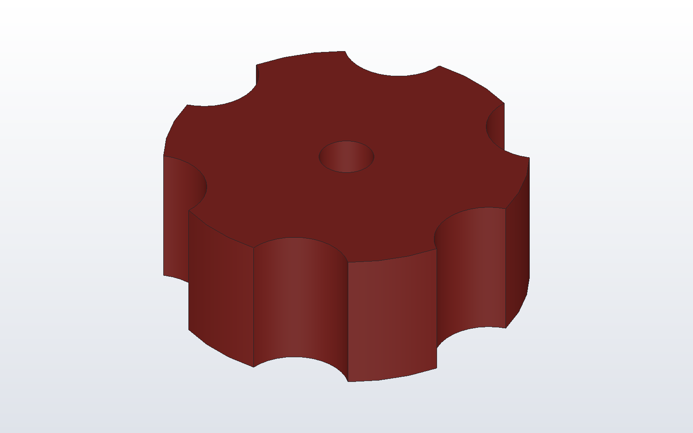

<details markdown="1">
<summary>The script, knob.py</summary>

```python
# SPDX-License-Identifier: Apache-2.0
"""A scalloped knob with a pocket for a captive nut.

A round knob with LOBES finger scallops cut around its rim, a bore for the
screw and a hexagonal pocket underneath that holds a nut. One scallop is made
and circular_pattern turns it about the axis; every cut is then taken in one
cut_all, the scallops, the bore and the pocket together.

Tags: solid
"""

DIAMETER = 40.0
HEIGHT = 16.0
LOBES = 6
SCALLOP = 12.0
SCALLOP_OFFSET = 2.0
BORE = 6.0
NUT = 10.0
NUT_DEPTH = 5.0

body = make_cylinder(DIAMETER / 2, HEIGHT)

# Each scallop is a cylinder standing just outside the rim and biting into it.
scallop = make_cylinder(SCALLOP / 2, HEIGHT, origin=(DIAMETER / 2 + SCALLOP_OFFSET, 0, 0))
scallops = circular_pattern(scallop, (0, 0, 0), (0, 0, 1), LOBES)

bore = make_cylinder(BORE / 2, HEIGHT)
# A nut is sized across its flats; the sketch wants the radius to a corner.
pocket = Sketch().polygon((0, 0), NUT / 3**0.5, 6).extrude(NUT_DEPTH)

part("knob", cut_all(body, [*scallops, bore, pocket]), color="dx-red")
```

</details>

The file: [knob.py](examples/knob.py).

### A Formula Student race car: tubular spaceframe chassis and running gear

A single-seat racing car built the way a student team builds one: a welded spaceframe of round steel tubes running between a named table of node points, bent front and main roll hoops swept along lines and arcs, a front bulkhead, side-impact structure and a triangulated engine bay. On it hang the running gear: double-wishbone suspension with pushrods, rockers and coil-over dampers, uprights, brakes, four wheels on 13 inch rims, the steering rack and wheel, the seat, an inline-four engine with its exhaust headers, chain drive, differential and drive shafts. Every frame tube carries its group's part number, size and material, so the bill of materials is the cut list. Shows oriented tubes from a node table, sweeps along a line-and-arc wire (hoops and headers), lofted coil springs, revolved tyres and rims, booleans, patterns, mirror, place() for the hubs and identity() for the bill of materials.

Tags: solid, assembly, showcase

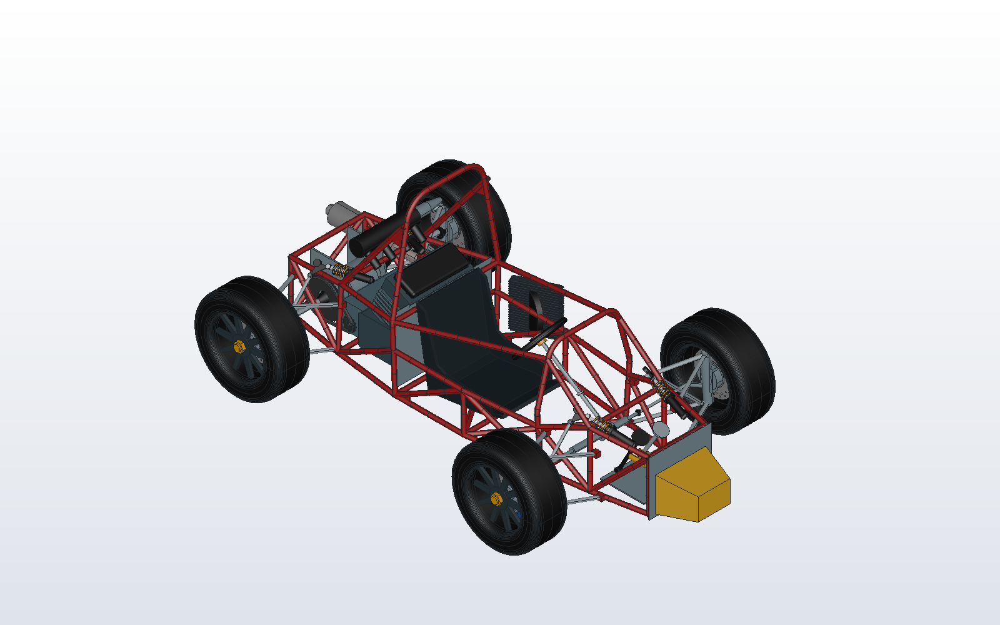

<details markdown="1">
<summary>The script, race_car_frame.py</summary>

```python
# SPDX-License-Identifier: Apache-2.0
"""A Formula Student race car: tubular spaceframe chassis and running gear.

A single-seat racing car built the way a student team builds one: a welded
spaceframe of round steel tubes running between a named table of node points,
bent front and main roll hoops swept along lines and arcs, a front bulkhead,
side-impact structure and a triangulated engine bay. On it hang the running
gear: double-wishbone suspension with pushrods, rockers and coil-over
dampers, uprights, brakes, four wheels on 13 inch rims, the steering rack and
wheel, the seat, an inline-four engine with its exhaust headers, chain drive,
differential and drive shafts. Every frame tube carries its group's part
number, size and material, so the bill of materials is the cut list. Shows
oriented tubes from a node table, sweeps along a line-and-arc wire (hoops and
headers), lofted coil springs, revolved tyres and rims, booleans, patterns,
mirror, place() for the hubs and identity() for the bill of materials.

As it opens the wishbone and pushrod tubes are drawn solid and each coil
spring with eight straight pieces to a turn, so the model builds quickly.
SOLID_LINKS = False bores the tubes and COIL_STEPS = 12 rounds the springs.

Tags: solid, assembly, showcase
"""

# ------------------------------------------------------------------ constants
TUBE_D = 25.4  # frame tube outside diameter
WALL_THIN = 1.65  # 25.4 x 1.65: bracing, bulkhead support, engine bay
WALL_THICK = 2.4  # 25.4 x 2.4: roll hoops, side impact, bulkhead
HOOP_BEND_R = 90.0  # centreline bend radius of the roll hoops
WISH_D = 19.05  # wishbone tube
WISH_WALL = 1.2
SOLID_LINKS = (
    True  # draw the wishbone and pushrod tubes solid: False bores them, four seconds slower
)
COIL_STEPS = 8  # straight pieces to a turn of each coil spring: 12 draws it rounder

WHEELBASE = 1550.0
TRACK_F = 1240.0
TRACK_R = 1200.0
FRONT_AXLE = 380.0  # station of the front axle behind the front bulkhead
TYRE_R = 260.0  # 20.5 x 7 - 13 slick
TYRE_W = 200.0
RIM_R = 165.0  # 13 inch rim

FRAME_LENGTH = 2080.0  # front bulkhead to rear of the frame
FRAME_Z = 100.0  # height of the bottom rails
BULKHEAD_W = 340.0
BULKHEAD_H = 290.0
FRONT_HOOP_AT = 560.0  # station of the front hoop
FRONT_HOOP_H = 720.0  # top of the front hoop centreline
MAIN_HOOP_AT = 1380.0  # station of the main hoop
MAIN_HOOP_H = 1060.0  # top of the main hoop centreline
MAIN_HOOP_W = 620.0  # main hoop width at the side-impact height
SIDE_IMPACT_Z = 330.0  # upper side-impact member height

FRAME_RED = "#C62828"
SILVER = "#B0BEC5"
ALU = "#90A4AE"
BLACK = "#212121"
TYRE = "#1B1B1B"
RIM = "#37474F"
SPRING = "#F9A825"
CALIPER = "#1565C0"
ENGINE = "#455A64"
CASE = "#607D8B"
EXHAUST = "#BCAAA4"
GOLD = "#FFB300"

REAR_AXLE = FRONT_AXLE + WHEELBASE
SEG = 130.0  # longest straight piece of a swept tube (even meshing)
STEEL = {"material": "25CrMo4 tube, powder coated"}


# ------------------------------------------------------------------ vector maths
def add(a, b):
    return (a[0] + b[0], a[1] + b[1], a[2] + b[2])


def sub(a, b):
    return (a[0] - b[0], a[1] - b[1], a[2] - b[2])


def mul(a, k):
    return (a[0] * k, a[1] * k, a[2] * k)


def dot(a, b):
    return a[0] * b[0] + a[1] * b[1] + a[2] * b[2]


def cross(a, b):
    return (a[1] * b[2] - a[2] * b[1], a[2] * b[0] - a[0] * b[2], a[0] * b[1] - a[1] * b[0])


def norm(a):
    return math.sqrt(dot(a, a))


def unit(a):
    return mul(a, 1.0 / norm(a))


def lerp(a, b, t):
    return add(a, mul(sub(b, a), t))


def perp(n):
    """Any unit vector square to n."""
    c = cross(n, (0.0, 0.0, 1.0))
    if norm(c) < 1e-6:
        c = cross(n, (1.0, 0.0, 0.0))
    return unit(c)


def S(s, y, z):
    """World point from a frame station s (mm behind the front bulkhead): the car faces +X."""
    return (-s, y, z)


def flip(p):
    """The same point on the car's other (left, -Y) side."""
    return (p[0], -p[1], p[2])


# ------------------------------------------------------------------ shape helpers
def orient(shape, p, v):
    """Turn a shape built along +Z so its Z axis runs along v, then move its origin to p.

    The rotation is about z x v by the angle between z and v (right-hand rule), which
    carries +Z exactly onto v; a v along -Z is a half turn about X.
    """
    length = norm(v)
    axis = (-v[1], v[0], 0.0)
    if norm(axis) < 1e-9 * length:
        if v[2] < 0:
            shape = rotate(shape, (0, 0, 0), (1, 0, 0), 180)
    else:
        angle = math.degrees(math.acos(max(-1.0, min(1.0, v[2] / length))))
        shape = rotate(shape, (0, 0, 0), axis, angle)
    return translate(shape, p)


def tube(p1, p2, d=TUBE_D, wall=WALL_THIN):
    """A hollow round tube from p1 to p2: a ring square to p2 - p1, swept along the line.

    The line is cut into short collinear pieces (one face each, as on a mitred
    cut list) so the tube meshes evenly along its length.
    """
    n = unit(sub(p2, p1))
    face = Sketch(Plane(p1, n, perp(n))).circle((0, 0), d / 2).circle((0, 0), d / 2 - wall).face()
    return sweep(face, path_wire([p1, p2], 0.0))


def rod(p1, p2, r):
    """A solid round bar from p1 to p2."""
    v = sub(p2, p1)
    return orient(make_cylinder(r, norm(v)), p1, v)


def link_tube(p1, p2, d, wall):
    """A suspension link's tube. With SOLID_LINKS it is drawn as a solid bar, the same outside:
    the fittings fused onto its ends then cross one wall, not two, which is the slow part."""
    return rod(p1, p2, d / 2) if SOLID_LINKS else tube(p1, p2, d, wall)


def disc(centre, axis, r, t):
    """A solid disc of thickness t centred on `centre`, its axis along `axis`."""
    a = unit(axis)
    return orient(make_cylinder(r, t), sub(centre, mul(a, t / 2)), a)


def drill(shape, tools):
    """Cut tools that do not touch one another out of a shape in one cut, not a cut each."""
    return cut(shape, compound(tools))


def join(shape, pieces):
    """Fuse pieces that do not touch one another onto a shape in one fuse."""
    return fuse(shape, compound(pieces))


def line_edges(a, b, step=SEG):
    """The straight run a-b as collinear edges no longer than `step`."""
    k = max(1, int(math.ceil(norm(sub(b, a)) / step)))
    pts = [lerp(a, b, j / k) for j in range(k + 1)]
    return [BRepBuilderAPI_MakeEdge(gp_Pnt(*pts[j]), gp_Pnt(*pts[j + 1])).Edge() for j in range(k)]


def path_wire(points, bend_r):
    """Straight lines through `points` with every inner corner rounded to bend_r."""
    edges, start = [], points[0]
    for i in range(1, len(points) - 1):
        a, p, b = points[i - 1], points[i], points[i + 1]
        u1, u2 = unit(sub(a, p)), unit(sub(b, p))
        half = math.acos(max(-1.0, min(1.0, dot(u1, u2)))) / 2
        t = bend_r / math.tan(half)
        t1, t2 = add(p, mul(u1, t)), add(p, mul(u2, t))
        bis = unit(add(u1, u2))
        centre = add(p, mul(bis, bend_r / math.sin(half)))
        mid = sub(centre, mul(bis, bend_r))
        edges += line_edges(start, t1)
        arc = GC_MakeArcOfCircle(gp_Pnt(*t1), gp_Pnt(*mid), gp_Pnt(*t2)).Value()
        edges.append(BRepBuilderAPI_MakeEdge(arc).Edge())
        start = t2
    edges += line_edges(start, points[-1])
    return make_wire(edges)


def bent_tube(points, bend_r, d=TUBE_D, wall=WALL_THICK):
    """A hollow tube bent through `points`: a ring face swept along lines and arcs."""
    n = unit(sub(points[1], points[0]))
    face = (
        Sketch(Plane(points[0], n, perp(n)))
        .circle((0, 0), d / 2)
        .circle((0, 0), d / 2 - wall)
        .face()
    )
    return sweep(face, path_wire(points, bend_r))


def coil(p1, p2, coil_r, wire_r, turns, per_turn=COIL_STEPS):
    """A coil spring from p1 to p2: a round wire swept along a helix of short lines and arcs."""
    axis = sub(p2, p1)
    w = unit(axis)
    u = perp(w)
    v = cross(w, u)
    n = int(turns * per_turn)
    pts = []
    for k in range(n + 1):
        a = 2 * math.pi * k / per_turn
        pts.append(
            add(
                add(p1, mul(axis, k / n)),
                add(mul(u, coil_r * math.cos(a)), mul(v, coil_r * math.sin(a))),
            )
        )
    n0 = unit(sub(pts[1], pts[0]))
    face = Sketch(Plane(pts[0], n0, perp(n0))).circle((0, 0), wire_r).face()
    return sweep(face, path_wire(pts, coil_r * 0.8))


def plate(points3, thickness):
    """A flat plate through three or more points of one plane, `thickness` thick about it."""
    o = points3[0]
    xd = unit(sub(points3[1], o))
    nrm = unit(cross(sub(points3[1], o), sub(points3[2], o)))
    yd = cross(nrm, xd)
    pts = [(dot(sub(p, o), xd), dot(sub(p, o), yd)) for p in points3]
    face = polygon_face(pts, Plane(sub(o, mul(nrm, thickness / 2)), nrm, xd))
    return extrude(face, thickness, nrm), nrm


def side_profile(points_sz, y0, width):
    """A prism of a (station, z) outline, from y0 across `width` in +Y."""
    pl = Plane((0, y0, 0), (0, 1, 0), (-1, 0, 0))
    return extrude(polygon_face(points_sz, pl), width, (0, 1, 0))


def guarded(fn, shape, *args):
    try:
        return fn(shape, *args)
    except (FilletError, ValueError):
        return shape


# ================================================================== 1 the frame
# Node table: the right-hand (+Y) side; each name ending in R has a mirror in L.
HW_FB = BULKHEAD_W / 2
SIS_W = MAIN_HOOP_W / 2
FH_Z_TOP = FRONT_HOOP_H
MH_SHOULDER_Z = 480.0
NODES = {
    "F1": S(0, HW_FB, FRAME_Z + 10),  # front bulkhead, lower
    "F2": S(0, HW_FB, FRAME_Z + 10 + BULKHEAD_H),  # front bulkhead, upper
    "A1": S(300, HW_FB + 50, FRAME_Z + 5),  # bulkhead support, lower
    "A2": S(300, HW_FB + 50, FRAME_Z + 10 + BULKHEAD_H + 30),  # bulkhead support, upper
    "H1": S(FRONT_HOOP_AT, 250, FRAME_Z),  # front hoop foot
    "H2": S(FRONT_HOOP_AT, 268, SIDE_IMPACT_Z),  # front hoop at side impact
    "H3": S(FRONT_HOOP_AT, 214, FH_Z_TOP - 70),  # front hoop shoulder
    "C1": S(970, SIS_W - 10, FRAME_Z),  # cockpit floor node
    "C2": S(970, SIS_W - 5, SIDE_IMPACT_Z),  # cockpit side-impact node
    "M1": S(MAIN_HOOP_AT, SIS_W - 10, FRAME_Z),  # main hoop foot
    "M2": S(MAIN_HOOP_AT, SIS_W - 6, SIDE_IMPACT_Z),  # main hoop at side impact
    "M3": S(MAIN_HOOP_AT, SIS_W, MH_SHOULDER_Z),  # main hoop, harness bar
    "M4": S(MAIN_HOOP_AT, 250, MAIN_HOOP_H - 120),  # main hoop, brace point
    "B1": S(1760, 240, 450),  # main hoop brace foot
    "E1": S(1760, 260, FRAME_Z + 10),  # engine bay, lower
    "R1": S(FRAME_LENGTH, 220, FRAME_Z + 30),  # rear, lower
    "R2": S(FRAME_LENGTH, 220, 420),  # rear, upper
}
for key in list(NODES):
    NODES[key + "R"] = NODES.pop(key)
    NODES[key + "L"] = flip(NODES[key + "R"])

# Member list: (group, part number, wall, node, node); a group with "*" is built once a side.
GROUPS = {
    "FB": ("front bulkhead", "FR-101", WALL_THICK),
    "FBS": ("bulkhead support", "FR-102", WALL_THIN),
    "SIS": ("side impact", "FR-103", WALL_THICK),
    "FLR": ("floor", "FR-104", WALL_THIN),
    "CKP": ("cockpit rail", "FR-105", WALL_THIN),
    "MHB": ("main hoop brace", "FR-106", WALL_THICK),
    "EB": ("engine bay", "FR-107", WALL_THIN),
    "RR": ("rear", "FR-108", WALL_THIN),
}
SIDE_MEMBERS = [
    ("FB", "F1", "F2"),
    ("FBS", "F1", "A1"),
    ("FBS", "F2", "A2"),
    ("FBS", "A1", "A2"),
    ("FBS", "F2", "A1"),
    ("FBS", "A1", "H1"),
    ("FBS", "A2", "H3"),
    ("FBS", "A2", "H2"),
    ("FBS", "A1", "H2"),
    ("SIS", "H1", "C1"),
    ("SIS", "C1", "M1"),
    ("SIS", "H2", "C2"),
    ("SIS", "C2", "M2"),
    ("SIS", "H1", "C2"),
    ("SIS", "C2", "M1"),
    ("SIS", "C1", "C2"),
    ("CKP", "H3", "M3"),
    ("MHB", "M4", "B1"),
    ("MHB", "B1", "M3"),
    ("EB", "M1", "E1"),
    ("EB", "M2", "E1"),
    ("EB", "E1", "B1"),
    ("EB", "M3", "B1"),
    ("RR", "E1", "R1"),
    ("RR", "B1", "R2"),
    ("RR", "R1", "R2"),
    ("RR", "E1", "R2"),
]
CROSS_MEMBERS = [
    ("FB", "F1R", "F1L"),
    ("FB", "F2R", "F2L"),
    ("FB", "F1R", "F2L"),
    ("FBS", "A1R", "A1L"),
    ("FBS", "A2R", "A2L"),
    ("FLR", "H1R", "H1L"),
    ("FLR", "C1R", "C1L"),
    ("FLR", "M1R", "M1L"),
    ("FLR", "H1R", "C1L"),
    ("FLR", "C1L", "M1R"),
    ("CKP", "M3R", "M3L"),
    ("MHB", "B1R", "B1L"),
    ("EB", "E1R", "E1L"),
    ("RR", "R1R", "R1L"),
    ("RR", "R2R", "R2L"),
    ("RR", "R1L", "R2R"),
]

members = []
for g, a, b in SIDE_MEMBERS:
    for side in "RL":
        members.append((g, a + side, b + side))
members += CROSS_MEMBERS

count = {}
for g, a, b in members:
    label, pn, wall = GROUPS[g]
    count[g] = count.get(g, 0) + 1
    name = f"tube_{g.lower()}_{count[g]:02d}_{a}_{b}"
    shape = tube(NODES[a], NODES[b], TUBE_D, wall)
    part(name, shape, color=FRAME_RED)
    identity(
        name,
        part_number=f"{pn}-{count[g]:02d}",
        properties={
            "group": label,
            "size": f"{TUBE_D} x {wall}",
            "length": f"{norm(sub(NODES[a], NODES[b])):.0f}",
            **STEEL,
        },
    )


# The roll hoops: one bent tube each, swept along lines and arcs.
FA = FRONT_HOOP_AT
front_pts = [
    S(FA, -250, FRAME_Z - 5),
    S(FA, -276, SIDE_IMPACT_Z + 80),
    S(FA, -190, FRONT_HOOP_H),
    S(FA, 190, FRONT_HOOP_H),
    S(FA, 276, SIDE_IMPACT_Z + 80),
    S(FA, 250, FRAME_Z - 5),
]
part(
    "front_hoop",
    bent_tube(front_pts, HOOP_BEND_R),
    color=FRAME_RED,
    part_number="FR-110",
    properties={"group": "front roll hoop", "size": f"{TUBE_D} x {WALL_THICK}", **STEEL},
)

main_pts = [
    S(MAIN_HOOP_AT, -(SIS_W - 10), FRAME_Z - 5),
    S(MAIN_HOOP_AT, -SIS_W - 6, MH_SHOULDER_Z),
    S(MAIN_HOOP_AT, -210, MAIN_HOOP_H),
    S(MAIN_HOOP_AT, 210, MAIN_HOOP_H),
    S(MAIN_HOOP_AT, SIS_W + 6, MH_SHOULDER_Z),
    S(MAIN_HOOP_AT, SIS_W - 10, FRAME_Z - 5),
]
part(
    "main_hoop",
    bent_tube(main_pts, HOOP_BEND_R * 1.4),
    color=FRAME_RED,
    part_number="FR-111",
    properties={"group": "main roll hoop", "size": f"{TUBE_D} x {WALL_THICK}", **STEEL},
)

# Node gussets where the main hoop braces land and at the hoop feet.
for side in "RL":
    for a, b, c in (("M4", "B1", "M3"), ("M1", "C1", "C2"), ("H1", "A1", "H2")):
        pa, pb, pc = NODES[a + side], NODES[b + side], NODES[c + side]
        g, _ = plate([pa, lerp(pa, pb, 0.22), lerp(pa, pc, 0.22)], 3.0)
        part(
            f"gusset_{a.lower()}_{side}",
            g,
            color=FRAME_RED,
            part_number="FR-120",
            properties={"group": "node gusset", "size": "3 mm plate", **STEEL},
        )


# ================================================================== 2 suspension
def corner(axle_s, track, front):
    """Right-hand corner: returns a dict of named shapes (in world, +Y side)."""
    yw = track / 2
    out = {}
    lbj = S(axle_s, yw - 55, TYRE_R - 125)  # lower ball joint
    ubj = S(axle_s, yw - 75, TYRE_R + 125)  # upper ball joint
    if front:
        lf, lr = S(axle_s - 150, 225, FRAME_Z + 12), S(axle_s + 150, 245, FRAME_Z + 8)
        uf, ur = S(axle_s - 130, 235, 330), S(axle_s + 140, 262, 320)
        rocker = S(axle_s + 10, 205, 470)
        dmount = S(110, 150, FRAME_Z + BULKHEAD_H + 10)
    else:
        lf, lr = S(axle_s - 160, 248, FRAME_Z + 18), S(axle_s + 130, 225, FRAME_Z + 27)
        uf, ur = S(axle_s - 170, 238, 345), S(axle_s + 130, 222, 340)
        rocker = S(axle_s - 10, 222, 470)
        dmount = S(axle_s - 260, 150, 470)
    for nm, f, r, bj in (("lower", lf, lr, lbj), ("upper", uf, ur, ubj)):
        housing = disc(bj, (0, 0, 1), 15, 26)
        arm = fuse_all(
            [housing, link_tube(f, bj, WISH_D, WISH_WALL), link_tube(r, bj, WISH_D, WISH_WALL)]
        )
        arm = join(arm, [disc(f, (1, 0, 0), 11, 22), disc(r, (1, 0, 0), 11, 22)])
        out[f"wishbone_{nm}"] = arm
        out[f"bracket_{nm}_f"] = make_box(30, 26, 26, sub(f, (15, 13, 13)))
        out[f"bracket_{nm}_r"] = make_box(30, 26, 26, sub(r, (15, 13, 13)))
    # upright: a machined body between the ball joints, a spindle boss and a steering or toe arm
    mid = lerp(lbj, ubj, 0.5)
    body = fuse_all(
        [
            rod(lbj, ubj, 22),
            disc(add(mid, (0, 18, 0)), (0, 1, 0), 58, 34),
            make_box(70, 30, 120, sub(mid, (35, 5, 60))),
        ]
    )
    arm_end = S(axle_s + 85, yw - 95, TYRE_R - 60)
    body = fuse(body, rod(add(mid, (0, 0, -40)), arm_end, 9))
    out["upright"] = body
    # pushrod from the lower wishbone near the ball joint up to the rocker
    pr_low = lerp(lerp(lf, lr, 0.5), lbj, 0.86)
    pr_low = add(pr_low, (0, 0, 18))
    pr_top = add(rocker, mul(unit(sub(pr_low, rocker)), 60))
    out["pushrod"] = join(
        link_tube(pr_low, pr_top, 16, 1.2),
        [disc(pr_low, (1, 0, 0), 9, 16), disc(pr_top, (1, 0, 0), 9, 16)],
    )
    d_end = add(rocker, mul(unit(sub(dmount, rocker)), 55))
    rk, n_rk = plate([rocker, pr_top, d_end], 8.0)
    bosses = [disc(p, n_rk, r, 14) for p, r in ((rocker, 16), (pr_top, 11), (d_end, 11))]
    out["rocker"] = fuse_all([rk] + bosses)
    # coil-over damper from the rocker to its mount
    dv = sub(dmount, d_end)
    dl = norm(dv)
    w = unit(dv)
    body_a = add(d_end, mul(w, 0.42 * dl))
    out["damper_body"] = fuse_all(
        [
            rod(body_a, dmount, 17),
            disc(dmount, n_rk, 10, 22),
            rod(add(body_a, mul(w, 18)), add(body_a, mul(w, 30)), 26),
        ]
    )
    out["damper_shaft"] = fuse_all(
        [rod(d_end, add(body_a, mul(w, 5)), 7), disc(d_end, n_rk, 10, 20)]
    )
    out["spring"] = coil(add(d_end, mul(w, 0.12 * dl)), add(body_a, mul(w, 22)), 24, 4.2, 5)
    # spindle, hub and brake: the wheel side
    out["link"] = rod(arm_end, S(axle_s + 85, 230 if front else 240, TYRE_R - 60), 7)
    out["link_end"] = disc(S(axle_s + 85, 230 if front else 240, TYRE_R - 60), (0, 0, 1), 11, 18)
    return out


SUSP_COLORS = {
    "wishbone_lower": SILVER,
    "wishbone_upper": SILVER,
    "bracket_lower_f": FRAME_RED,
    "bracket_lower_r": FRAME_RED,
    "bracket_upper_f": FRAME_RED,
    "bracket_upper_r": FRAME_RED,
    "upright": ALU,
    "pushrod": SILVER,
    "rocker": BLACK,
    "damper_body": BLACK,
    "damper_shaft": "#ECEFF1",
    "spring": SPRING,
    "link": SILVER,
    "link_end": BLACK,
}
SUSP_PN = {
    "wishbone_lower": "SU-301",
    "wishbone_upper": "SU-302",
    "bracket_lower_f": "FR-130",
    "bracket_lower_r": "FR-130",
    "bracket_upper_f": "FR-130",
    "bracket_upper_r": "FR-130",
    "upright": "SU-310",
    "pushrod": "SU-320",
    "rocker": "SU-321",
    "damper_body": "SU-330",
    "damper_shaft": "SU-331",
    "spring": "SU-332",
    "link": "SU-340",
    "link_end": "SU-341",
}
SUSP_MAT = {
    "wishbone_lower": "25CrMo4 tube 19.05 x 1.2",
    "wishbone_upper": "25CrMo4 tube 19.05 x 1.2",
    "upright": "7075-T6 billet",
    "rocker": "7075-T6, black anodised",
    "spring": "54SiCr6 spring wire",
    "pushrod": "25CrMo4 tube 16 x 1.2",
}

for axle_s, track, front, tag in (
    (FRONT_AXLE, TRACK_F, True, "F"),
    (REAR_AXLE, TRACK_R, False, "R"),
):
    parts_r = corner(axle_s, track, front)
    for key, shape in parts_r.items():
        nm = key.replace("link", "tie_rod" if front else "toe_link")
        for side, sh in (("R", shape), ("L", mirror(shape, (0, 0, 0), (0, 1, 0)))):
            part(
                f"{nm}_{tag}{side}",
                sh,
                color=SUSP_COLORS[key],
                part_number=SUSP_PN[key] + ("F" if front else "R"),
                properties={"material": SUSP_MAT.get(key, "steel")},
            )


# ================================================================== 3 wheels
def tyre_shape():
    pts = []
    rc, a = (RIM_R + TYRE_R) / 2 - 6, (TYRE_R - RIM_R) / 2 + 6
    b = TYRE_W / 2
    for k in range(48):
        t = 2 * math.pi * k / 48
        c, s_ = math.cos(t), math.sin(t)
        pts.append(
            (rc + a * math.copysign(abs(c) ** 0.45, c), b * math.copysign(abs(s_) ** 0.3, s_))
        )
    return revolve(polygon_face(pts, Plane.XZ), (0, 0, 0), (0, 0, 1))


def rim_shape():
    w = TYRE_W / 2 - 8
    prof = [
        (RIM_R - 6, -w),
        (RIM_R + 12, -w),
        (RIM_R + 12, -w + 6),
        (RIM_R, -w + 14),
        (RIM_R, w - 14),
        (RIM_R + 12, w - 6),
        (RIM_R + 12, w),
        (RIM_R - 6, w),
    ]
    return revolve(polygon_face(prof, Plane.XZ), (0, 0, 0), (0, 0, 1))


def centre_shape():
    z0 = TYRE_W / 2 - 60
    hub = make_cylinder(52, 26, (0, 0, z0))
    spoke = polygon_face(
        [(40, -14), (RIM_R - 3, -9), (RIM_R - 3, 9), (40, 14)], Plane.XY.offset(z0 + 4)
    )
    spoke = extrude(spoke, 16)
    spokes = circular_pattern(spoke, (0, 0, 0), (0, 0, 1), 10)
    shape = fuse_all([hub] + spokes)
    return cut(shape, make_cylinder(20, 40, (0, 0, z0 - 5)))


def nut_shape():
    z0 = TYRE_W / 2 - 34
    hexagon = polygon_face(
        [
            (30 * math.cos(math.radians(60 * k)), 30 * math.sin(math.radians(60 * k)))
            for k in range(6)
        ],
        Plane.XY.offset(z0),
    )
    return fuse(extrude(hexagon, 18), make_cylinder(19, 26, (0, 0, z0)))


def disc_shape():
    z0 = -24.0
    d = cut(make_cylinder(118, 6, (0, 0, z0)), make_cylinder(58, 6, (0, 0, z0)))
    holes = circular_pattern(make_cylinder(4, 6, (92, 0, z0)), (0, 0, 0), (0, 0, 1), 18)
    holes += circular_pattern(make_cylinder(4, 6, (104, 0, z0)), (0, 0, 0), (0, 0, 1), 18, 360)
    holes = holes[:18] + [rotate(h, (0, 0, 0), (0, 0, 1), 10) for h in holes[18:]]
    carrier = cut(make_cylinder(62, 10, (0, 0, z0 - 2)), make_cylinder(30, 10, (0, 0, z0 - 2)))
    return fuse(drill(d, holes), carrier)


def caliper_shape():
    body = make_box(70, 34, 44, (-35, 92, -43))
    return rotate(guarded(fillet_all, body, 5.0), (0, 0, 0), (0, 0, 1), 40)


WHEEL_PARTS = (
    ("tyre", tyre_shape(), TYRE, "WH-401", "slick 20.5 x 7.0-13"),
    ("rim", rim_shape(), RIM, "WH-402", "magnesium, painted"),
    ("wheel_centre", centre_shape(), RIM, "WH-403", "magnesium casting"),
    ("centre_nut", nut_shape(), GOLD, "WH-404", "7075-T6, gold anodised"),
    ("brake_disc", disc_shape(), "#9E9E9E", "BR-501", "cast iron"),
    ("caliper", caliper_shape(), CALIPER, "BR-502", "aluminium, anodised"),
)
for axle_s, track, tag in ((FRONT_AXLE, TRACK_F, "F"), (REAR_AXLE, TRACK_R, "R")):
    for side, sgn in (("R", 1), ("L", -1)):
        at = S(axle_s, sgn * track / 2, TYRE_R)
        for key, shape, col, pn, mat in WHEEL_PARTS:
            name = f"{key}_{tag}{side}"
            sh = rotate(shape, (0, 0, 0), (1, 0, 0), -90 * sgn)
            if key == "caliper" and tag == "F":
                sh = rotate(sh, (0, 0, 0), (0, 1, 0), 180)
            part(name, translate(sh, at), color=col, part_number=pn, properties={"material": mat})
        # the hub and spindle are placed: one shape, put in at each corner
        hub = fuse(make_cylinder(32, 80, (0, 0, -70)), make_cylinder(48, 12, (0, 0, -16)))
        place(f"hub_{tag}{side}", hub, at=at, rotate=(-90 * sgn, 0, 0))
        identity(f"hub_{tag}{side}", part_number="WH-405", properties={"material": "4340 steel"})

# ================================================================== 4 steering, seat, cockpit
rack_s, rack_z = FRONT_AXLE + 85, TYRE_R - 60
part(
    "steering_rack",
    fuse_all(
        [
            rod(S(rack_s, -160, rack_z), S(rack_s, 160, rack_z), 16),
            disc(S(rack_s, 40, rack_z), (0, 1, 0), 28, 70),
            rod(S(rack_s, -238, rack_z), S(rack_s, 238, rack_z), 8),
        ]
    ),
    color=ALU,
    part_number="ST-601",
    properties={"material": "aluminium housing, steel rack"},
)
col_a, col_b = S(rack_s, 40, rack_z + 20), S(800, 0, 505)
part(
    "steering_column",
    fuse(rod(col_a, col_b, 10), rod(lerp(col_a, col_b, 0.4), lerp(col_a, col_b, 0.42), 16)),
    color=SILVER,
    part_number="ST-602",
    properties={"material": "steel tube"},
)
cv = unit(sub(col_b, col_a))
sw = orient(
    fuse_all(
        [
            make_cylinder(40, 30, (0, 0, -10)),
            rod((-128, 0, 5), (128, 0, 5), 10),
            make_torus(130, 13),
        ]
    ),
    add(col_b, mul(cv, 25)),
    cv,
)
part(
    "steering_wheel",
    sw,
    color=BLACK,
    part_number="ST-603",
    properties={"material": "carbon, suede grips"},
)
part("quick_release", rod(col_b, add(col_b, mul(cv, 22)), 22), color=GOLD, part_number="ST-604")

SEAT_SHELL = [
    (860, 175),
    (930, 150),
    (1240, 108),
    (1300, 112),
    (1370, 520),
    (1356, 524),
    (1288, 128),
    (1240, 124),
    (935, 166),
    (868, 188),
]
SEAT_SIDE = [
    (930, 150),
    (1240, 108),
    (1300, 112),
    (1370, 520),
    (1320, 500),
    (1250, 260),
    (1200, 235),
    (930, 215),
]
seat = fuse_all(
    [
        side_profile(SEAT_SHELL, -175, 350),
        side_profile(SEAT_SIDE, -185, 12),
        side_profile(SEAT_SIDE, 173, 12),
    ]
)
part("seat", seat, color="#263238", part_number="CK-701", properties={"material": "carbon/foam"})
firewall = [
    S(MAIN_HOOP_AT + 25, -SIS_W + 20, FRAME_Z + 10),
    S(MAIN_HOOP_AT + 25, SIS_W - 20, FRAME_Z + 10),
    S(MAIN_HOOP_AT + 25, SIS_W - 10, MH_SHOULDER_Z + 20),
    S(MAIN_HOOP_AT + 25, -SIS_W + 10, MH_SHOULDER_Z + 20),
]
part(
    "firewall",
    plate(firewall, 2.0)[0],
    color=ALU,
    part_number="CK-702",
    properties={"material": "aluminium sheet 1 mm on 1 mm Nomex"},
)

# ================================================================== 5 engine and drivetrain
ENG_S, ENG_Z = 1440.0, FRAME_Z + 40
crank = make_box(260, 400, 180, (-(ENG_S + 260), -200, ENG_Z))
crank = guarded(fillet, crank, 18.0, edges_parallel_to(crank, (0, 1, 0)))
sump = make_box(200, 300, 60, (-(ENG_S + 230), -150, ENG_Z - 30))
part(
    "engine_crankcase",
    fuse(crank, sump),
    color=ENGINE,
    part_number="EN-801",
    properties={"material": "cast aluminium", "engine": "600 cc inline four"},
)
# cylinder block leaning forward 25 degrees, with cooling fins
blk = make_box(150, 360, 170, (-(ENG_S + 205), -180, ENG_Z + 170))
fins = linear_pattern(make_box(170, 380, 4, (-(ENG_S + 215), -190, ENG_Z + 200)), (0, 0, 22), 6)
blk = join(blk, fins)
blk = rotate(blk, S(ENG_S + 130, 0, ENG_Z + 180), (0, 1, 0), 25)
part(
    "engine_block", blk, color=CASE, part_number="EN-802", properties={"material": "cast aluminium"}
)
head = rotate(
    make_box(160, 380, 70, (-(ENG_S + 210), -190, ENG_Z + 345)),
    S(ENG_S + 130, 0, ENG_Z + 180),
    (0, 1, 0),
    25,
)
part(
    "cylinder_head",
    head,
    color=ENGINE,
    part_number="EN-803",
    properties={"material": "cast aluminium"},
)
cover = rotate(
    guarded(fillet_all, make_box(130, 340, 40, (-(ENG_S + 195), -170, ENG_Z + 412)), 12.0),
    S(ENG_S + 130, 0, ENG_Z + 180),
    (0, 1, 0),
    25,
)
part(
    "cam_cover",
    cover,
    color="#1C1C1C",
    part_number="EN-804",
    properties={"material": "magnesium, painted"},
)
# intake plenum and four runners rising behind the head
plenum = rod(S(ENG_S + 300, -170, ENG_Z + 470), S(ENG_S + 300, 170, ENG_Z + 470), 45)
runners = [
    rod(S(ENG_S + 205, y, ENG_Z + 400), S(ENG_S + 300, y, ENG_Z + 470), 18)
    for y in (-135, -45, 45, 135)
]
part(
    "intake_plenum",
    fuse_all([plenum] + runners),
    color="#212121",
    part_number="EN-810",
    properties={"material": "carbon"},
)
part(
    "throttle_body",
    rod(S(ENG_S + 300, 170, ENG_Z + 470), S(ENG_S + 300, 250, ENG_Z + 470), 26),
    color=ALU,
    part_number="EN-811",
)
part(
    "air_restrictor",
    orient(make_cone(26, 12, 80), S(ENG_S + 300, 250, ENG_Z + 470), (0, 1, 0)),
    color=ALU,
    part_number="EN-812",
    properties={"note": "20 mm restrictor"},
)
# gearbox and output sprocket
gbox = make_box(150, 330, 150, (-(ENG_S + 400), -165, ENG_Z + 10))
part(
    "gearbox",
    guarded(fillet, gbox, 15.0, edges_parallel_to(gbox, (0, 1, 0))),
    color=CASE,
    part_number="EN-820",
    properties={"material": "cast aluminium"},
)


def sprocket(teeth, r, t):
    pts = []
    for k in range(teeth * 2):
        a = math.pi * k / teeth
        rr = r + (5 if k % 2 == 0 else -3)
        pts.append((rr * math.cos(a), rr * math.sin(a)))
    face = polygon_face(pts, Plane((0, 0, 0), (0, 1, 0), (1, 0, 0)))
    return cut(extrude(face, t, (0, 1, 0)), rod((0, -1, 0), (0, t + 1, 0), r * 0.35))


out_c = S(ENG_S + 340, -175, ENG_Z + 60)
diff_c = S(REAR_AXLE, -175, TYRE_R)
part("sprocket_front", translate(sprocket(13, 34, 8), out_c), color="#424242", part_number="DT-901")
part(
    "sprocket_rear", translate(sprocket(40, 104, 8), diff_c), color="#424242", part_number="DT-902"
)
# chain: an open belt round both sprockets, as one swept ring
cdx, cdz = diff_c[0] - out_c[0], diff_c[2] - out_c[2]
cl = math.hypot(cdx, cdz)
ca = math.atan2(cdz, cdx)
r1, r2 = 36.0, 106.0
beta = math.asin((r2 - r1) / cl)
outline = []
for k in range(25):
    a = ca + math.pi / 2 + beta + (math.pi - 2 * beta) * k / 24
    outline.append((out_c[0] + r1 * math.cos(a), out_c[2] + r1 * math.sin(a)))
for k in range(41):
    a = ca - math.pi / 2 - beta + (math.pi + 2 * beta) * k / 40
    outline.append((diff_c[0] + r2 * math.cos(a), diff_c[2] + r2 * math.sin(a)))
pl = Plane((0, -186, 0), (0, -1, 0), (1, 0, 0))
outline_xy = [(x, z) for x, z in outline]
chain_out = extrude(polygon_face(outline_xy, pl), 12, (0, 1, 0))
inset = []
for x, z in outline:
    c = out_c if math.hypot(x - out_c[0], z - out_c[2]) < r1 + 1 else diff_c
    rr = math.hypot(x - c[0], z - c[2])
    k = (rr - 8) / rr
    inset.append((c[0] + (x - c[0]) * k, c[2] + (z - c[2]) * k))
chain = cut(chain_out, extrude(polygon_face(inset, pl), 12, (0, 1, 0)))
part("chain", chain, color="#616161", part_number="DT-903", properties={"size": "520 pitch"})
part(
    "differential",
    fuse_all(
        [
            disc(S(REAR_AXLE, 0, TYRE_R), (0, 1, 0), 78, 150),
            disc(S(REAR_AXLE, 0, TYRE_R), (0, 1, 0), 55, 260),
        ]
    ),
    color=ALU,
    part_number="DT-910",
    properties={"material": "Drexler FS limited-slip"},
)
for side, sgn in (("R", 1), ("L", -1)):
    a, b = S(REAR_AXLE, sgn * 130, TYRE_R), S(REAR_AXLE, sgn * (TRACK_R / 2 - 75), TYRE_R)
    part(
        f"driveshaft_{side}",
        rod(a, b, 13),
        color=SILVER,
        part_number="DT-920",
        properties={"material": "300M steel"},
    )
    for k, (p, r) in enumerate(((lerp(a, b, 0.05), 34), (lerp(a, b, 0.95), 32))):
        boot = orient(make_cone(r, 15, 60), p, mul((0, 1, 0), sgn))
        part(f"cv_boot_{side}{k + 1}", boot, color=BLACK, part_number="DT-921")
    plate_pts = [
        S(REAR_AXLE - 120, sgn * 110, FRAME_Z + 40),
        S(REAR_AXLE + 140, sgn * 110, FRAME_Z + 40),
        S(REAR_AXLE + 140, sgn * 110, 420),
        S(REAR_AXLE - 60, sgn * 110, 420),
    ]
    dp = plate(plate_pts, 8.0)[0]
    part(
        f"diff_carrier_{side}",
        cut(dp, disc(S(REAR_AXLE, sgn * 110, TYRE_R), (0, 1, 0), 60, 20)),
        color=ALU,
        part_number="DT-911",
        properties={"material": "7075-T6 plate"},
    )

# exhaust: four headers swept along lines and arcs into a collector and silencer
COLLECT = S(1990, 255, 300)
for k, y in enumerate((-135, -45, 45, 135)):
    port = S(ENG_S + 20, y, ENG_Z + 360)
    pts = [
        port,
        S(ENG_S - 30, y, ENG_Z + 300),
        S(ENG_S - 10, 300 - 0.15 * y, ENG_Z + 160 + 0.3 * y),
        S(ENG_S + 260, 300 - 0.12 * y, 260 + 0.2 * y),
        S(1940, 262, 300 + 0.05 * y),
    ]
    try:
        hdr = bent_tube(pts, 45.0, 38.0, 1.5)
    except (SweepError, ValueError):
        hdr = fuse_all([tube(pts[i], pts[i + 1], 38.0, 1.5) for i in range(len(pts) - 1)])
    part(
        f"header_{k + 1}",
        hdr,
        color=EXHAUST,
        part_number="EX-951",
        properties={"material": "321 stainless"},
    )
part(
    "collector",
    orient(make_cone(42, 30, 90), S(1930, 262, 300), (-1, 0, 0)),
    color=EXHAUST,
    part_number="EX-952",
)
part(
    "silencer",
    fuse(
        rod(S(2010, 262, 300), S(2290, 262, 300), 55), rod(S(2290, 262, 300), S(2330, 262, 300), 25)
    ),
    color="#9E9E9E",
    part_number="EX-953",
    properties={"material": "titanium"},
)

# radiator in the right side pod, with its fan
rad = make_box(220, 36, 260, (-(MAIN_HOOP_AT - 60), SIS_W + 40, 170))
rad = join(
    rad,
    linear_pattern(make_box(232, 44, 3, (-(MAIN_HOOP_AT - 54), SIS_W + 36, 180)), (0, 0, 12), 21),
)
rad = rotate(rad, S(MAIN_HOOP_AT - 170, SIS_W + 60, 300), (0, 0, 1), 25)
part(
    "radiator",
    rad,
    color="#37474F",
    part_number="CL-960",
    properties={"material": "aluminium core"},
)
part(
    "radiator_fan",
    disc(S(MAIN_HOOP_AT - 175, SIS_W + 34, 300), (0.42, 0.9, 0), 100, 26),
    color=BLACK,
    part_number="CL-961",
)


# ========================================================= 6 front: impact attenuator and pedal box
def rect_wire(s, hw, z0, z1):
    pts = [(-hw, z0), (hw, z0), (hw, z1), (-hw, z1)]
    return wires(polygon_face(pts, Plane(S(s, 0, 0), (-1, 0, 0), (0, -1, 0))))[0]


fb_z0, fb_z1 = FRAME_Z + 10, FRAME_Z + 10 + BULKHEAD_H
aip_s = -(TUBE_D / 2 + 2.5)  # the plate bolts flat on the front face of the bulkhead tubes
part(
    "anti_intrusion_plate",
    plate(
        [
            S(aip_s, -HW_FB - 15, fb_z0 - 15),
            S(aip_s, HW_FB + 15, fb_z0 - 15),
            S(aip_s, HW_FB + 15, fb_z1 + 15),
            S(aip_s, -HW_FB - 15, fb_z1 + 15),
        ],
        4.0,
    )[0],
    color=ALU,
    part_number="FR-140",
    properties={"material": "aluminium 4 mm"},
)
part(
    "impact_attenuator",
    loft(
        [
            rect_wire(aip_s - 2.5, 150, fb_z0, fb_z0 + 200),
            rect_wire(aip_s - 202.5, 95, fb_z0 + 30, fb_z0 + 160),
        ]
    ),
    color="#FBC02D",
    part_number="FR-141",
    properties={"material": "aluminium honeycomb, standard attenuator"},
)
part(
    "pedal_tray",
    make_box(260, 280, 6, (-320, -140, FRAME_Z + 14)),
    color=ALU,
    part_number="PD-150",
    properties={"material": "7075-T6 plate"},
)
for k, (nm, y, h) in enumerate((("brake_pedal", -50, 230), ("throttle_pedal", 70, 210))):
    pivot = S(300, y, FRAME_Z + 30)
    top = S(170, y, FRAME_Z + 30 + h)
    arm = fuse_all(
        [
            disc(pivot, (0, 1, 0), 14, 26),
            rod(pivot, top, 9),
            disc(top, unit(sub(top, pivot)), 38, 8),
        ]
    )
    part(
        nm,
        arm,
        color=SILVER if k else "#212121",
        part_number=f"PD-15{k + 1}",
        properties={"material": "7075-T6"},
    )
for k, y in enumerate((-75, -25)):
    part(
        f"master_cylinder_{k + 1}",
        rod(S(110, y, FRAME_Z + 160), S(205, y, FRAME_Z + 160), 13),
        color=GOLD,
        part_number="PD-160",
    )
```

</details>

The file: [race_car_frame.py](examples/race_car_frame.py).

### A welded rack frame on castors, from plain parts

Four posts and three levels of rails, each a 100 x 100 x 4 hollow square section with square-cut ends, gussets under every rail end, a base plate under each post and a cap on top, four castors and four lifting eyes. Each part is a box, a cylinder or a prism, so the bill of materials groups the identical ones: 12 rails, 24 gussets. Change HEIGHT and the posts grow; change LEVELS and the lower rails move.

Tags: solid, assembly

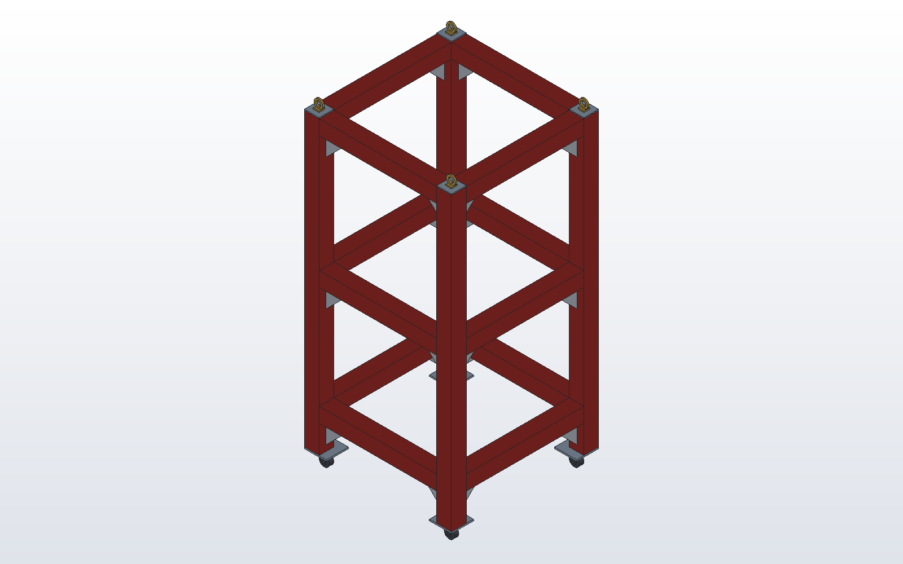

<details markdown="1">
<summary>The script, rack.py</summary>

```python
# SPDX-License-Identifier: Apache-2.0
"""A welded rack frame on castors, from plain parts.

Four posts and three levels of rails, each a 100 x 100 x 4 hollow square
section with square-cut ends, gussets under every rail end, a base plate
under each post and a cap on top, four castors and four lifting eyes. Each
part is a box, a cylinder or a prism, so the bill of materials groups the
identical ones: 12 rails, 24 gussets. Change HEIGHT and the posts grow;
change LEVELS and the lower rails move.

Tags: solid, assembly
"""

WIDTH = 1000.0
DEPTH = 1000.0
HEIGHT = 2000.0
MEMBER = 100.0
WALL = 4.0
LEVELS = (300.0, 1100.0)
PLATE = 150.0
PLATE_THICK = 10.0
CAP_THICK = 6.0
GUSSET = 150.0
GUSSET_THICK = 6.0
WHEEL = 35.0
WHEEL_WIDTH = 30.0
CASTOR = 100.0

POST_LENGTH = HEIGHT - PLATE_THICK - CAP_THICK


def member(length, axis):
    """A hollow square section `length` long along axis 0 (x), 1 (y) or 2 (z), open at both ends."""
    size = [MEMBER, MEMBER, MEMBER]
    size[axis] = length
    along = tuple(1 if i == axis else 0 for i in range(3))
    against = tuple(-1 if i == axis else 0 for i in range(3))
    return hollow_facing(make_box(*size), WALL, [along, against])


def gusset(at, turn):
    """A triangular gusset under a rail end: its corner at `at`, its top leg turned from +x."""
    triangle = extrude(polygon_face([(0, 0), (GUSSET, 0), (0, -GUSSET)]), GUSSET_THICK)
    upright = translate(rotate(triangle, (0, 0, 0), (1, 0, 0), 90), (0, GUSSET_THICK / 2, 0))
    return translate(rotate(upright, (0, 0, 0), (0, 0, 1), turn), at)


def across(radius, start, length, axle):
    """A cylinder across the fork, from y = start for `length`, on the axle at height `axle`."""
    upright = make_cylinder(radius, length, (0, 0, axle + start))
    return rotate(upright, (0, 0, axle), (1, 0, 0), -90)


def castor(x, y):
    """A castor under (x, y): a mounting plate, a swivel, a fork, two axle stubs and a wheel."""
    axle = WHEEL - CASTOR
    side = WHEEL_WIDTH / 2
    leg = -28 - (axle - 10)
    pieces = [
        make_box(120, 120, 8, (-60, -60, -8)),
        make_cylinder(25, 12, (0, 0, -20)),
        make_box(30, 2 * side + 16, 8, (-15, -side - 8, -28)),
        make_box(30, 6, leg, (-15, side + 2, axle - 10)),
        make_box(30, 6, leg, (-15, -side - 8, axle - 10)),
        across(6, side, 2, axle),
        across(6, -side - 2, 2, axle),
        across(WHEEL, -side, WHEEL_WIDTH, axle),
    ]
    return translate(fuse_all(pieces), (x, y, 0))


def eyebolt(x, y):
    """A lifting eye on a square foot, standing on a post's cap at (x, y)."""
    foot = make_box(40, 40, 8, (-20, -20, HEIGHT))
    ring = cut(make_cylinder(30, 10, (0, 0, -5)), make_cylinder(18, 10, (0, 0, -5)))
    ring = translate(rotate(ring, (0, 0, 0), (1, 0, 0), 90), (0, 0, HEIGHT + 8 + 30 - 4))
    return translate(fuse(foot, ring), (x, y, 0))


corners = [(0, 0), (WIDTH - MEMBER, 0), (WIDTH - MEMBER, DEPTH - MEMBER), (0, DEPTH - MEMBER)]
for number, (x, y) in enumerate(corners, start=1):
    px, py = min(x, WIDTH - PLATE), min(y, DEPTH - PLATE)
    part(f"base_plate_{number}", make_box(PLATE, PLATE, PLATE_THICK, (px, py, 0)), color="steel")
    part(f"post_{number}", translate(member(POST_LENGTH, 2), (x, y, PLATE_THICK)), color="dx-red")
    cap = make_box(MEMBER, MEMBER, CAP_THICK, (x, y, HEIGHT - CAP_THICK))
    part(f"cap_{number}", cap, color="steel")
    part(f"castor_{number}", castor(px + PLATE / 2, py + PLATE / 2), color="hardware")
    part(f"eyebolt_{number}", eyebolt(x + MEMBER / 2, y + MEMBER / 2), color="brass")

counts = {"rail": 0, "gusset": 0}


def rail(shape, ends):
    """Register a rail and a gusset under each of its ends, each end an (at, turn)."""
    counts["rail"] += 1
    part(f"rail_{counts['rail']}", shape, color="dx-red")
    for at, turn in ends:
        counts["gusset"] += 1
        part(f"gusset_{counts['gusset']}", gusset(at, turn), color="galvanised")


for top in (*LEVELS, HEIGHT - CAP_THICK):
    z = top - MEMBER
    for y in (0, DEPTH - MEMBER):
        shape = translate(member(WIDTH - 2 * MEMBER, 0), (MEMBER, y, z))
        middle = y + MEMBER / 2
        rail(shape, [((MEMBER, middle, z), 0), ((WIDTH - MEMBER, middle, z), 180)])
    for x in (0, WIDTH - MEMBER):
        shape = translate(member(DEPTH - 2 * MEMBER, 1), (x, MEMBER, z))
        middle = x + MEMBER / 2
        rail(shape, [((middle, MEMBER, z), 90), ((middle, DEPTH - MEMBER, z), -90)])
```

</details>

The file: [rack.py](examples/rack.py).

### A six-axis industrial robot arm in a working pose, with a parallel gripper

A mid-size articulated robot (about 10 kg payload, 1.4 m reach) built as a showcase of machined and cast components: a floor plate with mated anchor studs, a ribbed base casting, the J1 turntable, a lofted shoulder housing with the J2 gearbox and servo, a tapered upper arm with ribbed pockets, the elbow with its J3 servo, the J4 roll forearm, the J5/J6 wrist with an ISO 9409-1 50-4-M6 tool flange, and a two-finger parallel gripper holding a turned part. Servos have cooling fins and connector boxes, the cable harness is swept along a filleted path, and every joint carries its bolt circle. Each link is built in the zero pose and turned about its joint axes by J1 to J6, so changing one angle re-poses everything downstream of it.

Tags: solid, assembly, mates, sketch, showcase

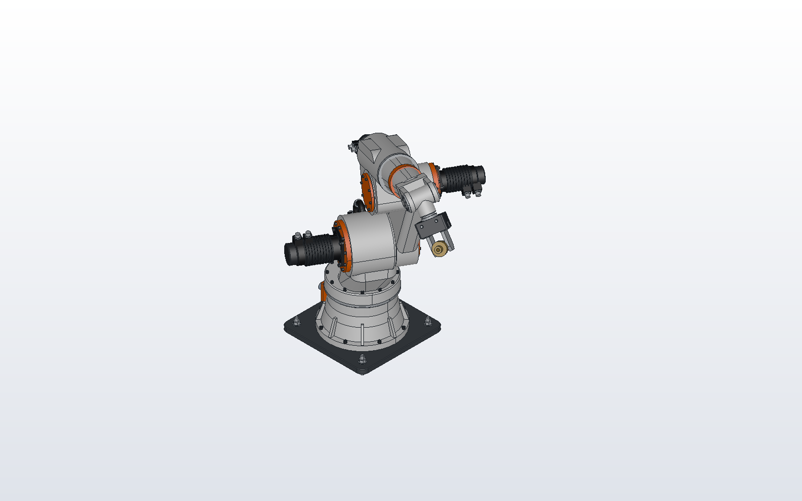

<details markdown="1">
<summary>The script, robot_arm.py</summary>

```python
# SPDX-License-Identifier: Apache-2.0
"""A six-axis industrial robot arm in a working pose, with a parallel gripper.

A mid-size articulated robot (about 10 kg payload, 1.4 m reach) built as a
showcase of machined and cast components: a floor plate with mated anchor
studs, a ribbed base casting, the J1 turntable, a lofted shoulder housing with
the J2 gearbox and servo, a tapered upper arm with ribbed pockets, the elbow
with its J3 servo, the J4 roll forearm, the J5/J6 wrist with an ISO 9409-1
50-4-M6 tool flange, and a two-finger parallel gripper holding a turned part.
Servos have cooling fins and connector boxes, the cable harness is swept along
a filleted path, and every joint carries its bolt circle. Each link is built
in the zero pose and turned about its joint axes by J1 to J6, so changing one
angle re-poses everything downstream of it.

Tags: solid, assembly, mates, sketch, showcase
"""

# ---------------------------------------------------------------- pose (degrees)
J1 = -30.0  # base rotation, about +Z
J2 = 32.0  # shoulder, about +Y (positive leans the upper arm forward)
J3 = -52.0  # elbow, about +Y (negative raises the forearm)
J4 = 15.0  # forearm roll, about the forearm axis
J5 = 75.0  # wrist bend, about +Y in the wrist
J6 = 25.0  # tool flange roll

# ---------------------------------------------------------------- main dimensions (mm)
PLATE_SIZE = 560.0  # square floor plate
PLATE_T = 28.0
ANCHOR_PITCH = 450.0  # anchor stud square
BASE_R = 205.0  # base casting radius at the foot
BASE_H = 235.0
TURNTABLE_R = 185.0
TURNTABLE_T = 70.0
SHOULDER_X = 150.0  # J2 axis offset from J1
SHOULDER_Z = 620.0  # J2 axis height above the floor
UPPER_ARM = 640.0  # J2 to J3
ARM_Y = 150.0  # upper arm centre plane, off the robot's centre line
ARM_T = 110.0  # upper arm thickness
FOREARM_RISE = 140.0  # J3 to the J4 axis
FOREARM = 700.0  # J3 to J5 along the forearm
WRIST = 100.0  # J5 to the tool flange face
FLANGE_PCD = 50.0  # ISO 9409-1-50-4-M6
FLANGE_D = 63.0
GRIP_OPEN = 52.0  # gap between the finger pads = workpiece diameter
FINGER_LEN = 105.0
MOTOR_R = 62.0  # J2 servo radius; the others scale from it

# ---------------------------------------------------------------- colours
CAST = "#E8E8E8"  # painted castings
ACCENT = "#FF6F00"  # covers and caps
MOTOR = "#1E1F22"
MOTOR_CAP = "#34373C"
MACHINED = "#BFC3C8"
SCREW = "#2A2C30"
PLATE = "#4B5157"
HARNESS = "#202020"
GRIPPER = "#3A3F46"
WORKPIECE = "#C9A54A"

# ---------------------------------------------------------------- joint frames (zero pose)
BASE_TOP = PLATE_T + BASE_H
TT_TOP = BASE_TOP + TURNTABLE_T
SX, SZ = SHOULDER_X, SHOULDER_Z
J3Z = SZ + UPPER_ARM
J4Z = J3Z + FOREARM_RISE
J5X = SX + FOREARM
FLANGE_X = J5X + WRIST
JOINTS = [
    ((0.0, 0.0, 0.0), (0, 0, 1), J1),
    ((SX, 0.0, SZ), (0, 1, 0), J2),
    ((SX, 0.0, J3Z), (0, 1, 0), J3),
    ((0.0, 0.0, J4Z), (1, 0, 0), J4),
    ((J5X, 0.0, J4Z), (0, 1, 0), J5),
    ((0.0, 0.0, J4Z), (1, 0, 0), J6),
]


def pose(shape, link):
    """A shape of link `link` (0 = the fixed base) moved from the zero pose into the pose."""
    for point, axis, angle in reversed(JOINTS[:link]):
        if angle:
            shape = rotate(shape, point, axis, angle)
    return shape


def add(name, shape, link, color, part_number=None, material=None):
    props = {"material": material} if material else None
    return part(name, pose(shape, link), color=color, part_number=part_number, properties=props)


def soft_fillet(shape, r, picked=None):
    """A fillet when OCCT will build it, the sharp shape when it will not."""
    try:
        return fillet(shape, r, picked) if picked is not None else fillet_all(shape, r)
    except Exception:
        return shape


def soft_chamfer(shape, d, picked):
    try:
        return chamfer(shape, d, picked)
    except Exception:
        return shape


# ---------------------------------------------------------------- shape helpers
def xcyl(r, x0, x1, y=0.0, z=0.0):
    return translate(rotate(make_cylinder(r, x1 - x0), (0, 0, 0), (0, 1, 0), 90), (x0, y, z))


def ycyl(r, y0, y1, x=0.0, z=0.0):
    return translate(rotate(make_cylinder(r, y1 - y0), (0, 0, 0), (1, 0, 0), -90), (x, y0, z))


def orient(shape, d):
    """Turn a shape built along local +Z so that +Z points along `d` (+x, -x, +y, -y, +z, -z)."""
    turns = {
        "+z": None,
        "-z": ((1, 0, 0), 180),
        "+x": ((0, 1, 0), 90),
        "-x": ((0, 1, 0), -90),
        "+y": ((1, 0, 0), -90),
        "-y": ((1, 0, 0), 90),
    }[d]
    return shape if turns is None else rotate(shape, (0, 0, 0), turns[0], turns[1])


def put(shape, d, at):
    return translate(orient(shape, d), at)


def rrect(plane, cx, cy, w, h, r):
    return Sketch(plane).rounded_rectangle((cx - w / 2, cy - h / 2), (cx + w / 2, cy + h / 2), r)


def hexagon(across, thick):
    r = across / math.sqrt(3)
    return extrude(
        polygon_face(
            [
                (r * math.cos(math.radians(60 * k + 30)), r * math.sin(math.radians(60 * k + 30)))
                for k in range(6)
            ]
        ),
        thick,
    )


_SCREWS = {}


def cap_screw(d):
    """ISO 4762 socket head cap screw, head seated on z = 0, shank down into the part."""
    if d not in _SCREWS:
        head = make_cylinder(0.8 * d, d)
        head = soft_chamfer(
            head, 0.08 * d, [e for e in edges(head) if bounding_box(e)[1][2] > d - 1e-6]
        )
        screw = fuse(head, make_cylinder(d / 2, 1.6 * d, (0, 0, -1.5 * d)))
        _SCREWS[d] = cut(screw, translate(hexagon(0.86 * d, 0.6 * d), (0, 0, 0.42 * d)))
    return _SCREWS[d]


def screw_ring(d, n, pcd, d_out, at, phase=0.0):
    """n cap screws on a circle of diameter pcd, heads facing d_out, centred on `at`."""
    out = []
    for k in range(n):
        a = math.radians(phase + 360.0 * k / n)
        s = translate(cap_screw(d), (pcd / 2 * math.cos(a), pcd / 2 * math.sin(a), 0))
        out.append(put(s, d_out, at))
    return out


def servo(R, L, spin=0.0):
    """A finned AC servo along local +Z from its mounting face at z = 0: (suffix, shape, colour)."""
    side = 2 * R + 22
    flange = extrude(rrect(Plane.XY, 0, 0, side, side, 10).face(), 14)
    pts = [(0, 13), (R, 13), (R, 0.22 * L)]
    z = 0.22 * L
    while z + 14 < 0.86 * L:
        pts += [(R + 8, z + 2), (R + 8, z + 7), (R, z + 9), (R, z + 14)]
        z += 14
    pts += [(R, L - 6), (R - 6, L), (0, L)]
    body = revolve(polygon_face(pts, Plane.XZ), (0, 0, 0), (0, 0, 1))
    cap = make_cylinder(R - 7, 38, (0, 0, L - 1))
    cap = soft_chamfer(cap, 4, [e for e in edges(cap) if bounding_box(e)[1][2] > L + 36])
    parts = [("flange", flange, MOTOR), ("body", body, MOTOR), ("encoder", cap, MOTOR_CAP)]
    for k, zc in enumerate((L - 0.62 * R - 30, L - 0.62 * R + 22)):
        box = make_box(42, 44, 40, (R - 12, -22, zc - 20))
        plug = xcyl(12, R + 29, R + 52, 0, zc)
        nut = translate(hexagon(30, 6), (0, 0, 0))
        nut = translate(rotate(nut, (0, 0, 0), (0, 1, 0), 90), (R + 29, 0, zc))
        parts += [
            (f"connector_box_{k + 1}", box, MOTOR),
            (f"plug_{k + 1}", fuse(nut, plug), MACHINED),
        ]
    screws = [
        translate(cap_screw(8), (sx * (side / 2 - 13), sy * (side / 2 - 13), 14))
        for sx in (-1, 1)
        for sy in (-1, 1)
    ]
    parts += [(f"flange_screw_{k + 1}", s, SCREW) for k, s in enumerate(screws)]
    if spin:
        parts = [(n, rotate(s, (0, 0, 0), (0, 0, 1), spin), c) for n, s, c in parts]
    return parts


def add_servo(prefix, R, L, d, at, link, spin=0.0, rating="1.5 kW"):
    for suffix, s, c in servo(R, L, spin):
        pn = f"SRV-{int(R)}-{int(L)}" if suffix == "body" else None
        add(
            f"{prefix}_{suffix}",
            put(s, d, at),
            link,
            c,
            part_number=pn,
            material="AC servo, " + rating if suffix == "body" else None,
        )


def filleted_path(sketch, pts, r):
    """An open path through pts with each inner corner rounded to radius r (tangent arcs)."""
    sketch.move_to(pts[0])
    for i in range(1, len(pts) - 1):
        p0, p1, p2 = pts[i - 1], pts[i], pts[i + 1]
        a = (p0[0] - p1[0], p0[1] - p1[1])
        b = (p2[0] - p1[0], p2[1] - p1[1])
        la, lb = math.hypot(*a), math.hypot(*b)
        a, b = (a[0] / la, a[1] / la), (b[0] / lb, b[1] / lb)
        half = math.acos(max(-1.0, min(1.0, a[0] * b[0] + a[1] * b[1]))) / 2
        t = r / math.tan(half)
        bis = (a[0] + b[0], a[1] + b[1])
        lbis = math.hypot(*bis)
        c = (p1[0] + bis[0] / lbis * r / math.sin(half), p1[1] + bis[1] / lbis * r / math.sin(half))
        mid = (c[0] - bis[0] / lbis * r, c[1] - bis[1] / lbis * r)
        sketch.line_to((p1[0] + a[0] * t, p1[1] + a[1] * t))
        sketch.arc_via(mid, (p1[0] + b[0] * t, p1[1] + b[1] * t))
    sketch.line_to(pts[-1])
    return sketch.path()


def harness(prefix, y, pts, r_bend, link, clamps):
    """A cable harness swept along a filleted path in the plane at y, with clamp rings."""
    plane = Plane((0, y, 0), (0, -1, 0), (1, 0, 0))
    path = filleted_path(Sketch(plane), pts, r_bend)
    dx, dz = pts[1][0] - pts[0][0], pts[1][1] - pts[0][1]
    ln = math.hypot(dx, dz)
    start = Plane((pts[0][0], y, pts[0][1]), (dx / ln, 0, dz / ln), (0, 1, 0))
    try:
        tube = sweep(Sketch(start).circle((0, 0), 15).face(), path)
    except Exception:
        tube = fuse_all(
            [
                rotate(
                    make_cylinder(15, math.hypot(q[0] - p[0], q[1] - p[1]), (p[0], y, p[1])),
                    (p[0], y, p[1]),
                    (0, 1, 0),
                    math.degrees(math.atan2(q[0] - p[0], q[1] - p[1])),
                )
                for p, q in zip(pts, pts[1:], strict=False)
            ]
            + [make_sphere(15, (p[0], y, p[1])) for p in pts[1:-1]]
        )
    add(
        f"{prefix}",
        tube,
        link,
        HARNESS,
        part_number="HRN-CORR-29",
        material="PA6 corrugated conduit",
    )
    gland = fuse(make_cylinder(19, 16), translate(hexagon(44, 10), (0, 0, 15)))
    for k, (p, q) in enumerate(((pts[1], pts[0]), (pts[-2], pts[-1]))):
        ang = math.degrees(math.atan2(q[0] - p[0], q[1] - p[1]))
        g = translate(
            rotate(rotate(gland, (0, 0, 0), (0, 0, 1), 0), (0, 0, 0), (0, 1, 0), ang + 180),
            (q[0], y, q[1]),
        )
        add(f"{prefix}_gland_{k + 1}", g, link, MACHINED, part_number="GLD-M40")
    for k, (seg, f) in enumerate(clamps):
        p, q = pts[seg], pts[seg + 1]
        cx, cz = p[0] + f * (q[0] - p[0]), p[1] + f * (q[1] - p[1])
        ang = math.degrees(math.atan2(q[0] - p[0], q[1] - p[1]))
        ring = cut(make_cylinder(20, 18, (0, 0, -9)), make_cylinder(15.5, 18, (0, 0, -9)))
        ring = translate(rotate(ring, (0, 0, 0), (0, 1, 0), ang), (cx, y, cz))
        add(f"{prefix}_clamp_{k + 1}", ring, link, MACHINED, part_number="CLP-29")


# ================================================================ 0  floor plate and base (fixed)
plate = extrude(rrect(Plane.XY, 0, 0, PLATE_SIZE, PLATE_SIZE, 40).face(), PLATE_T)
anchors = [(sx * ANCHOR_PITCH / 2, sy * ANCHOR_PITCH / 2) for sx in (-1, 1) for sy in (-1, 1)]
plate = cut_all(plate, [make_cylinder(13, PLATE_T, (x, y, 0)) for x, y in anchors])
plate = soft_chamfer(
    plate,
    3,
    [
        e
        for e in edges(plate)
        if bounding_box(e)[1][2] > PLATE_T - 1e-6
        and bounding_box(e)[1][0] - bounding_box(e)[0][0] > 100
    ],
)
part(
    "floor_plate",
    plate,
    color=PLATE,
    part_number="RB-100-FP",
    properties={"material": "S355 plate, painted"},
)

stud = fuse_all(
    [
        make_cylinder(10, 110, (0, 0, -70)),
        make_cylinder(20, 4),
        translate(hexagon(30, 16), (0, 0, 4)),
    ]
)
stud = fuse(stud, make_cone(10, 7, 4, (0, 0, 40)))
for k, (x, y) in enumerate(anchors):
    name = f"anchor_stud_{k + 1}"
    part(
        name,
        translate(stud, (x, y, PLATE_T)),
        color=MACHINED,
        part_number="ANC-M20x180",
        properties={"material": "8.8 zinc plated", "torque": "120 N m"},
    )
    try:
        mate(name, "cylinder 1", "floor_plate", f"hole {k + 1}", "concentric")
        mate(name, "<Z 2", "floor_plate", ">Z", "coincident")
    except Exception:
        pass

base_pts = [
    (0, PLATE_T - 1),
    (BASE_R + 22, PLATE_T - 1),
    (BASE_R + 22, PLATE_T + 32),
    (BASE_R - 4, PLATE_T + 36),
    (BASE_R - 22, PLATE_T + 110),
    (TURNTABLE_R - 12, BASE_TOP - 70),
    (TURNTABLE_R - 12, BASE_TOP - 14),
    (TURNTABLE_R - 2, BASE_TOP - 10),
    (TURNTABLE_R - 2, BASE_TOP),
    (0, BASE_TOP),
]
base = revolve(polygon_face(base_pts, Plane.XZ), (0, 0, 0), (0, 0, 1))
gusset = extrude(
    polygon_face(
        [
            (BASE_R - 30, PLATE_T + 20),
            (BASE_R + 20, PLATE_T + 20),
            (BASE_R + 20, PLATE_T + 34),
            (BASE_R - 14, PLATE_T + 130),
            (BASE_R - 30, PLATE_T + 130),
        ],
        Plane((0, -7, 0), (0, -1, 0), (1, 0, 0)),
    ),
    14,
    (0, 1, 0),
)
base = fuse_all([base] + circular_pattern(gusset, (0, 0, 0), (0, 0, 1), 8))
part(
    "base_casting",
    base,
    color=CAST,
    part_number="RB-110-BC",
    properties={"material": "EN-GJS-400 painted"},
)
for k, s in enumerate(screw_ring(12, 8, 2 * BASE_R + 22, "+z", (0, 0, PLATE_T + 32), phase=22.5)):
    part(f"base_screw_{k + 1}", s, color=SCREW, part_number="ISO4762-M12x40")
part(
    "j1_bearing_seal",
    cut(
        make_cylinder(TURNTABLE_R + 2, 14, (0, 0, BASE_TOP - 6)),
        make_cylinder(TURNTABLE_R - 20, 14, (0, 0, BASE_TOP - 6)),
    ),
    color=MACHINED,
    part_number="RB-111-SL",
)
panel = make_box(16, 150, 110, (-BASE_R - 4, -75, PLATE_T + 70))
part(
    "connector_panel",
    soft_fillet(panel, 4, edges_parallel_to(panel, (1, 0, 0))),
    color=ACCENT,
    part_number="RB-112-CP",
)
for k, y in enumerate((-36.0, 36.0)):
    plug = fuse_all(
        [
            xcyl(26, -BASE_R - 10, -BASE_R - 2, y, PLATE_T + 125),
            xcyl(20, -BASE_R - 40, -BASE_R - 8, y, PLATE_T + 125),
        ]
    )
    plug = cut(plug, xcyl(13, -BASE_R - 41, -BASE_R - 25, y, PLATE_T + 125))
    place(f"base_connector_{k + 1}", plug, part=None)
    identity(
        f"base_connector_{k + 1}",
        part_number="CON-M40-19P",
        properties={"material": "nickel brass"},
    )
for k, (y, z) in enumerate(
    [(-62, PLATE_T + 82), (62, PLATE_T + 82), (-62, PLATE_T + 168), (62, PLATE_T + 168)]
):
    part(
        f"panel_screw_{k + 1}",
        put(cap_screw(5), "-x", (-BASE_R - 4, y, z)),
        color=SCREW,
        part_number="ISO4762-M5x12",
    )

# ================================================================ 1  turntable and shoulder (J1)
tt = make_cylinder(TURNTABLE_R, TURNTABLE_T, (0, 0, BASE_TOP))
tt = soft_chamfer(tt, 6, [e for e in edges(tt) if bounding_box(e)[1][2] > TT_TOP - 1e-6])
add("turntable", tt, 1, CAST, part_number="RB-120-TT", material="EN-GJS-400 painted")
for k, s in enumerate(screw_ring(10, 12, 2 * (TURNTABLE_R - 15), "+z", (0, 0, TT_TOP), phase=15)):
    add(f"turntable_screw_{k + 1:02d}", s, 1, SCREW, part_number="ISO4762-M10x35")

low = rrect(Plane.XY.offset(TT_TOP - 1), 40, 0, 230, 250, 100).wire()
mid = rrect(Plane.XY.offset(SZ - 150), SX - 10, 0, 250, 230, 60).wire()
top = rrect(Plane.XY.offset(SZ), SX, 0, 230, 210, 40).wire()
shoulder = fuse_all(
    [
        loft([low, mid, top]),
        ycyl(150, -130, 92, SX, SZ),
        make_cylinder(52, 30, (-118, 0, TT_TOP - 2)),
    ]
)
shoulder = soft_fillet(
    shoulder,
    10,
    [
        e
        for e in edges(shoulder)
        if abs(bounding_box(e)[0][1] - bounding_box(e)[1][1]) < 1e-6
        and bounding_box(e)[0][1] in (-130.0, 92.0)
    ],
)
add("shoulder_housing", shoulder, 1, CAST, part_number="RB-130-SH", material="EN-GJS-400 painted")
add(
    "j2_gear_cap",
    ycyl(128, -152, -128, SX, SZ),
    1,
    ACCENT,
    part_number="RB-131-GC",
    material="AlSi10Mg painted",
)
for k, s in enumerate(screw_ring(10, 10, 2 * 112, "-y", (SX, -152, SZ), phase=18)):
    add(f"j2_cap_screw_{k + 1:02d}", s, 1, SCREW, part_number="ISO4762-M10x30")
add_servo("j2_servo", MOTOR_R, 230, "-y", (SX, -151, SZ), 1, spin=90, rating="2.5 kW")
add_servo(
    "j1_servo", 0.8 * MOTOR_R, 190, "+z", (-118, 0, TT_TOP + 27), 1, spin=180, rating="2.0 kW"
)
harness(
    "harness_shoulder",
    0.0,
    [(-118, TT_TOP + 245), (-118, SZ + 40), (-30, SZ + 110), (30, SZ + 60)],
    45,
    1,
    [(1, 0.5)],
)

# ================================================================ 2  upper arm (J2)
ay0, ay1 = ARM_Y - ARM_T / 2, ARM_Y + ARM_T / 2
arm = loft(
    [
        rrect(Plane.XY.offset(SZ), SX, ARM_Y, 240, ARM_T, 30).wire(),
        rrect(Plane.XY.offset(J3Z), SX, ARM_Y, 165, ARM_T, 30).wire(),
    ]
)
arm = fuse_all([arm, ycyl(140, ay0, ay1, SX, SZ), ycyl(102, ay0, ay1, SX, J3Z)])
pockets = []
face_plane = Plane((0, ay1 + 1, 0), (0, -1, 0), (1, 0, 0))


def hw(z):
    """Half the width of a rib pocket at height z: the arm's taper less the wall."""
    return (240 - 75 * (z - SZ) / UPPER_ARM) / 2 - 24


c = 16
for z0, z1 in ((SZ + 165, SZ + 300), (SZ + 320, SZ + 445), (SZ + 465, J3Z - 125)):
    pockets.append(
        extrude(
            polygon_face(
                [
                    (SX - hw(z0) + c, z0),
                    (SX + hw(z0) - c, z0),
                    (SX + hw(z0), z0 + c),
                    (SX + hw(z1), z1 - c),
                    (SX + hw(z1) - c, z1),
                    (SX - hw(z1) + c, z1),
                    (SX - hw(z1), z1 - c),
                    (SX - hw(z0), z0 + c),
                ],
                face_plane,
            ),
            40,
            (0, -1, 0),
        )
    )
arm = cut_all(arm, pockets)
add("upper_arm", arm, 2, CAST, part_number="RB-140-UA", material="EN-GJS-400 painted, ribbed")
add(
    "j2_arm_cap",
    ycyl(112, ay1 - 1, ay1 + 14, SX, SZ),
    2,
    ACCENT,
    part_number="RB-141-AC",
    material="AlSi10Mg painted",
)
for k, s in enumerate(screw_ring(8, 8, 2 * 96, "+y", (SX, ay1 + 14, SZ), phase=22.5)):
    add(f"j2_arm_cap_screw_{k + 1}", s, 2, SCREW, part_number="ISO4762-M8x25")
add(
    "j3_reducer",
    fuse(ycyl(96, ay1 - 1, ay1 + 26, SX, J3Z), ycyl(84, ay1 + 25, ay1 + 34, SX, J3Z)),
    2,
    ACCENT,
    part_number="RB-142-RD",
    material="AlSi10Mg painted",
)
for k, s in enumerate(screw_ring(8, 8, 2 * 89, "+y", (SX, ay1 + 26, J3Z), phase=22.5)):
    add(f"j3_reducer_screw_{k + 1}", s, 2, SCREW, part_number="ISO4762-M8x30")
add_servo("j3_servo", 0.85 * MOTOR_R, 200, "+y", (SX, ay1 + 33, J3Z), 2, spin=0, rating="1.8 kW")
harness(
    "harness_upper_arm",
    ARM_Y,
    [(SX - 105, SZ + 40), (SX - 190, SZ + 160), (SX - 165, J3Z - 170), (SX - 70, J3Z - 50)],
    70,
    2,
    [(1, 0.25), (1, 0.75)],
)

# ================================================================ 3  elbow and forearm housing (J3)
fy = 92.0
rear = extrude(
    rrect(
        Plane((0, -fy, 0), (0, -1, 0), (1, 0, 0)),
        SX - 15,
        (J3Z + J4Z) / 2 + 5,
        310,
        FOREARM_RISE + 175,
        55,
    ).face(),
    2 * fy,
    (0, 1, 0),
)
elbow = fuse_all(
    [rear, ycyl(112, -fy - 6, ay0 - 2, SX, J3Z), xcyl(100, SX - 175, SX + 240, 0, J4Z)]
)
elbow = soft_fillet(
    elbow,
    8,
    [
        e
        for e in edges(elbow)
        if abs(bounding_box(e)[0][1] - bounding_box(e)[1][1]) < 1e-6
        and abs(abs(bounding_box(e)[0][1]) - fy) < 1e-6
    ],
)
add("elbow_housing", elbow, 3, CAST, part_number="RB-150-EH", material="EN-GJS-400 painted")
add(
    "elbow_cover",
    ycyl(96, -fy - 18, -fy - 5, SX, J3Z),
    3,
    ACCENT,
    part_number="RB-151-EC",
    material="AlSi10Mg painted",
)
for k, s in enumerate(screw_ring(8, 8, 2 * 82, "-y", (SX, -fy - 18, J3Z), phase=22.5)):
    add(f"elbow_cover_screw_{k + 1}", s, 3, SCREW, part_number="ISO4762-M8x25")
add_servo("j4_servo", 0.75 * MOTOR_R, 180, "-x", (SX - 174, 0, J4Z), 3, spin=-90, rating="0.9 kW")

# ============================================================== 4  forearm tube and wrist yoke (J4)
x0, x1 = SX + 255, J5X - 130


def sec(x, w, h, r):
    return rrect(Plane((x, 0, 0), (1, 0, 0), (0, 1, 0)), 0, J4Z, w, h, r).wire()


tube = loft([sec(x0 - 2, 170, 180, 70), sec(x1, 120, 130, 50)])
yoke = [make_box(60, 150, 116, (J5X - 150, -75, J4Z - 58))]
for s in (-1, 1):
    yy = (52, 74) if s > 0 else (-74, -52)
    yoke += [make_box(140, 22, 104, (J5X - 140, yy[0], J4Z - 52)), ycyl(52, yy[0], yy[1], J5X, J4Z)]
forearm = fuse_all([tube] + yoke)
add("forearm", forearm, 4, CAST, part_number="RB-160-FA", material="AlSi10Mg casting, painted")
ring = cut(xcyl(103, SX + 238, SX + 258, 0, J4Z), xcyl(60, SX + 237, SX + 259, 0, J4Z))
add("j4_bearing_ring", ring, 4, MACHINED, part_number="RB-161-BR", material="42CrMo4")
add(
    "forearm_band",
    cut(xcyl(84, SX + 380, SX + 420, 0, J4Z), xcyl(40, SX + 379, SX + 421, 0, J4Z)),
    4,
    ACCENT,
    part_number="RB-162-BD",
    material="painted steel band",
)
for s, d in ((1, "+y"), (-1, "-y")):
    cap_y = 74 * s
    add(
        f"j5_bearing_cap_{'right' if s > 0 else 'left'}",
        ycyl(
            44,
            min(cap_y, cap_y + 8 * s) - (1 if s > 0 else 0),
            max(cap_y, cap_y + 8 * s) + (0 if s > 0 else 1),
            J5X,
            J4Z,
        ),
        4,
        MACHINED,
        part_number="RB-163-BC",
        material="7075-T6 anodised",
    )
    for k, sc in enumerate(screw_ring(6, 6, 2 * 34, d, (J5X, cap_y + 8 * s, J4Z), phase=30)):
        add(
            f"j5_cap_screw_{'r' if s > 0 else 'l'}{k + 1}",
            sc,
            4,
            SCREW,
            part_number="ISO4762-M6x20",
        )

# ================================================================ 5  wrist body (J5)
wrist = fuse_all([ycyl(46, -51, 51, J5X, J4Z), xcyl(42, J5X, FLANGE_X - 12, 0, J4Z)])
add("wrist_body", wrist, 5, CAST, part_number="RB-170-WB", material="AlSi10Mg painted")
add(
    "j6_seal_ring",
    cut(
        xcyl(40, FLANGE_X - 13, FLANGE_X - 9, 0, J4Z), xcyl(30, FLANGE_X - 14, FLANGE_X - 8, 0, J4Z)
    ),
    5,
    MACHINED,
    part_number="RB-171-SR",
)

# ================================================================ 6  tool flange and gripper (J6)
fl = xcyl(FLANGE_D / 2, FLANGE_X - 10, FLANGE_X, 0, J4Z)
fl = cut_all(
    fl,
    [
        xcyl(
            3.3,
            FLANGE_X - 10,
            FLANGE_X,
            FLANGE_PCD / 2 * math.cos(math.radians(45 + 90 * k)),
            J4Z + FLANGE_PCD / 2 * math.sin(math.radians(45 + 90 * k)),
        )
        for k in range(4)
    ]
    + [
        xcyl(3, FLANGE_X - 6, FLANGE_X, FLANGE_PCD / 2, J4Z),
        xcyl(15.75, FLANGE_X - 6, FLANGE_X, 0, J4Z),
    ],
)
add("tool_flange", fl, 6, MACHINED, part_number="ISO9409-1-50-4-M6", material="42CrMo4, ground")
ad_t = 12
adapter = fuse(
    xcyl(40, FLANGE_X, FLANGE_X + ad_t, 0, J4Z), xcyl(15.5, FLANGE_X - 5, FLANGE_X + 1, 0, J4Z)
)
add("gripper_adapter", adapter, 6, MACHINED, part_number="GRP-ADP-50", material="6082-T6 anodised")
for k, s in enumerate(screw_ring(6, 4, FLANGE_PCD, "+x", (FLANGE_X + ad_t, 0, J4Z), phase=45)):
    add(f"adapter_screw_{k + 1}", s, 6, SCREW, part_number="ISO4762-M6x20")
gx = FLANGE_X + ad_t
body = make_box(75, 150, 84, (gx, -75, J4Z - 42))
body = soft_fillet(body, 8, edges_parallel_to(body, (1, 0, 0)))
body = cut(body, make_box(30, 152, 20, (gx + 46, -76, J4Z - 10)))  # jaw guide slot
add("gripper_body", body, 6, GRIPPER, part_number="GRP-PG-80", material="7075-T6, black anodised")
for k, y in enumerate((-40.0, 40.0)):
    fit = fuse(
        make_cylinder(6, 14, (gx + 20, y, J4Z + 41)),
        translate(hexagon(14, 6), (gx + 20, y, J4Z + 48)),
    )
    add(f"air_fitting_{k + 1}", fit, 6, MACHINED, part_number="FIT-G18-6")
for s, side in ((1, "right"), (-1, "left")):
    inner = GRIP_OPEN / 2 + 6
    jaw_y = (inner, inner + 34) if s > 0 else (-inner - 34, -inner)
    jaw = make_box(36, 34, 70, (gx + 44, jaw_y[0], J4Z - 35))
    add(
        f"jaw_{side}",
        soft_fillet(jaw, 3, edges_parallel_to(jaw, (0, 1, 0))),
        6,
        MACHINED,
        part_number="GRP-JAW",
        material="7075-T6 anodised",
    )
    fy0 = inner if s > 0 else -inner - 16
    finger = extrude(
        polygon_face(
            [
                (gx + 78, J4Z - 30),
                (gx + 78 + FINGER_LEN - 25, J4Z - 30),
                (gx + 78 + FINGER_LEN, J4Z - 16),
                (gx + 78 + FINGER_LEN, J4Z + 16),
                (gx + 78 + FINGER_LEN - 25, J4Z + 30),
                (gx + 78, J4Z + 30),
            ],
            Plane((0, fy0, 0), (0, -1, 0), (1, 0, 0)),
        ),
        16,
        (0, 1, 0),
    )
    add(f"finger_{side}", finger, 6, MACHINED, part_number="GRP-FNG-105", material="6082-T6")
    pad_y = (GRIP_OPEN / 2, inner + 0.5) if s > 0 else (-inner - 0.5, -GRIP_OPEN / 2)
    pad = make_box(46, pad_y[1] - pad_y[0], 44, (gx + 78 + FINGER_LEN - 54, pad_y[0], J4Z - 22))
    pad = cut(
        pad,
        rotate(
            make_box(
                7, 7, 50, (gx + 78 + FINGER_LEN - 31 - 3.5, s * GRIP_OPEN / 2 - 3.5, J4Z - 25)
            ),
            (gx + 78 + FINGER_LEN - 31, s * GRIP_OPEN / 2, 0),
            (0, 0, 1),
            45,
        ),
    )
    add(f"finger_pad_{side}", pad, 6, ACCENT, part_number="GRP-PAD-V", material="PU 90 Shore A")
    for k, xx in enumerate((gx + 52, gx + 70)):
        add(
            f"finger_screw_{side}_{k + 1}",
            put(
                cap_screw(5),
                "+y" if s > 0 else "-y",
                (xx, jaw_y[1] if s > 0 else jaw_y[0], J4Z + 18),
            ),
            6,
            SCREW,
            part_number="ISO4762-M5x16",
        )
wx = gx + 78 + FINGER_LEN - 31
work = fuse_all(
    [
        make_cylinder(GRIP_OPEN / 2, 70, (wx, 0, J4Z - 35)),
        make_cylinder(GRIP_OPEN / 2 + 12, 22, (wx, 0, J4Z + 35)),
        make_cylinder(GRIP_OPEN / 2 - 8, 26, (wx, 0, J4Z + 56)),
    ]
)
work = cut(work, make_cylinder(9, 140, (wx, 0, J4Z - 40)))
add("workpiece", work, 6, WORKPIECE, part_number="WP-2207", material="CuZn39Pb3 brass, turned")
```

</details>

The file: [robot_arm.py](examples/robot_arm.py).

### A two-level industrial steel platform, 3 x 2 bays

An equipment platform in painted structural steel: UC 203x203x46 columns on concrete plinths with base plates and four anchor bolts each, UB 356x171x51 main beams on bolted end plates, UB 254x146x31 secondary beams on fin plates, CHS X-bracing with gusset plates in the end bays, angle knee braces, a chequer-plate floor at level 1 and an open-grid galvanised grating at level 2, a straight steel stair with grating treads, and side-mounted safety-yellow handrails (top rail, knee rail, posts, toe boards) round every open edge. Every section is a true I, channel or angle profile drawn with polygon_face and swept along its member line, root radii included. Shows place() for anchor bolts, floor panels and stair treads, mate() for the base plates, part numbers by member mark (C1, B1, B2, ...) and section properties.

Tags: solid, assembly, mates, showcase

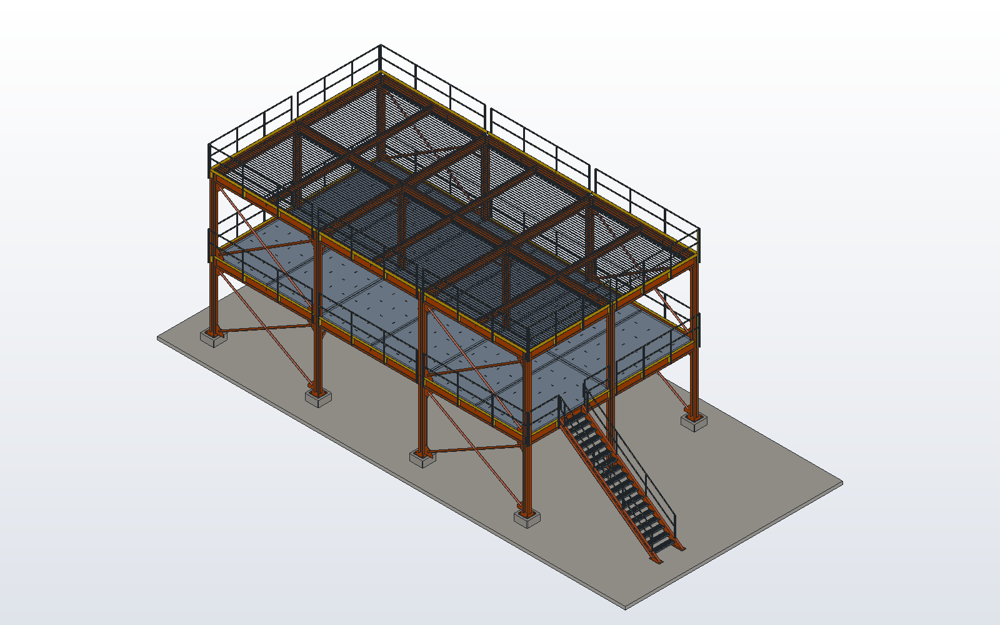

<details markdown="1">
<summary>The script, steel_structure.py</summary>

```python
# SPDX-License-Identifier: Apache-2.0
"""A two-level industrial steel platform, 3 x 2 bays.

An equipment platform in painted structural steel: UC 203x203x46 columns on
concrete plinths with base plates and four anchor bolts each, UB 356x171x51
main beams on bolted end plates, UB 254x146x31 secondary beams on fin plates,
CHS X-bracing with gusset plates in the end bays, angle knee braces, a
chequer-plate floor at level 1 and an open-grid galvanised grating at level 2,
a straight steel stair with grating treads, and side-mounted safety-yellow
handrails (top rail, knee rail, posts, toe boards) round every open edge.
Every section is a true I, channel or angle profile drawn with polygon_face
and swept along its member line, root radii included. Shows place() for
anchor bolts, floor panels and stair treads, mate() for the base plates,
part numbers by member mark (C1, B1, B2, ...) and section properties.

As it opens the platform is drawn light, so it builds in a few seconds: the
handrail tubes are six-sided (RAIL_SIDES = 0 draws them round), the end
plates and fin plates carry no bolts (BOLTS = True draws them), the chequer
pattern and the grating are sparse (LUG_PITCH = 240 and BAR_PITCH = 62 draw
them closer) and each member's faces are whole (MESH_SEG = 300 cuts them into
short facets). All five together build the full model, in about 25 s.

Tags: solid, assembly, mates, showcase
"""

# ---------------------------------------------------------------- grid and levels (mm)
BAY_X = 5000.0  # bay length along X
BAYS_X = 3
BAY_Y = 4000.0  # bay width along Y
BAYS_Y = 2
LEVEL_1 = 3500.0  # top of steel, level 1 (from the slab)
LEVEL_2 = 7000.0  # top of steel, level 2
PLINTH_H = 300.0  # concrete plinth above the slab

# ---------------------------------------------------------------- sections (h, b, tw, tf, r)
COLUMN = ("UC 203x203x46", 203.2, 203.6, 7.2, 11.0, 10.2)
BEAM = ("UB 356x171x51", 355.0, 171.5, 7.4, 11.5, 10.2)
SECONDARY = ("UB 254x146x31", 251.4, 146.1, 6.0, 8.6, 7.6)
BRACE_D, BRACE_T = 88.9, 5.0  # CHS 88.9x5.0
KNEE_LEG, KNEE_T = 70.0, 7.0  # L 70x70x7
KNEE_REACH = 700.0
STRINGER = ("PFC 230x90x32", 230.0, 90.0, 7.5, 14.0)

# ---------------------------------------------------------------- plates and bolts
BASE_PLATE, BASE_T = 450.0, 25.0
ANCHOR_D, ANCHOR_PITCH = 24.0, 330.0
END_PLATE_T = 15.0
BOLT_D = 20.0
FIN_T = 10.0
BOLTS = (
    False  # True draws the six M20 on every end plate and the three on every fin plate, 2 s slower
)

# ---------------------------------------------------------------- floors, stair, handrails
CHEQUER_T = 6.0
GRATING_T = 30.0
BAR_PITCH = 100.0  # grating bearing bars, centres: 62 draws half as many again, a second slower
LUG_PITCH = 600.0  # chequer plate pattern: 240 draws six times the lugs, a second slower
STAIR_W = 1000.0
STAIR_GOING = 250.0
MAX_RISE = 190.0
RAIL_H = 1100.0
KNEE_RAIL_H = 550.0
RAIL_D = 48.3
RAIL_OFFSET = 130.0  # handrail line outside the grid (side-mounted posts)
RAIL_SIDES = (
    6  # handrail tubes are drawn as prisms of this many sides; 0 draws them round, 12 s slower
)
POST_SPACING = 1700.0

PAINT = "#D35400"  # primary steel, painted orange
YELLOW = "#F2C200"
# galvanised items (anchors, floor panels, treads) go in with place() and keep the
# viewer's plain grey, which reads as hot-dip galvanising
CONCRETE = "#C4BFB5"
GRADE = "S355J2"

XS = [i * BAY_X for i in range(BAYS_X + 1)]
YS = [j * BAY_Y for j in range(BAYS_Y + 1)]
LEVELS = [LEVEL_1, LEVEL_2]
LX, LY = XS[-1], YS[-1]
COL_H, COL_B, COL_TW = COLUMN[1], COLUMN[2], COLUMN[3]
BM_H, BM_B, BM_TW = BEAM[1], BEAM[2], BEAM[3]
SC_H, SC_B, SC_TW = SECONDARY[1], SECONDARY[2], SECONDARY[3]
FLOOR_T = [CHEQUER_T, GRATING_T]
COL_Z0 = PLINTH_H + BASE_T
PANEL_X = BAY_X / 2  # floor panels span from a main beam to the mid-bay B3
MESH_SEG = (
    10000.0  # long members are built from facets this long (see line_path): 300 meshes them evenly
)


# ---------------------------------------------------------------- helpers
def vsub(a, b):
    return (a[0] - b[0], a[1] - b[1], a[2] - b[2])


def vlen(a):
    return math.sqrt(a[0] ** 2 + a[1] ** 2 + a[2] ** 2)


def unit(a):
    n = vlen(a)
    return (a[0] / n, a[1] / n, a[2] / n)


def cross(a, b):
    return (a[1] * b[2] - a[2] * b[1], a[2] * b[0] - a[0] * b[2], a[0] * b[1] - a[1] * b[0])


def arc(cx, cy, r, a0, a1, n=4):
    """Points strictly inside the arc from a0 to a1 degrees (the ends are the caller's)."""
    return [
        (
            cx + r * math.cos(math.radians(a0 + (a1 - a0) * k / n)),
            cy + r * math.sin(math.radians(a0 + (a1 - a0) * k / n)),
        )
        for k in range(1, n)
    ]


def i_profile(h, b, tw, tf, r):
    """A rolled I-section, centred, x across the flanges and y up the web, root radii faceted."""
    hb, hh, hw = b / 2, h / 2, tw / 2
    pts = [(-hb, -hh), (hb, -hh), (hb, -hh + tf), (hw + r, -hh + tf)]
    pts += arc(hw + r, -hh + tf + r, r, -90, -180)
    pts += [(hw, -hh + tf + r), (hw, hh - tf - r)]
    pts += arc(hw + r, hh - tf - r, r, 180, 90)
    pts += [
        (hw + r, hh - tf),
        (hb, hh - tf),
        (hb, hh),
        (-hb, hh),
        (-hb, hh - tf),
        (-hw - r, hh - tf),
    ]
    pts += arc(-hw - r, hh - tf - r, r, 90, 0)
    pts += [(-hw, hh - tf - r), (-hw, -hh + tf + r)]
    pts += arc(-hw - r, -hh + tf + r, r, 0, -90)
    pts += [(-hw - r, -hh + tf), (-hb, -hh + tf)]
    return pts


def angle_profile(leg, t):
    """An equal angle with its heel at the origin, legs along +x and +y."""
    return (
        [(0, 0), (leg, 0), (leg, t), (t + 6, t)]
        + arc(t + 6, t + 6, 6, -90, -180)
        + [(t, t + 6), (t, leg), (0, leg)]
    )


def line_path(start, end):
    """A straight path from start to end, drawn as short collinear lines.

    Sweeping along it instead of extruding splits each long side of a member into
    MESH_SEG-long faces, so the viewport meshes a 5 m beam as neat short facets.
    """
    d = unit(vsub(end, start))
    side = (0, 0, 1) if abs(d[2]) < 0.9 else (1, 0, 0)
    length = vlen(vsub(end, start))
    n = max(1, int(math.ceil(length / MESH_SEG)))
    sk = Sketch(Plane(start, unit(cross(d, side)), d)).move_to((0, 0))
    for k in range(1, n + 1):
        sk = sk.line_to((length * k / n, 0))
    return sk.path()


def member(profile, start, end, up):
    """A prismatic member: `profile` drawn square to the line start -> end, its y along `up`."""
    d = unit(vsub(end, start))
    face = polygon_face(profile, Plane(start, d, cross(up, d)))
    return sweep(face, line_path(start, end))


def rod(p0, p1, r):
    """A round bar from p0 to p1."""
    d = vsub(p1, p0)
    length = vlen(d)
    d = unit(d)
    c = make_cylinder(r, length)
    axis = cross((0, 0, 1), d)
    if vlen(axis) > 1e-9:
        c = rotate(c, (0, 0, 0), unit(axis), math.degrees(math.acos(max(-1.0, min(1.0, d[2])))))
    elif d[2] < 0:
        c = rotate(c, (0, 0, 0), (1, 0, 0), 180)
    return translate(c, p0)


def rail_bar(p0, p1, r):
    """A handrail tube from p0 to p1: round, or with RAIL_SIDES a prism of that many sides, whose
    flat faces the kernel fuses where rails cross posts far quicker than it does round ones."""
    if not RAIL_SIDES:
        return rod(p0, p1, r)
    d = vsub(p1, p0)
    length = vlen(d)
    d = unit(d)
    side = (0, 0, 1) if abs(d[2]) < 0.9 else (1, 0, 0)
    pts = [
        (r * math.cos(2 * math.pi * k / RAIL_SIDES), r * math.sin(2 * math.pi * k / RAIL_SIDES))
        for k in range(RAIL_SIDES)
    ]
    return extrude(polygon_face(pts, Plane(p0, d, unit(cross(side, d)))), length, d)


def tube(p0, p1, d, t):
    """A circular hollow section from p0 to p1."""
    axis = unit(vsub(p1, p0))
    side = (0, 0, 1) if abs(axis[2]) < 0.9 else (1, 0, 0)
    ring = (
        Sketch(Plane(p0, axis, unit(cross(side, axis))))
        .circle((0, 0), d / 2)
        .circle((0, 0), d / 2 - t)
    )
    return sweep(ring.face(), line_path(p0, p1))


def hexagon(af, plane, height, direction):
    r = af / math.sqrt(3)
    pts = [
        (r * math.cos(math.radians(30 + 60 * k)), r * math.sin(math.radians(30 + 60 * k)))
        for k in range(6)
    ]
    return extrude(polygon_face(pts, plane), height, direction)


def bolt_stub(d=BOLT_D, grip=0.0):
    """Nut, washer and thread end of a bolt standing on +X from x = 0 (one solid)."""
    washer = rod((-0.5, 0, 0), (3.5, 0, 0), d * 0.95)
    nut = hexagon(d * 1.5, Plane((3.0, 0, 0), (1, 0, 0), (0, 1, 0)), d * 0.8, (1, 0, 0))
    thread = rod((-0.5 - grip, 0, 0), (3 + d * 0.8 + 6, 0, 0), d / 2)
    return fuse_all([washer, nut, thread])


def comb(length, width, pitch, t, band, seg=2 * MESH_SEG):
    """Plan outline of a grating's bearing bars along x, banded at both ends.

    The bars are joined by end bands alternately at x = 0 and x = length, so the
    outline is one closed meander; extra points every `seg` along each bar keep
    the facets short.
    """
    n = int(round((width - t) / pitch)) + 1
    p = (width - t) / (n - 1)
    ys = [i * p for i in range(n)]
    pts = [(0, 0), (length, 0)]
    for i in range(n - 1):  # right side, going up
        if i % 2 == 0:  # slot open to the right, band at x = 0
            pts += [(length, ys[i] + t), (band, ys[i] + t), (band, ys[i + 1]), (length, ys[i + 1])]
    pts += [(length, width), (0, width)]
    for i in reversed(range(n - 1)):  # left side, going down
        if i % 2 == 1:  # slot open to the left, band at x = length
            pts += [
                (0, ys[i + 1]),
                (length - band, ys[i + 1]),
                (length - band, ys[i] + t),
                (0, ys[i] + t),
            ]
    out = []
    for k, a in enumerate(pts):
        b = pts[(k + 1) % len(pts)]
        m = max(1, int(math.ceil(math.hypot(b[0] - a[0], b[1] - a[1]) / seg)))
        out += [(a[0] + (b[0] - a[0]) * q / m, a[1] + (b[1] - a[1]) * q / m) for q in range(m)]
    return out


def put(name, shape, at, turn=0.0):
    """A painted plate or fitting built once at the origin, turned about Z and moved to `at`."""
    if turn:
        shape = rotate(shape, (0, 0, 0), (0, 0, 1), turn)
    return part(name, translate(shape, at), color=PAINT)


def ident(name, mark, section, extra=None):
    props = {"material": GRADE, "section": section}
    if extra:
        props.update(extra)
    identity(name, part_number=mark, properties=props)


def grid(i, j):
    return f"{'ABCDEFGH'[i]}{j + 1}"


# -------------------------------------------------------------- slab, plinths, base plates, anchors
part(
    "ground_slab",
    make_box(LX + 7400, LY + 2400, 150, (-1500, -1200, -150)),
    color="#D9D5CC",
    part_number="SLAB-150",
    properties={"material": "C32/40 concrete"},
)

plinth = make_box(650, 650, PLINTH_H, (-325, -325, 0))
plinth = chamfer(plinth, 20, [e for e in edges_parallel_to(plinth, (0, 0, 1))])
bp_pts = [
    (-BASE_PLATE / 2 + 20, -BASE_PLATE / 2),
    (BASE_PLATE / 2 - 20, -BASE_PLATE / 2),
    (BASE_PLATE / 2, -BASE_PLATE / 2 + 20),
    (BASE_PLATE / 2, BASE_PLATE / 2 - 20),
    (BASE_PLATE / 2 - 20, BASE_PLATE / 2),
    (-BASE_PLATE / 2 + 20, BASE_PLATE / 2),
    (-BASE_PLATE / 2, BASE_PLATE / 2 - 20),
    (-BASE_PLATE / 2, -BASE_PLATE / 2 + 20),
]
base_plate = extrude(polygon_face(bp_pts), BASE_T)
a = ANCHOR_PITCH / 2
anchor_xy = [(-a, -a), (-a, a), (a, -a), (a, a)]
base_plate = hole(
    base_plate,
    outermost_face(base_plate, (0, 0, 1)),
    None,
    ANCHOR_D / 2 + 1.5,
    world=[(x, y, BASE_T) for x, y in anchor_xy],
)
anchor = rotate(bolt_stub(ANCHOR_D, grip=BASE_T + 60), (0, 0, 0), (0, 1, 0), -90)  # standing up +Z

for i, x in enumerate(XS):
    for j, y in enumerate(YS):
        g = grid(i, j)
        part(
            f"plinth_{g}",
            translate(plinth, (x, y, 0)),
            color=CONCRETE,
            part_number="PL1",
            properties={"material": "C32/40 concrete", "size": "650 x 650 x 300"},
        )
        put(f"base_plate_{g}", base_plate, (x, y, PLINTH_H))
        ident(f"base_plate_{g}", "BP1", f"PL {BASE_PLATE:.0f}x{BASE_PLATE:.0f}x{BASE_T:.0f}")
        try:
            mate(f"base_plate_{g}", "<Z", f"plinth_{g}", ">Z", "coincident")
        except Exception:
            pass
        for k, (ax_, ay_) in enumerate(anchor_xy):
            name = f"anchor_{g}_{k + 1}"
            place(name, anchor, at=(x + ax_, y + ay_, PLINTH_H + BASE_T))
            identity(
                name,
                part_number="AB1",
                properties={
                    "material": "grade 8.8, galvanised",
                    "size": f"M{ANCHOR_D:.0f} cast-in anchor",
                },
            )

# ---------------------------------------------------------------- columns
col_profile = i_profile(*COLUMN[1:])
for i, x in enumerate(XS):
    for j, y in enumerate(YS):
        g = grid(i, j)
        col = member(col_profile, (x, y, COL_Z0), (x, y, LEVEL_2), (1, 0, 0))
        part(
            f"column_{g}",
            col,
            color=PAINT,
            part_number="C1",
            properties={
                "material": GRADE,
                "section": COLUMN[0],
                "length": f"{LEVEL_2 - COL_Z0:.0f} mm",
            },
        )


# --------------------------------------------------- end plates (built once, placed at every joint)
def end_plate(width, height, rows, gauge):
    plate = make_box(END_PLATE_T, width, height, (0, -width / 2, -height / 2))
    stub = translate(bolt_stub(), (END_PLATE_T, 0, 0))
    bolts = [translate(stub, (0, s * gauge / 2, z)) for z in rows for s in (-1, 1)]
    return fuse(plate, compound(bolts)) if BOLTS else plate


EP1 = end_plate(200.0, BM_H, (BM_H / 2 - 70, 0.0, -BM_H / 2 + 70), 100.0)
EP2 = end_plate(150.0, 250.0, (80.0, 0.0, -80.0), 90.0)

# fin plate: welded to the B1 web at y = 0, lapping the B3 web on its +X side, three bolts
FIN_REACH = BM_B / 2 + 10 - BM_TW / 2  # from the B1 web face to the end of B3
fin = make_box(FIN_T, FIN_REACH + 90, 180, (SC_TW / 2, 0, -210))
fin_bolts = []
for z in (-60.0, -120.0, -180.0):
    head = hexagon(
        BOLT_D * 1.5, Plane((-SC_TW / 2 - 13, 0, 0), (1, 0, 0), (0, 1, 0)), 13.5, (1, 0, 0)
    )
    b = fuse(head, translate(bolt_stub(grip=SC_TW + FIN_T + 2), (SC_TW / 2 + FIN_T, 0, 0)))
    fin_bolts.append(translate(b, (0, FIN_REACH + 45, z)))
FIN = fuse(fin, compound(fin_bolts)) if BOLTS else fin

# ---------------------------------------------------------------- beams
beam_profile = i_profile(*BEAM[1:])
sec_profile = i_profile(*SECONDARY[1:])
for lv, z in enumerate(LEVELS):
    L = f"L{lv + 1}"
    zc = z - BM_H / 2
    # B1: main beams along X, onto the column flanges
    for j, y in enumerate(YS):
        for i in range(BAYS_X):
            x0, x1 = XS[i] + COL_H / 2, XS[i + 1] - COL_H / 2
            name = f"B1_{L}_{grid(i, j)}-{grid(i + 1, j)}"
            beam = member(
                beam_profile, (x0 + END_PLATE_T, y, zc), (x1 - END_PLATE_T, y, zc), (0, 0, 1)
            )
            part(
                name,
                beam,
                color=PAINT,
                part_number="B1",
                properties={
                    "material": GRADE,
                    "section": BEAM[0],
                    "length": f"{x1 - x0 - 2 * END_PLATE_T:.0f} mm",
                },
            )
            put(f"{name}_EP_a", EP1, (x1, y, zc), 180)
            put(f"{name}_EP_b", EP1, (x0, y, zc))
            for s in ("a", "b"):
                ident(f"{name}_EP_{s}", "EP1", f"PL 200x{BM_H:.0f}x{END_PLATE_T:.0f}, 6 M20 8.8")
    # B2: main beams along Y, onto the column webs
    for i, x in enumerate(XS):
        for j in range(BAYS_Y):
            y0, y1 = YS[j] + COL_TW / 2, YS[j + 1] - COL_TW / 2
            name = f"B2_{L}_{grid(i, j)}-{grid(i, j + 1)}"
            beam = member(
                beam_profile, (x, y0 + END_PLATE_T, zc), (x, y1 - END_PLATE_T, zc), (0, 0, 1)
            )
            part(
                name,
                beam,
                color=PAINT,
                part_number="B2",
                properties={
                    "material": GRADE,
                    "section": BEAM[0],
                    "length": f"{y1 - y0 - 2 * END_PLATE_T:.0f} mm",
                },
            )
            put(f"{name}_EP_a", EP2, (x, y0, zc), 90)
            put(f"{name}_EP_b", EP2, (x, y1, zc), -90)
            for s in ("a", "b"):
                ident(f"{name}_EP_{s}", "EP2", f"PL 150x250x{END_PLATE_T:.0f}, 6 M20 8.8")
    # B3: secondary beams along Y at mid-bay, on fin plates off the B1 webs
    for i in range(BAYS_X):
        xc = XS[i] + BAY_X / 2
        for j in range(BAYS_Y):
            y0, y1 = YS[j] + BM_B / 2 + 10, YS[j + 1] - BM_B / 2 - 10
            name = f"B3_{L}_{grid(i, j)}"
            sec = member(sec_profile, (xc, y0, z - SC_H / 2), (xc, y1, z - SC_H / 2), (0, 0, 1))
            part(
                name,
                sec,
                color=PAINT,
                part_number="B3",
                properties={
                    "material": GRADE,
                    "section": SECONDARY[0],
                    "length": f"{y1 - y0:.0f} mm",
                },
            )
            put(f"{name}_FP_a", FIN, (xc, YS[j] + BM_TW / 2, z))
            put(f"{name}_FP_b", FIN, (xc, YS[j + 1] - BM_TW / 2, z), 180)
            for s in ("a", "b"):
                ident(f"{name}_FP_{s}", "FP1", f"PL 10x{FIN_REACH + 90:.0f}x180, 3 M20 8.8")


# --------------------------------------------------------------- vertical X-bracing in the end bays
def gusset(xf, zc, sx, sz, y):
    """A gusset in the plane y, its corner at (xf, zc), legs running sx along X and sz up Z."""
    pts = [
        (xf, zc),
        (xf + sx * 380, zc),
        (xf + sx * 380, zc + sz * 120),
        (xf + sx * 120, zc + sz * 380),
        (xf, zc + sz * 380),
    ]
    return extrude(polygon_face(pts, Plane((0, y - 6, 0), (0, -1, 0), (1, 0, 0))), 12, (0, 1, 0))


storeys = [(COL_Z0, LEVEL_1 - BM_H), (LEVEL_1, LEVEL_2 - BM_H)]
n_brace = 0
for j in (0, BAYS_Y):
    y = YS[j]
    for i in sorted({0, BAYS_X - 1}):
        xa, xb = XS[i] + COL_H / 2, XS[i + 1] - COL_H / 2
        for s, (zb, zt) in enumerate(storeys):
            corners = [(xa, zb, 1, 1), (xb, zt, -1, -1), (xa, zt, 1, -1), (xb, zb, -1, 1)]
            for k, (xf, zc, sx, sz) in enumerate(corners):
                gname = f"gusset_{grid(i, j)}-{grid(i + 1, j)}_S{s + 1}_{k + 1}"
                part(
                    gname,
                    gusset(xf, zc, sx, sz, y),
                    color=PAINT,
                    part_number="GP1",
                    properties={"material": GRADE, "section": "PL 12"},
                )
            for k in range(2):
                (x0, z0, sx0, sz0), (x1, z1, sx1, sz1) = corners[2 * k], corners[2 * k + 1]
                p0 = (x0 + sx0 * 170, y, z0 + sz0 * 170)
                p1 = (x1 + sx1 * 170, y, z1 + sz1 * 170)
                n_brace += 1
                part(
                    f"VB_{grid(i, j)}-{grid(i + 1, j)}_S{s + 1}_{k + 1}",
                    tube(p0, p1, BRACE_D, BRACE_T),
                    color=PAINT,
                    part_number="VB1",
                    properties={
                        "material": "S355J2H",
                        "section": f"CHS {BRACE_D}x{BRACE_T}",
                        "length": f"{vlen(vsub(p1, p0)):.0f} mm",
                    },
                )

# ---------------------------------------------------------------- knee braces on the inner frames
knee = angle_profile(KNEE_LEG, KNEE_T)
knee = [(px - KNEE_LEG / 2, py) for px, py in knee]
for lv, z in enumerate(LEVELS):
    for i in range(1, BAYS_X):
        x = XS[i]
        for j in range(BAYS_Y):
            for end, (yf, sy) in enumerate(((YS[j] + COL_TW / 2, 1), (YS[j + 1] - COL_TW / 2, -1))):
                p0 = (x, yf, z - BM_H - KNEE_REACH)
                p1 = (x, yf + sy * KNEE_REACH, z - BM_H)
                kb = member(knee, p0, p1, (1, 0, 0))
                part(
                    f"KB_L{lv + 1}_{grid(i, j)}_{end + 1}",
                    kb,
                    color=PAINT,
                    part_number="KB1",
                    properties={
                        "material": GRADE,
                        "section": f"L {KNEE_LEG:.0f}x{KNEE_LEG:.0f}x{KNEE_T:.0f}",
                    },
                )

# ---------------------------------------------------------------- level 1: chequer plate
lug = make_box(100, 20, 2.5, (-50, -10, CHEQUER_T - 0.5))


def chequer_panel(px, py, notch):
    plate = make_box(px, py, CHEQUER_T)
    plate = cut_all(
        plate,
        [
            make_box(notch + 1, notch + 1, CHEQUER_T + 2, (-1, -1, -1)),
            make_box(notch + 1, notch + 1, CHEQUER_T + 2, (-1, py - notch, -1)),
        ],
    )
    lugs = []
    pitch = LUG_PITCH
    for a_ in range(int(px // pitch)):
        for b_ in range(int(py // pitch)):
            cx, cy = pitch / 2 + a_ * pitch, pitch / 2 + b_ * pitch
            if cx < notch + 60 and (cy < notch + 60 or cy > py - notch - 60):
                continue
            one = translate(lug, (cx, cy, 0))
            if (a_ + b_) % 2:
                one = rotate(one, (cx, cy, 0), (0, 0, 1), 90)
            lugs.append(one)
    return fuse(plate, compound(lugs))


GAP = 5.0
NOTCH = COL_H / 2 + 12 - GAP
cp_left = chequer_panel(PANEL_X - 2 * GAP, BAY_Y - 2 * GAP, NOTCH)
cp_right = mirror(cp_left, ((PANEL_X - 2 * GAP) / 2, 0, 0), (1, 0, 0))
n_px = int(round(LX / PANEL_X))
for a_ in range(n_px):
    x0 = a_ * PANEL_X
    on_col = abs(x0 / BAY_X - round(x0 / BAY_X)) < 1e-6
    for j in range(BAYS_Y):
        name = f"chequer_L1_{a_ + 1}_{j + 1}"
        place(name, cp_left if on_col else cp_right, at=(x0 + GAP, YS[j] + GAP, LEVEL_1))
        identity(
            name,
            part_number="CP1",
            properties={
                "material": "S275 chequer plate, galvanised",
                "section": f"{CHEQUER_T:.0f} mm on {CHEQUER_T + 2:.0f} mm pattern",
            },
        )

# ---------------------------------------------------------------- level 2: open grating
gy = BAY_Y / 2 - 2 * GAP
gx = PANEL_X - 2 * GAP

# bearing bars 30 x 5, banded at both ends
grating = extrude(polygon_face(comb(gx, gy, BAR_PITCH, 5.0, 10.0)), GRATING_T)
for a_ in range(n_px):
    for b_ in range(2 * BAYS_Y):
        name = f"grating_L2_{a_ + 1}_{b_ + 1}"
        place(name, grating, at=(a_ * PANEL_X + GAP, b_ * BAY_Y / 2 + GAP, LEVEL_2))
        identity(
            name,
            part_number="GR1",
            properties={
                "material": "S275, hot-dip galvanised",
                "section": f"30 x 5 bearing bars at {BAR_PITCH:.0f} mm, banded",
            },
        )

# ---------------------------------------------------------------- stair to level 1
FL1 = LEVEL_1 + CHEQUER_T
N_RISE = int(math.ceil(FL1 / MAX_RISE))
RISE = FL1 / N_RISE
STAIR_Y = YS[0] + BAY_Y / 2
X_TOP = -BM_B / 2 - 5
slope = math.atan2(RISE, STAIR_GOING)
c_, s_ = math.cos(slope), math.sin(slope)
d_ = (c_, 0, s_)
up_ = (-s_, 0, c_)


def flip(shape):
    """The stair is drawn climbing +X to the grid line x = 0, then mirrored to the x = LX end."""
    return mirror(shape, (LX / 2, 0, 0), (1, 0, 0))


def nosing_z(x):
    return FL1 - (X_TOP - x) * RISE / STAIR_GOING


_, s_h, s_b, s_tw, s_tf = STRINGER
x_start = X_TOP - (N_RISE + 2) * STAIR_GOING
for side, sgn in (("left", -1), ("right", 1)):
    top = 70 * c_
    bot = top - s_h
    pts = [
        (0, top),
        (sgn * s_b, top),
        (sgn * s_b, top - s_tf),
        (sgn * s_tw, top - s_tf),
        (sgn * s_tw, bot + s_tf),
        (sgn * s_b, bot + s_tf),
        (sgn * s_b, bot),
        (0, bot),
    ]
    origin = (x_start, STAIR_Y + sgn * STAIR_W / 2, nosing_z(x_start))
    length = (X_TOP + 400 - x_start) / c_
    st_end = (origin[0] + length * c_, origin[1], origin[2] + length * s_)
    st = sweep(polygon_face(pts, Plane(origin, d_, (0, 1, 0))), line_path(origin, st_end))
    st = cut_all(
        st,
        [
            make_box(20000, 2000, 5000, (-15000, -1000 + STAIR_Y, -5000 + 15)),
            make_box(2000, 2000, 10000, (X_TOP - 5, -1000 + STAIR_Y, -2000)),
        ],
    )
    part(
        f"stringer_{side}",
        flip(st),
        color=PAINT,
        part_number="ST1",
        properties={"material": GRADE, "section": STRINGER[0]},
    )
    xa = X_TOP - (FL1 - 15 + top / c_) * STAIR_GOING / RISE  # top edge meets the foot plate
    xb = X_TOP - (FL1 - 15 + bot / c_) * STAIR_GOING / RISE  # bottom edge meets it
    yb = STAIR_Y + sgn * (STAIR_W / 2 + s_b / 2)
    part(
        f"stringer_foot_{side}",
        flip(make_box(xb - xa + 100, 200, 15, (xa - 50, yb - 100, 0))),
        color=PAINT,
        part_number="SP1",
        properties={"material": GRADE, "section": "PL 15"},
    )
    y_in = STAIR_Y + sgn * STAIR_W / 2
    cleat = make_box(10, s_b, 200, (X_TOP - 5, min(y_in, y_in + sgn * s_b), LEVEL_1 - 230))
    part(
        f"stringer_cleat_{side}",
        flip(cleat),
        color=PAINT,
        part_number="SC1",
        properties={"material": GRADE, "section": "PL 12"},
    )

# treads: grating with a chequer nosing and end cleats, built once, placed per step
TW = STAIR_W - 4
TD = STAIR_GOING - 10
t_bars = extrude(
    polygon_face(comb(TW, TD, 30.0, 5.0, 10.0), Plane((TD, -TW / 2, -30), (0, 0, 1), (0, 1, 0))), 30
)
tread = fuse_all(
    [
        t_bars,
        make_box(35, TW, 35, (0, -TW / 2, -32)),
        make_box(TD, 10, 30, (0, TW / 2 - 10, -30)),
        make_box(TD - 20, 8, 70, (10, -TW / 2, -70)),
        make_box(TD - 20, 8, 70, (10, TW / 2 - 8, -70)),
    ]
)
tread = mirror(tread, (0, 0, 0), (1, 0, 0))  # the stair climbs towards -X
for k in range(1, N_RISE):
    xk = X_TOP - (N_RISE - k) * STAIR_GOING + 5
    name = f"tread_{k:02d}"
    place(name, tread, at=(LX - xk, STAIR_Y, k * RISE))
    identity(
        name,
        part_number="TR1",
        properties={
            "material": "S275, hot-dip galvanised",
            "section": f"{STAIR_W:.0f} x {STAIR_GOING:.0f} grating tread",
        },
    )
# ---------------------------------------------------------------- handrails
RR = RAIL_D / 2  # posts, CHS 48.3
RAIL_R = 42.4 / 2  # rails, CHS 42.4


def posts_between(s0, s1):
    n = max(1, int(math.ceil((s1 - s0) / POST_SPACING)))
    return [s0 + (s1 - s0) * k / n for k in range(n + 1)]


def rail_frame(r0, r1, posts, corners, along, fixed, web, z, fz):
    """Top and knee rails from r0 to r1 along one side, side-mounted posts at `posts`."""

    def at(s, h):
        return (s, fixed, h) if along == "x" else (fixed, s, h)

    top_z, knee_z, foot_z = fz + RAIL_H - RR, fz + KNEE_RAIL_H, z - BM_H + 60
    e = RR * 0.4
    posts_, feet = [], []
    for s in posts:
        posts_.append(rail_bar(at(s, foot_z), at(s, top_z), RR))
        if s in corners:  # corner post: a block welded to the corner column's flange tips
            px, py = at(s, 0)[:2]
            gx = XS[0] if px < XS[0] else XS[-1]
            gy = YS[0] if py < YS[0] else YS[-1]
            ex = gx + math.copysign(COL_H / 2 - 3, px - gx)
            ey = gy + math.copysign(COL_B / 2 - 3, py - gy)
            feet.append(
                make_box(
                    abs(px - ex), abs(py - ey), z - 25 - foot_z, (min(px, ex), min(py, ey), foot_z)
                )
            )
            continue
        lo, hi = min(fixed, web) - 1, max(fixed, web) + 1  # bracket plate to the beam web
        if along == "x":
            feet.append(make_box(12, hi - lo, z - 25 - foot_z, (s - 6, lo, foot_z)))
        else:
            feet.append(make_box(hi - lo, 12, z - 25 - foot_z, (lo, s - 6, foot_z)))
    # one boolean per frame: the two rails and the brackets never touch one another, nor do
    # the posts, so all the posts go onto the rails and the brackets at once
    rails = [
        rail_bar(at(r0 - e, top_z), at(r1 + e, top_z), RAIL_R),
        rail_bar(at(r0 - e, knee_z), at(r1 + e, knee_z), RAIL_R),
    ]
    return fuse(compound(rails + feet), compound(posts_))


STAIR_GAP = STAIR_W / 2 + STRINGER[2] / 2 + 70
for lv, z in enumerate(LEVELS):
    fz = z + FLOOR_T[lv]
    L = f"L{lv + 1}"
    # (along, rail line, grid positions along it, outward sign, grid edge)
    sides = [
        ("x", -RAIL_OFFSET, XS, -1, YS[0]),
        ("x", LY + RAIL_OFFSET, XS, 1, YS[-1]),
        ("y", -RAIL_OFFSET, YS, -1, XS[0]),
        ("y", LX + RAIL_OFFSET, YS, 1, XS[-1]),
    ]
    for along, fixed, gpos, sgn, edge in sides:
        web = edge + sgn * BM_TW / 2
        tip = edge + sgn * BM_B / 2
        half_col = COL_H / 2 if along == "x" else COL_B / 2
        tag = f"{along}{'+' if sgn > 0 else '-'}"
        last = len(gpos) - 2
        for b in range(last + 1):
            first_end = gpos[0] - RAIL_OFFSET if b == 0 else gpos[b] + 10
            last_end = gpos[-1] + RAIL_OFFSET if b == last else gpos[b + 1] - 10
            # pieces: (rail from, rail to, first post, last post, toe from, toe to)
            p0 = (
                first_end
                if (b == 0 and along == "x")
                else (first_end + RR + 60 if b == 0 else first_end + 140)
            )
            p1 = (
                last_end
                if (b == last and along == "x")
                else (last_end - RR - 60 if b == last else last_end - 140)
            )
            r0 = first_end if b == 0 else p0
            r1 = last_end if b == last else p1
            t0, t1 = gpos[b] - BM_B / 2 - 6, gpos[b + 1] + BM_B / 2 + 6
            if b > 0:
                t0 = gpos[b] + 10
            if b < last:
                t1 = gpos[b + 1] - 10
            if lv == 0:
                t0, t1 = gpos[b] + half_col + 3, gpos[b + 1] - half_col - 3
            pieces_ = [(r0, r1, p0, p1, t0, t1)]
            if lv == 0 and along == "y" and sgn > 0 and b == 0:
                pieces_ = [
                    (r0, STAIR_Y - STAIR_GAP, p0, STAIR_Y - STAIR_GAP, t0, STAIR_Y - STAIR_GAP),
                    (STAIR_Y + STAIR_GAP, r1, STAIR_Y + STAIR_GAP, p1, STAIR_Y + STAIR_GAP, t1),
                ]
            for q, (a0, a1, q0, q1, u0, u1) in enumerate(pieces_):
                posts = posts_between(q0, q1)
                corners = [
                    s
                    for s in posts
                    if along == "x" and (s == gpos[0] - RAIL_OFFSET or s == gpos[-1] + RAIL_OFFSET)
                ]
                frame = rail_frame(a0, a1, posts, corners, along, fixed, web, z, fz)
                name = f"handrail_{L}_{tag}_{b + 1}{'ab'[q]}"
                part(
                    name,
                    frame,
                    color=YELLOW,
                    part_number="HR1",
                    properties={
                        "material": "S275, galvanised and painted",
                        "section": f"CHS {RAIL_D}x3.2",
                        "height": f"{RAIL_H:.0f} mm",
                    },
                )
                tb_y = tip if sgn > 0 else tip - 6
                if along == "x":
                    tb = make_box(u1 - u0, 6, fz + 100 - z, (u0, tb_y, z))
                else:
                    tb = make_box(6, u1 - u0, fz + 100 - z, (tb_y, u0, z))
                part(
                    f"toe_board_{L}_{tag}_{b + 1}{'ab'[q]}",
                    tb,
                    color=YELLOW,
                    part_number="TB1",
                    properties={"material": "S275, galvanised and painted", "section": "FL 100x6"},
                )

# stair handrails, one frame per side: posts on the stringer top flange, rails parallel to the pitch
for side, sgn in (("left", -1), ("right", 1)):
    y = STAIR_Y + sgn * (STAIR_W / 2 + s_b / 2)
    xb = X_TOP - (N_RISE - 1) * STAIR_GOING + 60
    xt = X_TOP - 2 * RR - 10
    post_x = posts_between(xb, X_TOP - STAIR_GOING)
    top0 = (xb, y, nosing_z(xb) + 1000)
    top1 = (xt, y, nosing_z(xt) + 1000)
    rails = [
        rail_bar(top0, top1, RAIL_R),
        rail_bar((xb, y, nosing_z(xb) + 500), (xt, y, nosing_z(xt) + 500), RAIL_R),
    ]
    posts = []
    for px in post_x:
        zt = nosing_z(px) + 70 + 0
        posts.append(rail_bar((px, y, zt - 30), (px, y, nosing_z(px) + 1000), RR))
    posts.append(rail_bar((xt, y, nosing_z(xt) + 1000 + RR), (xt, y, nosing_z(xt) + 500 - RR), RR))
    part(
        f"stair_handrail_{side}",
        flip(fuse(compound(rails), compound(posts))),
        color=YELLOW,
        part_number="HR2",
        properties={"material": "S275, galvanised and painted", "section": f"CHS {RAIL_D}x3.2"},
    )
```

</details>

The file: [steel_structure.py](examples/steel_structure.py).

## Sketched parts

### A mounting bracket with four holes: the worked example of docs/examples/bracket.md

An L in section, drawn on the YZ plane and extruded along X, with a row of holes through its base. Every name the kernel and the sketch API have is already in scope. Change a number and run it again.

Tags: sketch

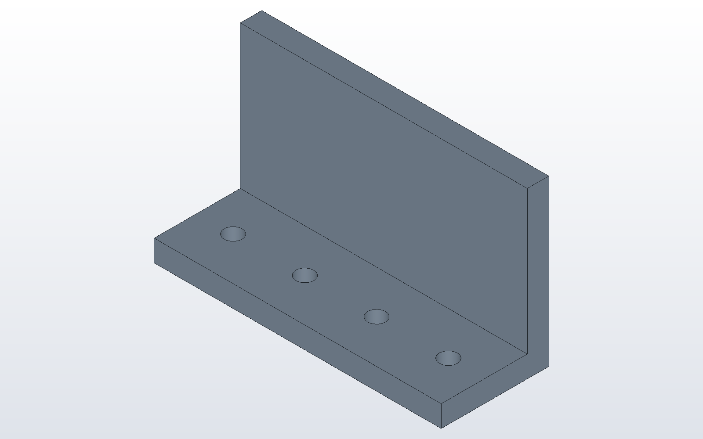

<details markdown="1">
<summary>The script, bracket.py</summary>

```python
# SPDX-License-Identifier: Apache-2.0
"""A mounting bracket with four holes: the worked example of docs/examples/bracket.md.

An L in section, drawn on the YZ plane and extruded along X, with a row of
holes through its base. Every name the kernel and the sketch API have is
already in scope. Change a number and run it again.

Tags: sketch
"""

LENGTH = 80.0
DEPTH = 30.0
HEIGHT = 46.0
THICKNESS = 6.0
HOLES = 4
HOLE_DIAMETER = 5.0
INSET = 10.0

section = (
    Sketch(Plane.YZ)
    .move_to((0, 0))
    .line_to((DEPTH, 0))
    .line_to((DEPTH, HEIGHT))
    .line_to((DEPTH - THICKNESS, HEIGHT))
    .line_to((DEPTH - THICKNESS, THICKNESS))
    .line_to((0, THICKNESS))
    .close()
)
body = section.extrude(LENGTH)

pitch = (LENGTH - 2 * INSET) / (HOLES - 1)
drill = make_cylinder(HOLE_DIAMETER / 2, THICKNESS, origin=(INSET, (DEPTH - THICKNESS) / 2, 0))
drills = linear_pattern(drill, (pitch, 0, 0), HOLES)

part("bracket", cut_all(body, drills), color="steel")
```

</details>

The file: [bracket.py](examples/bracket.py).

### A cable clip, drawn with arcs

A C-shaped ring standing on a foot, with a screw hole through the foot beside it. The whole section is one loop of lines and arcs on the XZ plane: arc_to names an arc by its radius, which is how a drawing gives one, its sign says which way the arc turns, and long=True asks for the way round that goes most of the way about the centre. The sketch is then extruded to the clip's width.

Tags: sketch

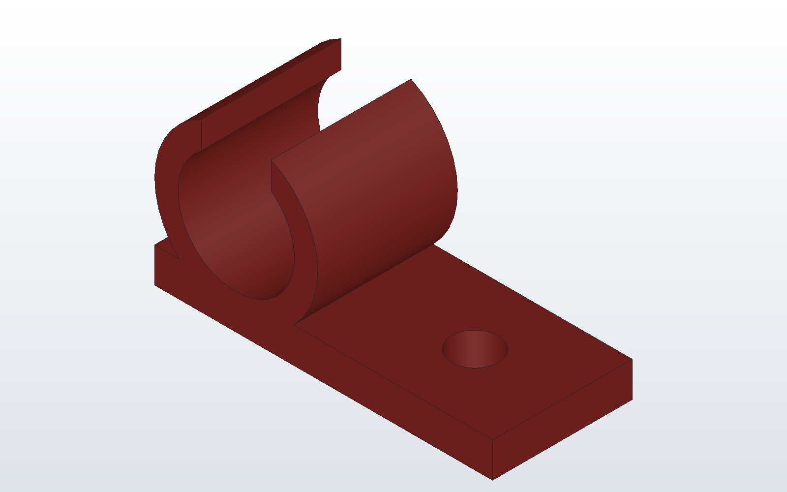

<details markdown="1">
<summary>The script, clip.py</summary>

```python
# SPDX-License-Identifier: Apache-2.0
"""A cable clip, drawn with arcs.

A C-shaped ring standing on a foot, with a screw hole through the foot beside
it. The whole section is one loop of lines and arcs on the XZ plane: arc_to
names an arc by its radius, which is how a drawing gives one, its sign says
which way the arc turns, and long=True asks for the way round that goes most
of the way about the centre. The sketch is then extruded to the clip's width.

Tags: sketch
"""

CABLE = 10.0
WALL = 2.0
BASE = 3.0
GAP = 6.0
FOOT = 22.0
WIDTH = 12.0
SCREW = 4.0

inner = CABLE / 2
outer = inner + WALL
# The cable rests on the foot, so the ring's centre is one radius above it.
height = BASE + inner
# Where the outside of the ring meets the top of the foot, and where the two
# sides of the gap, GAP apart, meet the outside and the inside of the ring.
meets_foot = (outer**2 - inner**2) ** 0.5
gap_outer = height + (outer**2 - (GAP / 2) ** 2) ** 0.5
gap_inner = height + (inner**2 - (GAP / 2) ** 2) ** 0.5

section = (
    Sketch(Plane.XZ)
    .move_to((-outer, 0))
    .line_to((FOOT, 0))
    .line_to((FOOT, BASE))
    .line_to((meets_foot, BASE))
    .arc_to((GAP / 2, gap_outer), outer)
    .line_to((GAP / 2, gap_inner))
    # Back round the inside the long way: past the bottom of the bore.
    .arc_to((-GAP / 2, gap_inner), inner, long=True)
    .line_to((-GAP / 2, gap_outer))
    .arc_to((-meets_foot, BASE), outer)
    .line_to((-outer, BASE))
    .close()
)
body = section.extrude(WIDTH)

# The XZ plane looks along -Y, so the clip lies between y = -WIDTH and y = 0.
drill = make_cylinder(SCREW / 2, BASE, origin=((outer + FOOT) / 2, -WIDTH / 2, 0))

part("clip", cut(body, drill), color="dx-red")
```

</details>

The file: [clip.py](examples/clip.py).

### A funnel, a thin wall turned about its axis

A cone on a spout, one wall thick throughout. The wall itself is the sketch: its outside going up and its inside coming back down, WALL apart measured across, closed and turned a whole turn about Z. Nothing is hollowed, so nothing can fail to hollow.

Tags: sketch

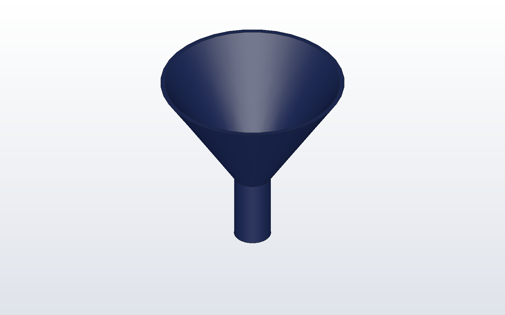

<details markdown="1">
<summary>The script, funnel.py</summary>

```python
# SPDX-License-Identifier: Apache-2.0
"""A funnel, a thin wall turned about its axis.

A cone on a spout, one wall thick throughout. The wall itself is the sketch:
its outside going up and its inside coming back down, WALL apart measured
across, closed and turned a whole turn about Z. Nothing is hollowed, so
nothing can fail to hollow.

Tags: sketch
"""

MOUTH = 80.0
SPOUT = 16.0
CONE_HEIGHT = 50.0
SPOUT_HEIGHT = 30.0
WALL = 2.0

top = SPOUT_HEIGHT + CONE_HEIGHT

wall = (
    Sketch(Plane.XZ)
    .move_to((SPOUT / 2, 0))
    .line_to((SPOUT / 2, SPOUT_HEIGHT))
    .line_to((MOUTH / 2, top))
    .line_to((MOUTH / 2 - WALL, top))
    .line_to((SPOUT / 2 - WALL, SPOUT_HEIGHT))
    .line_to((SPOUT / 2 - WALL, 0))
    .close()
)

part("funnel", wall.revolve((0, 0, 0), (0, 0, 1)), color="navy")
```

</details>

The file: [funnel.py](examples/funnel.py).

### A bent handle, a round bar swept along a path

Extrude carries a section in a straight line, revolve turns one about an axis and loft runs between two of them; a section carried along a path the model draws is a sweep. The path is an open wire, which is what Sketch.path() hands back: two straight legs and a quarter turn between them, tangent to both, so the bar bends rather than kinks. The section is a circle on the plane the path sets off through.

Tags: sketch

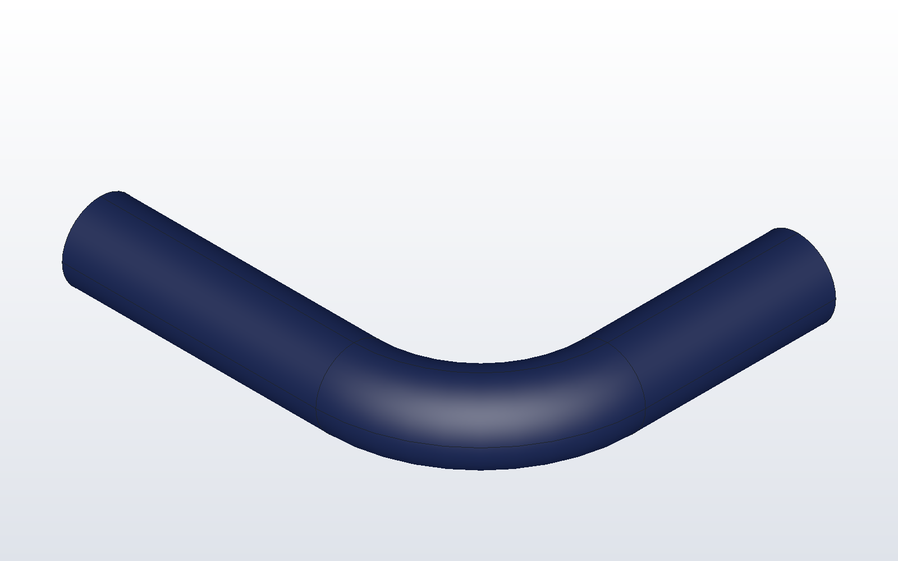

<details markdown="1">
<summary>The script, handle.py</summary>

```python
# SPDX-License-Identifier: Apache-2.0
"""A bent handle, a round bar swept along a path.

Extrude carries a section in a straight line, revolve turns one about an axis
and loft runs between two of them; a section carried along a path the model
draws is a sweep. The path is an open wire, which is what Sketch.path() hands
back: two straight legs and a quarter turn between them, tangent to both, so
the bar bends rather than kinks. The section is a circle on the plane the
path sets off through.

Tags: sketch
"""

SECTION = 12.0
RUN = 40.0
BEND = 20.0
RISE = 30.0

# The path lies in XY and leaves the origin along +X, turning left at the end
# of the run. A positive radius turns left, and this one is a quarter circle:
# the corner it turns is BEND across and BEND up.
path = (
    Sketch()
    .move_to((0, 0))
    .line_to((RUN, 0))
    .arc_to((RUN + BEND, BEND), BEND)
    .line_to((RUN + BEND, BEND + RISE))
)

# The section stands square to the path where it starts, so it is drawn on
# YZ, whose normal is +X, and centred on the path's first point.
section = Sketch(Plane.YZ).circle((0, 0), SECTION / 2)

part("handle", sweep(section.face(), path.path()), color="navy")
```

</details>

The file: [handle.py](examples/handle.py).

## Sheet metal

### A lipped channel, its width, depth and lips dimensioned to the outside

A drawing gives a channel's sizes over the outside of the sheet, and `length_from="outside"` takes a flange's length that way: the depth runs outside to outside over both bends, and the lip to the outside at its own bend. The base is drawn to where the bends start, the outside width less one outside setback (bend radius plus thickness, at 90 degrees) at each side. Its flat is 196.096 x 30.000 mm. Build it and unfold it with:

Tags: sheet

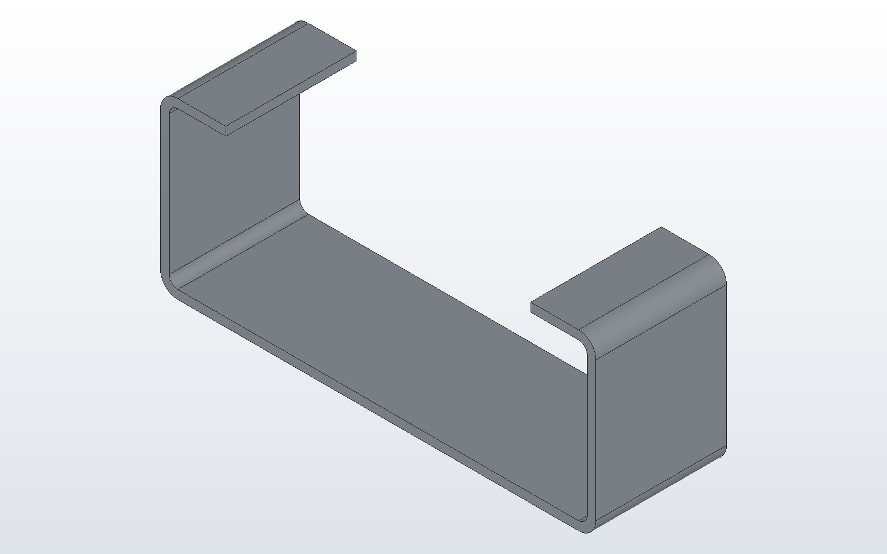


<details markdown="1">
<summary>The script, channel.py</summary>

```python
# SPDX-License-Identifier: Apache-2.0
"""A lipped channel, its width, depth and lips dimensioned to the outside.

A drawing gives a channel's sizes over the outside of the sheet, and
`length_from="outside"` takes a flange's length that way: the depth runs
outside to outside over both bends, and the lip to the outside at its own
bend. The base is drawn to where the bends start, the outside width less one
outside setback (bend radius plus thickness, at 90 degrees) at each side. Its
flat is 196.096 x 30.000 mm. Build it and unfold it with:

    dxcad run channel.py --output channel.dxcprt
    dxcad flat channel.dxcprt --part channel

Tags: sheet
"""

WIDTH = 100.0
DEPTH = 40.0
LIP = 15.0
LENGTH = 30.0
THICKNESS = 2.0
BEND_RADIUS = 2.0
K_FACTOR = 0.44

spec = SheetSpec(THICKNESS, BEND_RADIUS, K_FACTOR)
setback = BEND_RADIUS + THICKNESS
inside = WIDTH - 2 * setback
channel = base_flange([(0, 0), (inside, 0), (inside, LENGTH), (0, LENGTH)], spec)
for edge in (1, 3):
    channel = flange(channel, edge, DEPTH, return_length=LIP, length_from="outside")

part("channel", channel, color="galvanised")
```

</details>

The file: [channel.py](examples/channel.py).

### A door corner post bent from one 1.5 mm sheet, with flanges on its flanges' edges

Looking down on it: wall B along the bottom, wall A up the left, flange C turned in off wall A and lip D turned outward off flange C, flange E up the right with lip F turned in. 130 x 120 x 200 over the walls, every length to the outside. Each end has two end flanges with a return lip, one bent off wall B and one off wall A's own end, which is a flange on a flange's edge, as lip D is on flange C's free edge. The two end flanges are mitred from the walls' outer corner, the end lip meets lip D on a 45 degree joint as a picture frame does, and at lip F the corner is square: lip F runs its whole height and the end lip stops short of it. Every gap is the sheet's 1.5.

Tags: sheet


<details markdown="1">
<summary>The script, corner_post.py</summary>

```python
# SPDX-License-Identifier: Apache-2.0
"""A door corner post bent from one 1.5 mm sheet, with flanges on its flanges' edges.

Looking down on it: wall B along the bottom, wall A up the left, flange C
turned in off wall A and lip D turned outward off flange C, flange E up the
right with lip F turned in. 130 x 120 x 200 over the walls, every length to
the outside. Each end has two end flanges with a return lip, one bent off
wall B and one off wall A's own end, which is a flange on a flange's edge,
as lip D is on flange C's free edge. The two end flanges are mitred from the
walls' outer corner, the end lip meets lip D on a 45 degree joint as a
picture frame does, and at lip F the corner is square: lip F runs its whole
height and the end lip stops short of it. Every gap is the sheet's 1.5.

Wall B is the base flange, drawn a bend radius and a thickness smaller all
round, since a flange's outside face stands that far beyond the edge it is
bent on. Flange C is given a bend radius short for the same reason: lip D's
bend stands that far beyond flange C's edge, which puts lip D's outside face
C + T from wall A's, where the end flanges' lips are. The flat is one piece
with thirteen bend lines.

    dxcad run corner_post.py --output corner_post.dxcprt
    dxcad flat corner_post.dxcprt --part corner_post

Tags: sheet
"""

H = 200.0
A = 120.0
B = 130.0
C = 25.0
D = 10.0
E = 20.0
F = 10.0
END = 20.0
END_LIP = 10.0
THICKNESS = 1.5
BEND_RADIUS = 1.5
K_FACTOR = 0.44

spec = SheetSpec(THICKNESS, BEND_RADIUS, K_FACTOR)
out = BEND_RADIUS + THICKNESS
# On Plane.XZ the sketch's x is the model's X and its y the model's Z, and
# "down" bends towards +Y, into the post. Edge 0 is the bottom, 1 the right
# (flange E), 2 the top and 3 the left (wall A).
post = base_flange([(out, out), (B - out, out), (B - out, H - out), (out, H - out)], spec, Plane.XZ)
post = flange(post, 3, A, 90, "down", return_length=C - BEND_RADIUS, length_from="outside")
post = flange(post, 1, E, 90, "down", return_length=F, length_from="outside")
for edge in (0, 2):
    post = flange(
        post,
        edge,
        END,
        90,
        "down",
        return_length=END_LIP,
        length_from="outside",
        corner_treatment="square",
    )
# Lip D, on the free edge of wall A's return, turned away from the post's inside.
post = flange(post, (3, "free"), D, 90, "down", length_from="outside")
# Wall A's own ends, at the start and the end of edge 3, turned over the post.
for end in ("start", "end"):
    post = flange(
        post,
        (3, end),
        C + THICKNESS,
        90,
        "up",
        return_length=END_LIP,
        length_from="outside",
        corner_treatment="mitre",
    )
part("corner_post", post, color="galvanised")
```

</details>

The file: [corner_post.py](examples/corner_post.py).

### A 1000 x 800 cabinet door bent from 2 mm steel, its return lips mitred at the corners

1000 x 800 overall, as a drawing gives it: a 45 mm flange on every edge, each with a 25 mm return lip, both measured to the outside, bent with a 2 mm inside radius. Where two lips meet at a corner they are mitred, cut back at 45 degrees with a 2 mm gap between them, so no lip runs into the next. The base is the overall size less a bend radius and a thickness each side, 992 x 792. Each 45 mm flange with its return is a 37 mm leg and a 21 mm lip, once both bends' setbacks (2 + 2 = 4 each) are taken off, and each bend allows pi / 2 x (2 + 0.44 x 2) = 4.52389 mm, so every side of the flat reaches 2 x 4.52389 + 37 + 21 = 67.04779 mm past the base. Its flat is 1126.096 x 926.096 mm, with eight bend lines and the mitres cut in its corners.

Tags: sheet

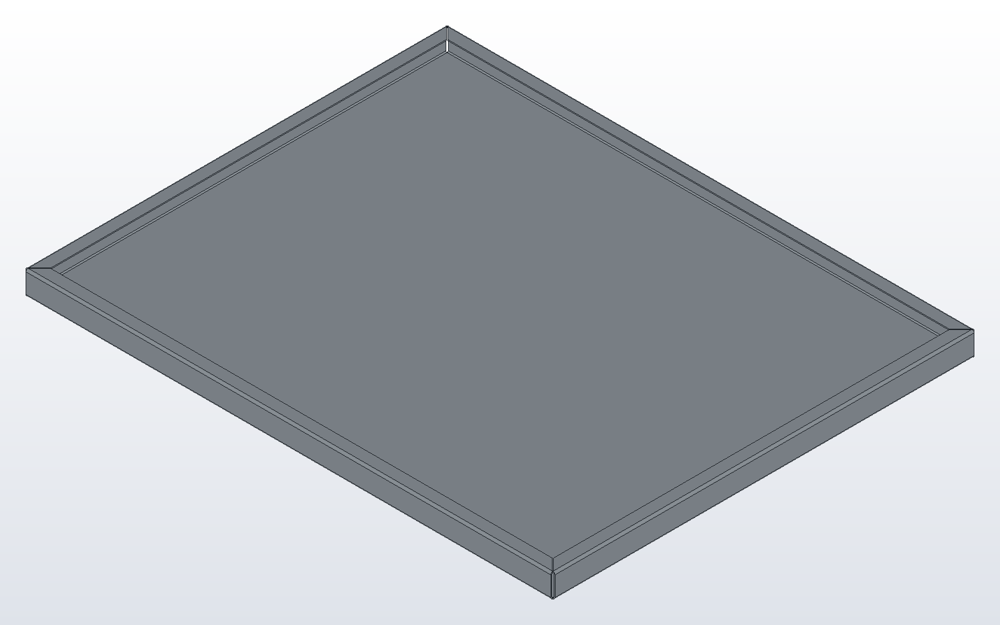


<details markdown="1">
<summary>The script, mitred_door.py</summary>

```python
# SPDX-License-Identifier: Apache-2.0
"""A 1000 x 800 cabinet door bent from 2 mm steel, its return lips mitred at the corners.

1000 x 800 overall, as a drawing gives it: a 45 mm flange on every edge,
each with a 25 mm return lip, both measured to the outside, bent with a
2 mm inside radius. Where two lips meet at a corner they are mitred, cut
back at 45 degrees with a 2 mm gap between them, so no lip runs into the
next. The base is the overall size less a bend radius and a thickness each
side, 992 x 792. Each 45 mm flange with its return is a 37 mm leg and a
21 mm lip, once both bends' setbacks (2 + 2 = 4 each) are taken off, and
each bend allows pi / 2 x (2 + 0.44 x 2) = 4.52389 mm, so every side of the
flat reaches 2 x 4.52389 + 37 + 21 = 67.04779 mm past the base. Its flat is
1126.096 x 926.096 mm, with eight bend lines and the mitres cut in its
corners.

    dxcad run mitred_door.py --output mitred_door.dxcprt
    dxcad flat mitred_door.dxcprt --part door

Tags: sheet
"""

WIDTH = 1000.0
HEIGHT = 800.0
FLANGE = 45.0
RETURN = 25.0
THICKNESS = 2.0
BEND_RADIUS = 2.0
K_FACTOR = 0.44

spec = SheetSpec(THICKNESS, BEND_RADIUS, K_FACTOR)
out = BEND_RADIUS + THICKNESS
base_x, base_y = WIDTH - 2 * out, HEIGHT - 2 * out
door = base_flange([(0, 0), (base_x, 0), (base_x, base_y), (0, base_y)], spec)
for edge in range(4):
    door = flange(
        door,
        edge,
        FLANGE,
        return_length=RETURN,
        length_from="outside",
        corner_treatment="mitre",
    )
part("door", door, color="galvanised")
```

</details>

The file: [mitred_door.py](examples/mitred_door.py).

### A sheet metal tray with two relieved flanges and two holes in its base

Each flange is inset from both ends of its edge, and `relief=True` cuts a slot into the base at each inset end so the bend does not tear the corner. The holes are cut through the base before it is bent. Its flat is 120.000 x 136.786 mm: the base's 80 plus, for each flange, its bend allowance and its leg. Build it and cut the flat for a laser with:

Tags: sheet

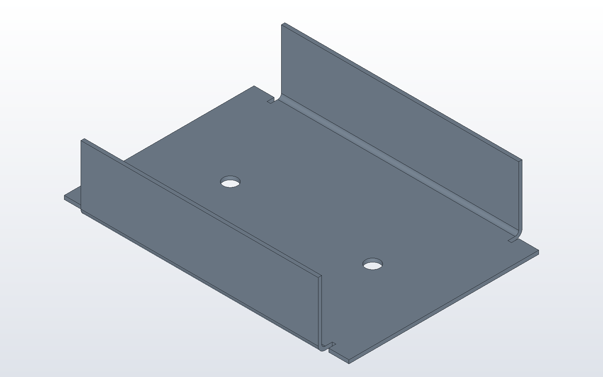


<details markdown="1">
<summary>The script, relieved_tray.py</summary>

```python
# SPDX-License-Identifier: Apache-2.0
"""A sheet metal tray with two relieved flanges and two holes in its base.

Each flange is inset from both ends of its edge, and `relief=True` cuts a
slot into the base at each inset end so the bend does not tear the corner.
The holes are cut through the base before it is bent. Its flat is 120.000 x
136.786 mm: the base's 80 plus, for each flange, its bend allowance and its
leg. Build it and cut the flat for a laser with:

    dxcad run relieved_tray.py --output relieved_tray.dxcprt
    dxcad flat relieved_tray.dxcprt --part tray

Tags: sheet
"""

LENGTH = 120.0
WIDTH = 80.0
HEIGHT = 25.0
THICKNESS = 1.5
BEND_RADIUS = 1.5
K_FACTOR = 0.44
INSET = 10.0
HOLE = 6.0

spec = SheetSpec(THICKNESS, BEND_RADIUS, K_FACTOR)
holes = [(30.0, WIDTH / 2, HOLE), (LENGTH - 30.0, WIDTH / 2, HOLE)]
tray = base_flange([(0, 0), (LENGTH, 0), (LENGTH, WIDTH), (0, WIDTH)], spec, holes=holes)
for edge in (0, 2):
    tray = flange(tray, edge, HEIGHT, start_inset=INSET, end_inset=INSET, relief=True)

part("tray", tray, color="steel")
```

</details>

The file: [relieved_tray.py](examples/relieved_tray.py).

### A cabinet door bent from 1.5 mm mild steel, with flanges and return lips

600 x 400 overall, as a drawing gives it: a 20 mm flange on every edge, each with a 10 mm return lip, both measured to the outside, relieved at their ends, the corners left open. The base is the overall size less a bend radius and a thickness each side, 594 x 394. Each 20 mm flange with its return is a 14 mm leg and a 7 mm lip, once both bends' setbacks (1.5 + 1.5 = 3) are taken off, and each bend allows pi / 2 x (1.5 + 0.44 x 1.5) = 3.39292 mm, so every side of the flat reaches 2 x 3.39292 + 14 + 7 = 27.78584 mm past the base. Its flat is 649.572 x 449.572 mm. The long edge at y = 0 carries two pairs of hinge holes; the handle is a cut-out in the face. It hangs on the solid door's hinge, door-hinge.dxcasm, used twice and placed by mates. Copy door-hinge.dxcasm beside this file; `dxcad examples sheet_door` does.

Tags: sheet, mates, assembly

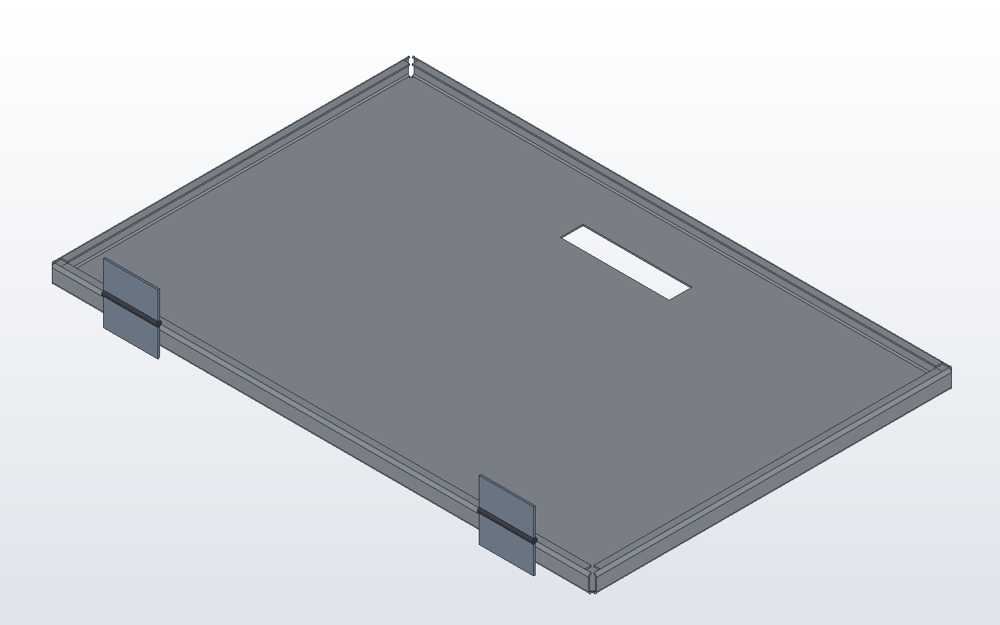


<details markdown="1">
<summary>The script, sheet_door.py</summary>

```python
# SPDX-License-Identifier: Apache-2.0
"""A cabinet door bent from 1.5 mm mild steel, with flanges and return lips.

600 x 400 overall, as a drawing gives it: a 20 mm flange on every edge, each
with a 10 mm return lip, both measured to the outside, relieved at their
ends, the corners left open. The base is the overall size less a bend radius
and a thickness each side, 594 x 394. Each 20 mm flange with its return is a
14 mm leg and a 7 mm lip, once both bends' setbacks (1.5 + 1.5 = 3) are
taken off, and each bend allows pi / 2 x (1.5 + 0.44 x 1.5) = 3.39292 mm,
so every side of the flat reaches 2 x 3.39292 + 14 + 7 = 27.78584 mm past
the base. Its flat is 649.572 x 449.572 mm. The long edge at y = 0 carries
two pairs of hinge holes; the handle is a cut-out in the face. It hangs on
the solid door's hinge, door-hinge.dxcasm, used twice and placed by mates.
Copy door-hinge.dxcasm beside this file; `dxcad examples sheet_door` does.

    dxcad run sheet_door.py --output sheet_door.dxcasm
    dxcad flat sheet_door.dxcasm --part panel

Tags: sheet, mates, assembly
"""

WIDTH = 600.0
HEIGHT = 400.0
FLANGE = 20.0
RETURN = 10.0
THICKNESS = 1.5
BEND_RADIUS = 1.5
K_FACTOR = 0.44
HOLE = 4.0
HINGES = (60.0, 474.0)
HANDLE = (120.0, 25.0)

spec = SheetSpec(THICKNESS, BEND_RADIUS, K_FACTOR)
out = BEND_RADIUS + THICKNESS
base_x, base_y = WIDTH - 2 * out, HEIGHT - 2 * out
handle = (base_x / 2, base_y - 60.0, *HANDLE)
panel = base_flange(
    [(0, 0), (base_x, 0), (base_x, base_y), (0, base_y)],
    spec,
    cutouts=[handle],
    corner_treatment="open",
)
# Each hinge's leaf covers a pair of holes 34 apart, half way up the leg.
leg = FLANGE - 2 * out
holes = [(at + offset, leg / 2, HOLE) for at in HINGES for offset in (13.0, 47.0)]
for edge in range(4):
    panel = flange(
        panel,
        edge,
        FLANGE,
        return_length=RETURN,
        length_from="outside",
        start_inset=THICKNESS,
        end_inset=THICKNESS,
        relief=True,
        holes=holes if edge == 0 else (),
    )
part("panel", panel, color="galvanised")

# The hinge turned to lie along the flange, its first leaf over a pair of
# holes, its pin and second leaf above; placed off the door, then mated flush
# against the leg's outside face.
hinge = use("door-hinge.dxcasm", as_group=True)
for name, at in zip(("hinge_left", "hinge_right"), HINGES, strict=True):
    # The leaf's top at the door's top, FLANGE, so the pin clears the return.
    place(name, hinge, at=(at, -40.0, FLANGE), rotate=(0, 90, 0))
    mate(name, ">Y", "panel", "<Y", "coincident")
```

</details>

The file: [sheet_door.py](examples/sheet_door.py).

### A sheet metal tray, a flange bent up on each edge of its base

The sheet is named once, in SheetSpec: its thickness, the inside radius every bend is made with, and the K-factor the flat pattern is worked out with. The corners are left open, so `dxcad flat` can unfold it for a laser.

Tags: sheet

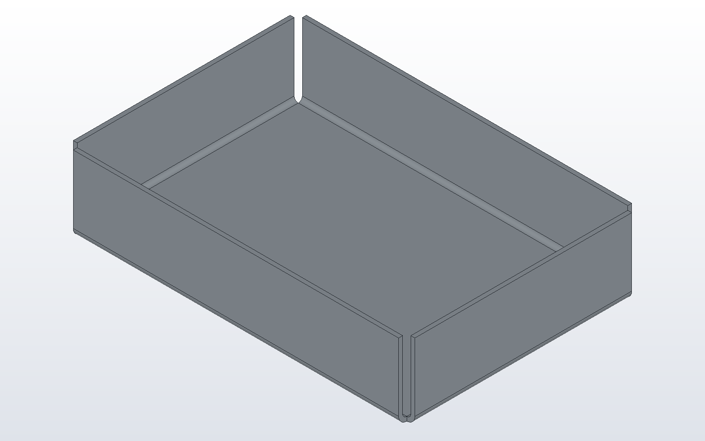


<details markdown="1">
<summary>The script, tray.py</summary>

```python
# SPDX-License-Identifier: Apache-2.0
"""A sheet metal tray, a flange bent up on each edge of its base.

The sheet is named once, in SheetSpec: its thickness, the inside radius every
bend is made with, and the K-factor the flat pattern is worked out with. The
corners are left open, so `dxcad flat` can unfold it for a laser.

Tags: sheet
"""

LENGTH = 120.0
WIDTH = 80.0
HEIGHT = 25.0
THICKNESS = 1.5
BEND_RADIUS = 1.5
K_FACTOR = 0.44

spec = SheetSpec(THICKNESS, BEND_RADIUS, K_FACTOR)
tray = base_flange([(0, 0), (LENGTH, 0), (LENGTH, WIDTH), (0, WIDTH)], spec)
for edge in range(4):
    tray = flange(tray, edge, HEIGHT)

part("tray", tray, color="galvanised")
```

</details>

The file: [tray.py](examples/tray.py).

## Placed by mates

### A bolt placed in a plate's hole by two mates, as docs/kernel.md shows it

The bolt is built anywhere; `mate` puts its shank's axis on the hole's and the underside of its head on the plate's top. 'cylinder 1' is the bolt's thinnest cylinder, its shank, and '<Z 2' the second plane out facing down, the head's underside. Make the plate thicker and the bolt rises with it.

Tags: mates, assembly


<details markdown="1">
<summary>The script, bolt_mate.py</summary>

```python
# SPDX-License-Identifier: Apache-2.0
"""A bolt placed in a plate's hole by two mates, as docs/kernel.md shows it.

The bolt is built anywhere; `mate` puts its shank's axis on the hole's and
the underside of its head on the plate's top. 'cylinder 1' is the bolt's
thinnest cylinder, its shank, and '<Z 2' the second plane out facing down,
the head's underside. Make the plate thicker and the bolt rises with it.

Tags: mates, assembly
"""

THICK = 5.0
RADIUS = 3.0

plate = cut(make_box(60, 40, THICK), translate(make_cylinder(RADIUS, THICK), (20, 20, 0)))
part("plate", plate, color="steel")

bolt = fuse(make_cylinder(RADIUS, 20), translate(make_cylinder(5, 4), (0, 0, 20)))
part("bolt", translate(bolt, (100, 50, 30)), color="hardware")
mate("bolt", "cylinder 1", "plate", "hole 1", "concentric")
mate("bolt", "<Z 2", "plate", ">Z", "coincident")
```

</details>

The file: [bolt_mate.py](examples/bolt_mate.py).

### A round enclosure whose lid is placed on its base by two mates

The lid is built where it is easy to build, off to one side, and the mates put it on: its axis in line with the base's, then the underside of its top flush with the base's rim, its lip inside the wall. Make the base taller and the lid follows it up. The one freedom left, the turn about the axis, is reported by `dxcad describe`.

Tags: mates, assembly

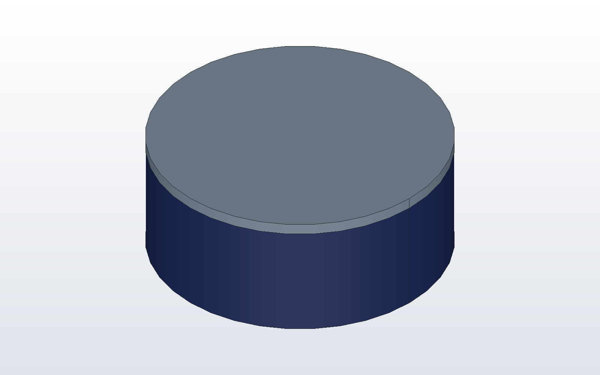

<details markdown="1">
<summary>The script, mated_enclosure.py</summary>

```python
# SPDX-License-Identifier: Apache-2.0
"""A round enclosure whose lid is placed on its base by two mates.

The lid is built where it is easy to build, off to one side, and the mates
put it on: its axis in line with the base's, then the underside of its top
flush with the base's rim, its lip inside the wall. Make the base taller and
the lid follows it up. The one freedom left, the turn about the axis, is
reported by `dxcad describe`.

Tags: mates, assembly
"""

RADIUS = 40.0
HEIGHT = 30.0
WALL = 2.0
LID = 3.0
LIP = 4.0
CLEARANCE = 0.2

base = cut(
    make_cylinder(RADIUS, HEIGHT),
    translate(make_cylinder(RADIUS - WALL, HEIGHT - WALL), (0, 0, WALL)),
)
part("base", base, color="navy")

lip = RADIUS - WALL - CLEARANCE
ring = cut(make_cylinder(lip, LIP), make_cylinder(lip - WALL, LIP))
lid = fuse(make_cylinder(RADIUS, LID), translate(ring, (0, 0, -LIP)))
part("lid", translate(lid, (2 * RADIUS + 20, 0, 0)), color="steel")
mate("lid", "cylinder 1", "base", "cylinder 1", "concentric")
mate("lid", "<Z 2", "base", ">Z", "coincident")
```

</details>

The file: [mated_enclosure.py](examples/mated_enclosure.py).

## Assemblies

### A door hung on one hinge sub-assembly used twice, from door-hinge.dxcasm

The hinge, two leaves and a pin, is a project of its own. `use` with `as_group=True` takes it as one sub-assembly, which `place` puts in twice, each copy's parts named `hinge_top/leaf_1` and so on. `dxcad bom door.py` lists the hinge twice, with each of its leaves and its pin twice under it. Copy door-hinge.dxcasm beside this file; `dxcad examples door` does.

Tags: assembly

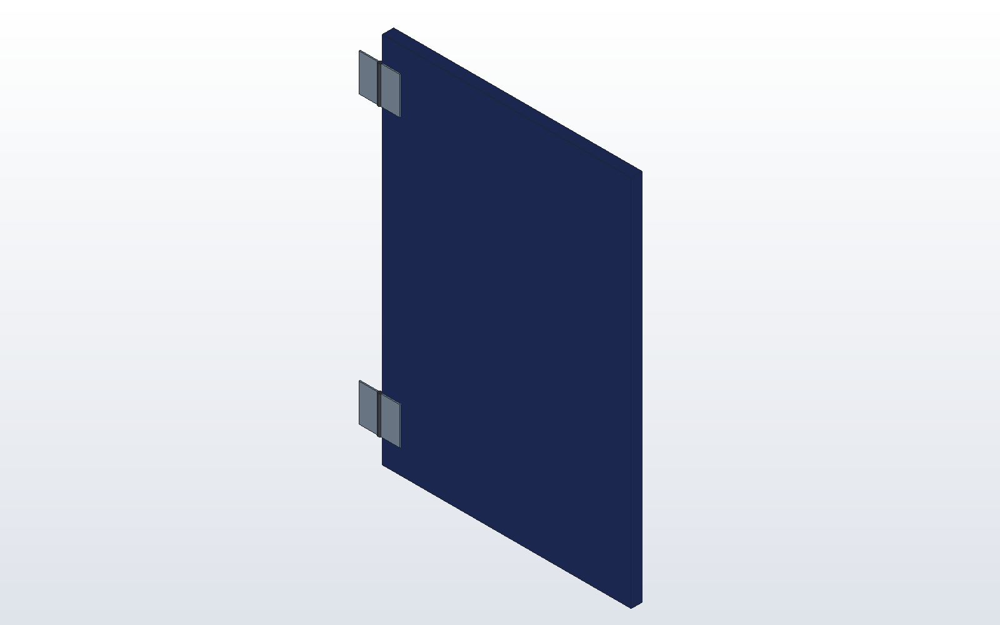

<details markdown="1">
<summary>The script, door.py</summary>

```python
# SPDX-License-Identifier: Apache-2.0
"""A door hung on one hinge sub-assembly used twice, from door-hinge.dxcasm.

The hinge, two leaves and a pin, is a project of its own. `use` with
`as_group=True` takes it as one sub-assembly, which `place` puts in twice,
each copy's parts named `hinge_top/leaf_1` and so on. `dxcad bom door.py`
lists the hinge twice, with each of its leaves and its pin twice under it.
Copy door-hinge.dxcasm beside this file; `dxcad examples door` does.

Tags: assembly
"""

WIDTH = 400.0
HEIGHT = 600.0
THICKNESS = 18.0

part("door", make_box(WIDTH, THICKNESS, HEIGHT), color="navy")

# On the door's front face, at y = 0: the hinge's leaves are 2 thick.
hinge = use("door-hinge.dxcasm", as_group=True)
place("hinge_top", hinge, at=(0, -2, HEIGHT - 100))
place("hinge_bottom", hinge, at=(0, -2, 40))
```

</details>

The file: [door.py](examples/door.py).

## Drawings

### An angle bracket with its drawing, drawn_bracket.dxcdrg, on an ISO A3 sheet

The drawing holds no geometry: it names the model, the sheet, the title block's fields and where each view has been moved, and is drawn again from the model whenever it is opened. Build the model beside it and export the drawing with:

Tags: drawing

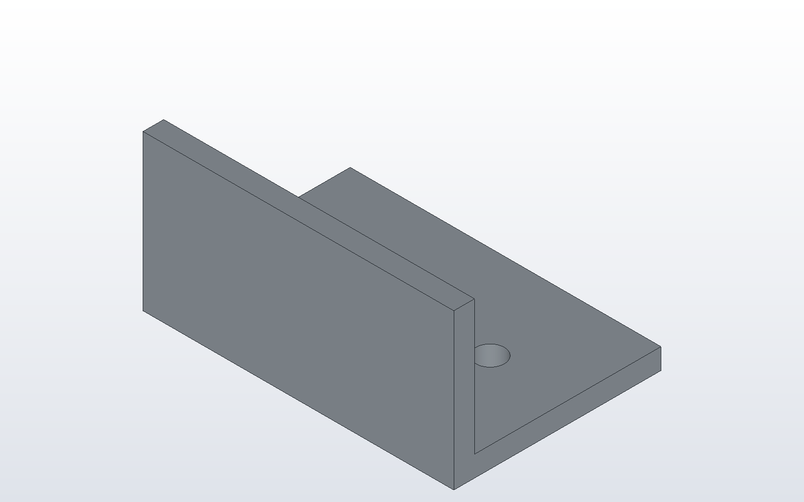

<details markdown="1">
<summary>The script, drawn_bracket.py</summary>

```python
# SPDX-License-Identifier: Apache-2.0
"""An angle bracket with its drawing, drawn_bracket.dxcdrg, on an ISO A3 sheet.

The drawing holds no geometry: it names the model, the sheet, the title
block's fields and where each view has been moved, and is drawn again from
the model whenever it is opened. Build the model beside it and export the
drawing with:

    dxcad run drawn_bracket.py --output drawn_bracket.dxcprt
    dxcad drawing drawn_bracket.dxcdrg drawn_bracket.pdf

Tags: drawing
"""

LENGTH = 60.0
WIDTH = 40.0
HEIGHT = 30.0
THICKNESS = 4.0
HOLE = 5.5

bracket = fuse(make_box(LENGTH, WIDTH, THICKNESS), make_box(LENGTH, THICKNESS, HEIGHT))
for x in (LENGTH / 4, 3 * LENGTH / 4):
    hole = translate(make_cylinder(HOLE / 2, THICKNESS), (x, (WIDTH + THICKNESS) / 2, 0))
    bracket = cut(bracket, hole)

part("bracket", bracket, color="galvanised")
```

</details>

The file: [drawn_bracket.py](examples/drawn_bracket.py).
