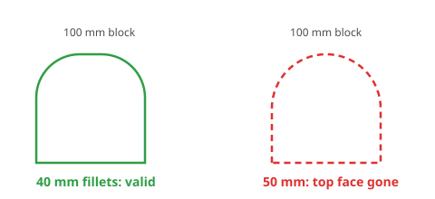
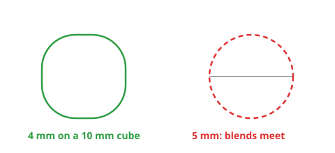
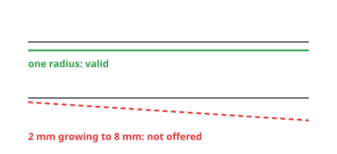
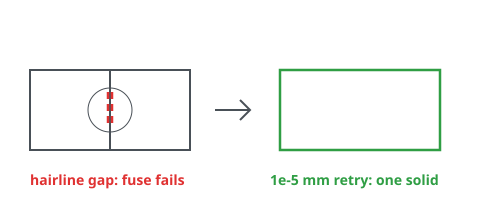
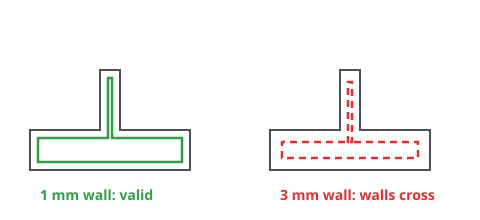
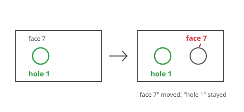
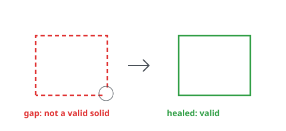
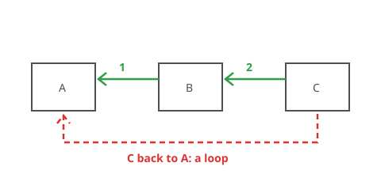
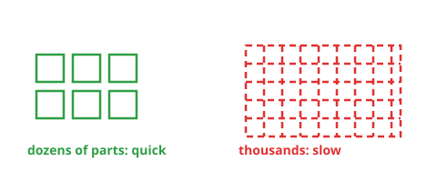
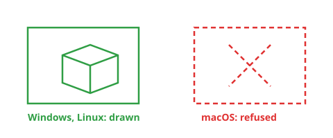

# Known limitations

DX-CAD&trade; builds every solid with OpenCASCADE (OCCT), the geometry kernel
underneath it; its release notes are at
[github.com/Open-Cascade-SAS/OCCT/releases](https://github.com/Open-Cascade-SAS/OCCT/releases).
This page says plainly what DX-CAD cannot do, or does unreliably, why, and
what to do instead. It describes the version you have and promises nothing
about later ones. At the end, every case of DX-CAD's robustness suite is
listed with what it comes to today, regenerated from the suite itself.

In the diagrams, green is what works and red dashed is what is refused or
goes wrong.

## Fillets that would consume a face

Cause: a fillet as big as half the face it runs along leaves nothing of
that face between its blends, and OCCT cannot build the solid that would
need. DX-CAD refuses it and names the radius.

Workaround: make the fillet smaller than half the shortest edge it meets,
or remove the face first and model the round as a revolve or a sketch arc.

## Fillets meeting at a vertex

Cause: where three or more filleted edges meet at a corner, OCCT has to
build a corner patch between the blends. When the blends meet in a point,
or nearly so, there is no patch to build, and the fillet fails.

Workaround: give a radius under half the shortest edge that meets the
corner, or fillet fewer edges in one call; or chamfer the corner instead.

## Variable-radius fillets

Cause: DX-CAD's fillets take one radius per call, from the model language,
the window and the agent door alike; a blend whose radius changes along its
edge is not offered.

Workaround: split the edge where the radius should change and fillet each
part at its own radius, or model the shape as a loft between sketched
sections.

## Booleans on coincident or tangent faces

Cause: when two parts share a face, or touch along a line or at a point,
floating-point noise can leave a hairline gap or overlap that OCCT reads as
two solids. DX-CAD retries a failed boolean once with a fuzzy tolerance of
0.00001 mm (`BOOLEAN_FUZZY_VALUE`), which closes such gaps; when that fails
too, or the parts only touch along a line or at a point, the boolean is
refused rather than leaving two solids or an invalid one.

Workaround: make the parts overlap by some volume, at least a few hundredths
of a millimetre, rather than only touching.

## Shelling and offsets on complex faces

Cause: hollowing a part offsets every face inwards by the wall's thickness.
Where a feature is thinner than two walls, or a face is a free-form surface
whose offset folds over itself, the offset faces cross and OCCT cannot close
the shell.

Workaround: give a wall thinner than half the thinnest feature, or hollow
the plain body first and add the thin features after.

## Persistent naming

Cause: OCCT numbers a solid's faces and edges afresh each time it is built,
so "face 7" can be a different face after an earlier feature changes. This
is the persistent naming problem every CAD kernel has.

Workaround: DX-CAD does not keep kernel numbers between runs. A model is a
script, so each feature is built from the values in it, not from picked
faces; mates and references name faces by what they are and where they lie
("hole 1", ">Z", a face picked by position), found again on every run; and
each part keeps a stable id of its own in the file, whatever it is renamed.
Name faces in a model by position, not by number.

## STEP and IGES files that need healing

Cause: a STEP file from another program can carry faces whose edges do not
quite meet, or solids that are not closed. DX-CAD reads STEP as it is and
does not heal it, so such a solid is reported as not valid by OCCT's check,
and booleans on it may fail. IGES files are not read at all.

Workaround: heal or sew the model in the program that wrote it and export
it again as closed solids, in STEP (AP214 or AP242).

## No simultaneous assembly solver

Cause: DX-CAD resolves an assembly's mates one at a time, in the order the
model writes them, each placing its part against parts already placed. A
mate that would need several parts moved at once, such as one closing a
loop, or one that disagrees with the mates before it, is refused rather
than solved.

Workaround: write the mates in the order the parts are placed, each part
mated to parts before it, and change the order by editing the script.

## Large assemblies

Cause: every part is its own full shape in the view and in the file, with
no lightweight stand-ins, so an assembly of thousands of parts is slow to
open, to turn and to save.

Workaround: keep sub-assemblies in files of their own and bring them in
with `use()`, working on one at a time.

## Pictures without a window on macOS

Cause: a picture drawn with no window open (`dxcad render`, the agent's
`render_view`, the gallery, and the preview a saved part carries for
Explorer) needs a hidden native window for OCCT to draw into. On macOS that
is a Cocoa window, made on the application's main thread, which DX-CAD does
not make without its own window. Such a request is refused there, saying so,
and a part saved on macOS has no preview picture.

Workaround: open the part in DX-CAD's window to see it, or draw its picture
on Windows or on Linux. With the window open, the Assistant's `render_view`
and the window link's draw from the window's own view on every platform
(item 771), so the Assistant looks at the model on a Mac as it does
elsewhere; only a picture asked for with no window open is refused there.

## The robustness suite

The hard cases DX-CAD is tested against each time, each run as a model.py:
booleans of coplanar and tangent faces, blends bigger than their edges
allow, shells against what they meet, overlapping patterns, sheet bends of
radius 0, tiny text and mates that cannot be met. Each ends in a valid solid
or is refused with its reason and what would work instead, never a crash.
This list is rewritten by `python -m dxcad.docsgen limitations`, and the
test suite fails when it and the cases disagree.

<!-- generated by python -m dxcad.docsgen limitations -->

Run on OCCT 7.9.3, each case a model.py as `dxcad run` runs one.

| Case | Outcome | Why, and what would work |
| --- | --- | --- |
| fuse of coplanar faces | valid | |
| cut flush with a face | valid | |
| common of faces that only touch | refused | common produced 0 solids, expected exactly 1. What would work: move the parts so they overlap by some volume, not only touch, then common again |
| fuse along a tangent line | refused | fuse produced 2 solids, expected exactly 1. What would work: move the parts to overlap by some volume, not touch at a line or a point, so the fuse is one solid; or keep them as separate parts |
| cut along a tangent line | valid | |
| fuse of spheres touching at a point | refused | fuse produced 2 solids, expected exactly 1. What would work: move the parts to overlap by some volume, not touch at a line or a point, so the fuse is one solid; or keep them as separate parts |
| cut taking everything | refused | cut produced 0 solids, expected exactly 1. What would work: cut with a smaller tool, or move it: this cut takes all of the solid away |
| fuse of a box and a copy of itself | valid | |
| fillet over half the edge | refused | fillet at radius 6.0 on 12 edges produced a shape that is not a valid solid. What would work: make the fillet smaller than 6.0: under half the shortest edge it is on and less than the faces beside it, or fillet fewer edges |
| fillet far bigger than the part | refused | fillet at radius 50.0 on 12 edges could not be built. What would work: make the fillet smaller than 50.0: under half the shortest edge it is on and less than the faces beside it, or fillet fewer edges |
| fillet exactly half the edge | refused | fillet at radius 5.0 on 12 edges could not be built. What would work: make the fillet smaller than 5.0: under half the shortest edge it is on and less than the faces beside it, or fillet fewer edges |
| chamfer over half the edge | refused | chamfer at distance 6.0 on 12 edges could not be built. What would work: make the chamfer smaller than 6.0: under half the shortest edge it is on and less than the faces beside it, or chamfer fewer edges |
| shell over half the part | refused | hollow thickness 6.0 must be under half the solid's smallest extent, which is 10.0. What would work: give a wall thinner than half of 10.0 |
| shell thicker than a boss | refused | hollow at thickness 3.0 with 1 faces open could not be built. What would work: make the hollow's wall thinner than 3.0, thinner than the smallest boss, rib or hole it meets, or leave other faces open |
| shell through a hole's wall | refused | hollow at thickness 2.0 with 1 faces open could not be built. What would work: make the hollow's wall thinner than 2.0, thinner than the smallest boss, rib or hole it meets, or leave other faces open |
| linear copies overlapping, fused | valid | |
| linear copies overlapping, apart | valid | |
| circular copies all meeting at the axis | valid | |
| a flange of bend radius 0 | valid | |
| four flanges of bend radius 0 | valid | |
| a hem of bend radius 0 | refused | a hem, a flange at 180 degrees, needs a bend radius above 0. What would work: give the hem a bend radius above 0, or bend it less than 180 degrees |
| text a twentieth of a millimetre high | valid | |
| text a thousandth of a millimetre high | valid | |
| text of no height | refused | text is drawn above 0 high and above 0 deep, not 0.0 and 1.0. What would work: give the text a size and a depth above 0 |
| a mate to a hole the part has not got | refused | 'hole 1': the part has 0 holes. What would work: name a hole the part has: 'hole 1' asks past its 0 holes, counted as dxcad describe lists them |
| a mate against the one before it | refused | mate('b', '<Z', 'p', '<Z', 'coincident') disagrees with the mates before it: it misses by 180 degrees. What would work: drop or change this mate, or one before it: the mates before it already hold the part, and this one misses by 180 degrees |
| an angle the mates before it rule out | refused | mate('b', '>X', 'p', '>Z', 'angle', 45) disagrees with the mates before it: it misses by 45 degrees. What would work: drop or change this mate, or one before it: the mates before it already hold the part, and this one misses by 45 degrees |
| a mate to a part placed after | refused | mate('b', '<Z', 'p', '>Z', 'coincident'): 'p' is placed after 'b'; a part is mated to parts placed before it. What would work: register 'p' before the part mated to it, and mate to parts placed earlier |
| a plane past the last one | refused | '<Z 3': 1 plane faces -Z, at z = 0. What would work: name a plane the part has facing -Z,: '<Z 3' is past the last one, as dxcad describe lists them |

<!-- end of generated limitations -->
