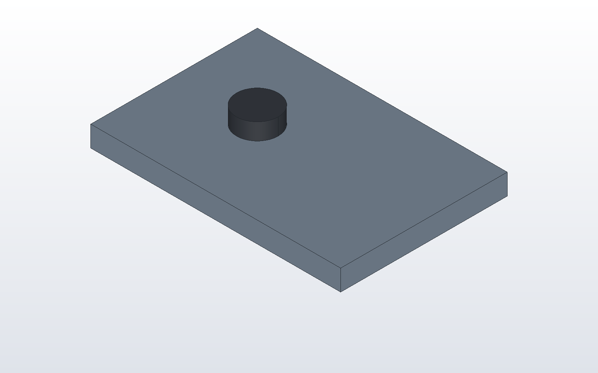
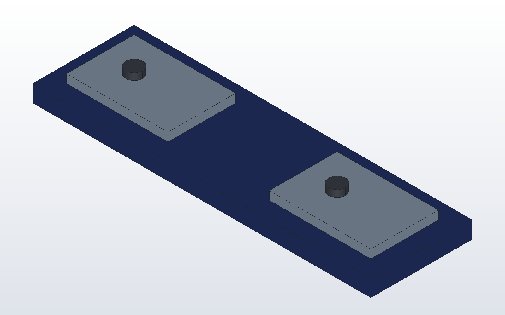

# Assemblies with mates

An assembly in DX-CAD is a model.py that places several parts. A part can
be placed by numbers, or by mates, which place it by its faces and axes,
so it follows whatever it is mated to. This tutorial bolts a plate, then
uses that bolted pair twice in a bigger assembly.

## A bolt in a plate

```python
# bolt_plate.py
THICK = 5.0
RADIUS = 3.0

plate = cut(make_box(60, 40, THICK), make_cylinder(RADIUS, THICK, (20, 20, 0)))
part("plate", plate, color="steel")

bolt = fuse(make_cylinder(RADIUS, 20), make_cylinder(5, 4, (0, 0, 20)))
part("bolt", translate(bolt, (100, 50, 30)), color="hardware")
mate("bolt", "cylinder 1", "plate", "hole 1", "concentric")
mate("bolt", "<Z 2", "plate", ">Z", "coincident")
```

The bolt is built anywhere, here 100 mm off to the side. The two mates
move it into place:

- `concentric` puts the bolt's `cylinder 1`, its thinnest cylinder (the
  shank), on the axis of the plate's `hole 1`.
- `coincident` lays the bolt's `<Z 2`, the second plane out facing down
  (the underside of the head), flush on the plate's `>Z`, its top face.

The rules for these names are on [the model language page](../kernel.md):
planes are counted, holes are counted by position, and every name is read
in the part's own frame. Make `THICK` 8 and the bolt rises with the plate's
top. A mate that cannot be met is refused, with the distance it misses by.



## A sub-assembly, used twice

```
dxcad run bolt_plate.py --output bolt_plate.dxcasm
```

That writes bolt_plate.dxcasm, an assembly of the two. A second model takes its parts with `use()`.
With `as_group=True` they come as one sub-assembly, which `place` puts down
whole:

```python
# frame.py
pair = use("bolt_plate.dxcasm", as_group=True)

rail = make_box(200, 60, 10)
for x in (30, 150):
    rail = cut(rail, make_cylinder(3, 10, (x, 30, 0)))
part("rail", rail, color="navy")
place("left", pair, at=(10, 10, 10))
place("right", pair, at=(130, 10, 10))
```

Each placed part is named `left/plate`, `left/bolt` and so on. When
bolt_plate.py changes and is run again, frame.py picks up the change the
next time it runs.



```
dxcad run frame.py --output frame.dxcasm
dxcad bom frame.dxcasm
```

`bom` lists the rail once and each part of the pair with a count of two.
Next: [drawing a part](drawing.md).
