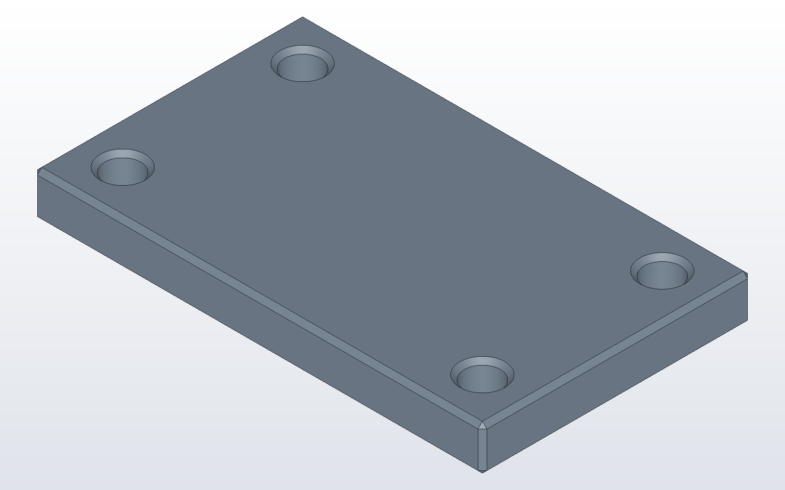

# DX-CAD with Claude Desktop

DX-CAD&trade; has a door for agents: `dxcad serve`, an MCP server. Claude Desktop
can drive it to make, change, measure and export parts. With the live
window link, Claude works on the window you have open, so each part it
makes appears in the view as it is made, and each step is one undo in the
window. The full reference is [DX-CAD for agents](../agents.md).

## Connect Claude Desktop

Open DX-CAD with `dxcad gui`. On the start page, choose
Connect Claude Desktop. It reads Claude Desktop's configuration and adds a
DX-CAD server that drives the open window. If one is there already it says
so, and if one points at another install it offers to replace it, keeping
the old file as a backup. The same from a terminal:

```
dxcad serve --install
```

Restart Claude Desktop. DX-CAD's tools are then listed under the tools it
offers. Keep the DX-CAD window open while you talk to Claude: the server
works on whichever tab is in front, and while no window is open each call
is refused, saying so.

## Three prompts

**"Make a 50 x 30 x 5 mm plate with a 4 mm hole 5 mm in from each
corner."** Claude makes the box with `make_box` and drills it with `hole`
four times. The plate appears in the view. The window's model pane gains a
line for each call, and `Ctrl+Z` undoes them one at a time.

**"Chamfer every edge 0.5 mm and show me it from the top."** Claude calls
`chamfer_all`, then `render_view` with the top view. The picture comes back
into the conversation, and a copy is saved where you can open it; the answer
gives its whole path.

**"Save it as plate.dxcprt and export a STEP beside it."** Claude calls
`project_save` and `export`. Each answer gives the whole path written, and
the window's status bar says where the file went.

The part those three prompts make is the one this model builds. The suite
builds it and checks that it is valid:

```python
# desk_plate.py
plate = make_box(50, 30, 5)
for x in (5, 45):
    for y in (5, 25):
        plate = cut(plate, make_cylinder(2, 5, (x, y, 0)))
plate = chamfer_all(plate, 0.5)
part("plate", plate)
```



Claude reads each part back through the tools' answers: its volume, its
size, its faces and its holes. Asking it to check a part against what you
meant ("is each hole 5 mm from both edges?") is a good habit.
