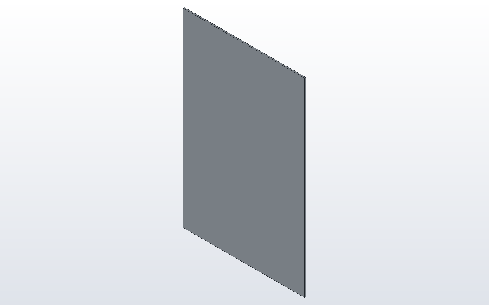
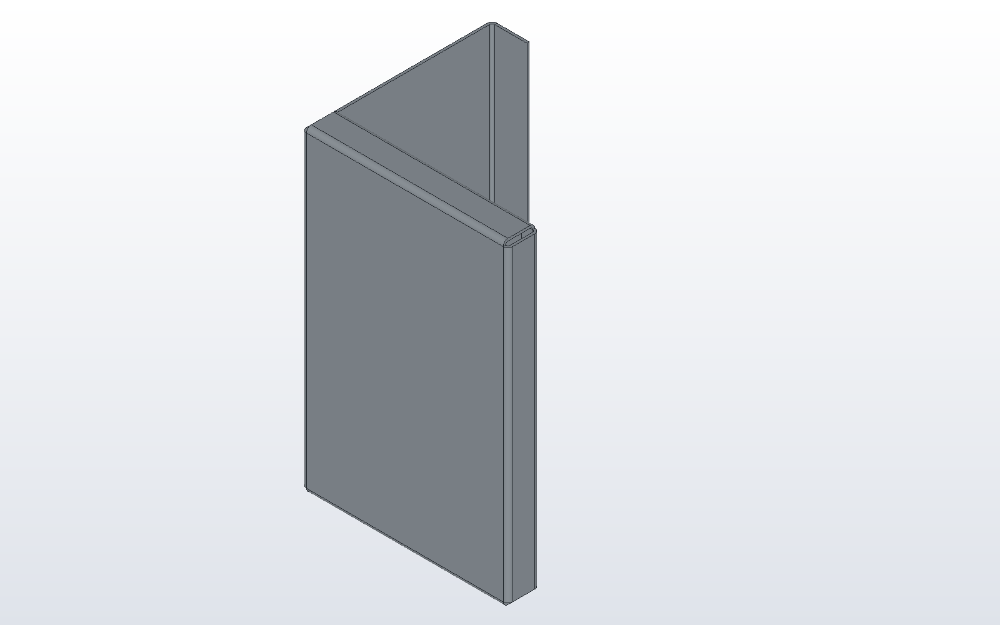
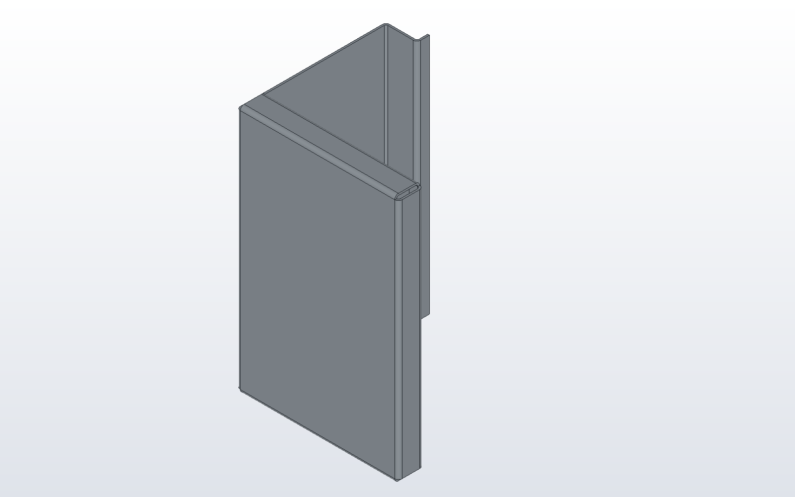
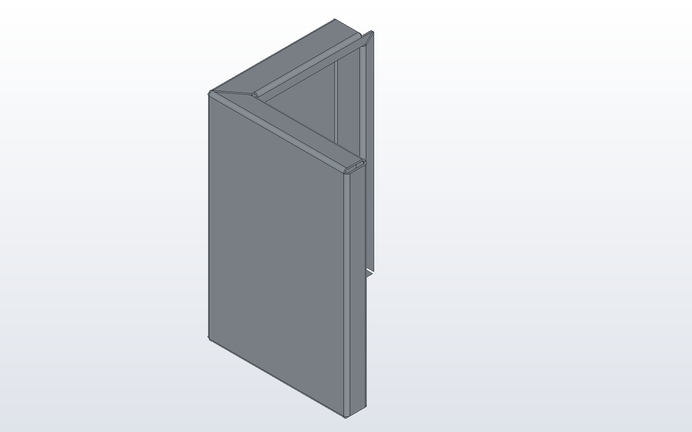

# Corner post in the window

A door's corner post is one sheet with a flange on every edge of its base and
more flanges on those flanges: a lip on the free edge of a return, and an
end flange on each end of a wall. This tutorial builds it in the window
with two commands, Sheet Metal > Base Flange... and Sheet Metal >
Flange..., and unfolds it. Each step shows the model as it stands after it;
the window writes the same calls into the model, one inside the next. The
finished post is the example [corner_post.py](../examples/corner_post.py),
and [the sheet metal page](../sheetmetal.md) says what each number means.

The post is 130 x 120 x 200 over its walls, of 1.5 mm sheet bent at a radius
of 1.5. Looking down on it, wall B runs along the bottom, wall A stands up
the left with flange C turned in off it and lip D turned outward off flange
C, and flange E stands up the right with lip F turned in. Every length
below is typed with Length to set to outside.

## 1. Base Flange: wall B

Choose Sketch > Sketch on XZ, take the Rectangle tool and click the corners
(3, 3) and (127, 197): wall B, drawn a bend radius and a thickness smaller
all round, since a flange's outside face stands that far beyond the edge it
is bent on. Choose Sheet Metal > Base Flange..., Custom, and type the
thickness 1.5, the bend radius 1.5 and the K-factor 0.44.

```python
# post_base.py
spec = SheetSpec(1.5, 1.5, 0.44)
post = base_flange([(3, 3), (127, 3), (127, 197), (3, 197)], spec, Plane.XZ)

part("post", post, color="galvanised")
```



## 2. Flange four times: the base's edges

Click the part and choose Sheet Metal > Flange.... The view shows the
edges that can take a flange; click one, or choose it in the Edge list.
F1 shows the command's steps while the dialog is up.

- The left edge, edge 3: length 120, Direction down, return length 23.5.
  This is wall A with flange C. Flange C is 25 less a bend radius, because
  lip D's bend will stand that far beyond its edge.
- The right edge, edge 1: length 20, down, return length 10: flange E with
  lip F.
- The bottom edge and then the top edge, edges 0 and 2: length 20, down,
  return length 10, Corners square. These are wall B's end flanges. Square
  lets lip F run its whole height and stops each end lip short of it.

```python
# post_walls.py
spec = SheetSpec(1.5, 1.5, 0.44)
post = base_flange([(3, 3), (127, 3), (127, 197), (3, 197)], spec, Plane.XZ)
post = flange(post, 3, 120, 90, "down", return_length=23.5, length_from="outside")
post = flange(post, 1, 20, 90, "down", return_length=10, length_from="outside")
for edge in (0, 2):
    post = flange(post, edge, 20, 90, "down", return_length=10,
                  length_from="outside", corner_treatment="square")

part("post", post, color="galvanised")
```



## 3. Flange on a flange's edge: lip D

Every edge of the base now has its flange, and is grey in the Edge list.
After them the list offers the edges of each flange: for wall A's, "Edge 3
leg, start end", "Edge 3 leg, end end" and "Edge 3 return, free edge".
Click the free edge of flange C in the view, or choose "Edge 3 return,
free edge" in the list. Direction now reads "towards the inside" and
"outward": type length 10 and choose outward. The preview shows lip D
before OK.

```python
# post_lip.py
spec = SheetSpec(1.5, 1.5, 0.44)
post = base_flange([(3, 3), (127, 3), (127, 197), (3, 197)], spec, Plane.XZ)
post = flange(post, 3, 120, 90, "down", return_length=23.5, length_from="outside")
post = flange(post, 1, 20, 90, "down", return_length=10, length_from="outside")
for edge in (0, 2):
    post = flange(post, edge, 20, 90, "down", return_length=10,
                  length_from="outside", corner_treatment="square")
post = flange(post, (3, "free"), 10, 90, "down", length_from="outside")

part("post", post, color="galvanised")
```



## 4. Flange on wall A's two ends

Flange again, and click the top end of wall A, "Edge 3 leg, start end":
length 26.5, towards the inside, return length 10, Corners mitre. Then the
bottom end, "Edge 3 leg, end end", with the same numbers. Each end flange
reaches over flange C, so its lip lies in lip D's plane: the mitre carries
the end lip on to lip D and joins the two at 45 degrees, as a picture
frame's corner, and mitres the end flange against wall B's from the walls'
outer corner.

```python
# post_ends.py
spec = SheetSpec(1.5, 1.5, 0.44)
post = base_flange([(3, 3), (127, 3), (127, 197), (3, 197)], spec, Plane.XZ)
post = flange(post, 3, 120, 90, "down", return_length=23.5, length_from="outside")
post = flange(post, 1, 20, 90, "down", return_length=10, length_from="outside")
for edge in (0, 2):
    post = flange(post, edge, 20, 90, "down", return_length=10,
                  length_from="outside", corner_treatment="square")
post = flange(post, (3, "free"), 10, 90, "down", length_from="outside")
for end in ("start", "end"):
    post = flange(post, (3, end), 26.5, 90, "up", return_length=10,
                  length_from="outside", corner_treatment="mitre")

part("post", post, color="galvanised")
```



## 5. Show Flat Pattern

Click the part and choose Sheet Metal > Show Flat Pattern: the post is drawn
unfolded in its place, one piece with thirteen bend lines, and the command
again draws it formed. Sheet Metal > Bend Table lists the thirteen bends,
and Sheet Metal > Export Flat Pattern... writes the DXF a laser cuts.


One Undo takes each flange back, and the model the window has written runs
again to the same post.
