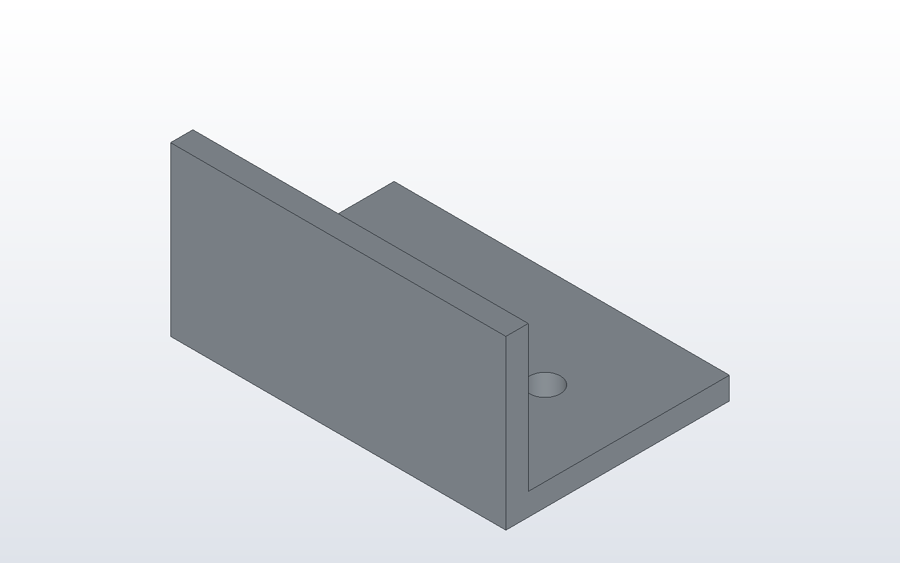

# Drawing a part

A drawing in DX-CAD&trade; is a .dxcdrg file. It holds no geometry: it names
the model, the sheet, the title block's fields and where each view has
been moved. Each time it is opened or exported it is drawn again from the
model, so it never goes stale. This tutorial draws an angle bracket and its
two rubber feet on an ISO A3 sheet, with a parts list, and exports it to
PDF.

## The part

```python
# angle.py
LENGTH = 60.0
WIDTH = 40.0
HEIGHT = 30.0
THICK = 4.0
HOLE = 5.5

angle = fuse(make_box(LENGTH, WIDTH, THICK), make_box(LENGTH, THICK, HEIGHT))
for x in (LENGTH / 4, 3 * LENGTH / 4):
    hole = make_cylinder(HOLE / 2, THICK, (x, (WIDTH + THICK) / 2, 0))
    angle = cut(angle, hole)
part("angle", angle, color="galvanised")

for x in (LENGTH / 4, 3 * LENGTH / 4):
    part(f"foot_{int(x)}", make_cylinder(6, 3, (x, (WIDTH + THICK) / 2, -3)), color="black")
```



## The drawing

In the window, save the model's project, then File > Drawing... makes the
drawing in a tab of its own, on the sheet you choose. It is drawn with the front, top, right and isometric views, the overall
sizes, a callout for each hole and the parts list. Drag a view to move
it, fill in the title block, and save. Here is what was saved, beside this
page as angle.dxcdrg:

```json
{
  "format": "dxcaddrg",
  "format_version": 1,
  "model": "angle.dxcprt",
  "sheet": "ISO-A3",
  "scale": null,
  "views": {},
  "dimensions": true,
  "parts_list": true,
  "fields": {
    "company_name": "Designmatix Ltd",
    "drawn_by": "DX-CAD",
    "material": "Galvanised steel",
    "drawing_no": "TUT-0001",
    "rev_number": "A"
  },
  "hidden_off": [],
  "font": null,
  "text_height": null
}
```

`"scale": null` lets DX-CAD pick the largest standard scale that fits.
`"views": {}` means no view has been moved. `"parts_list": true` puts the
bill of materials on the sheet: the angle once, and the two feet as one
line with a count of two.

## To PDF and DXF

```
dxcad run angle.py --output angle.dxcprt
dxcad drawing angle.dxcdrg --output angle.pdf --output angle.dxf
```

The PDF is one page, the size of the sheet. The DXF has one layer for each
view's visible and hidden edges, and each dimension is a DIMENSION entity.
Change `HEIGHT` in angle.py, run it again, and export again: the views,
the dimensions and the parts list follow. Next:
[DX-CAD with Claude Desktop](claude-desktop.md).
