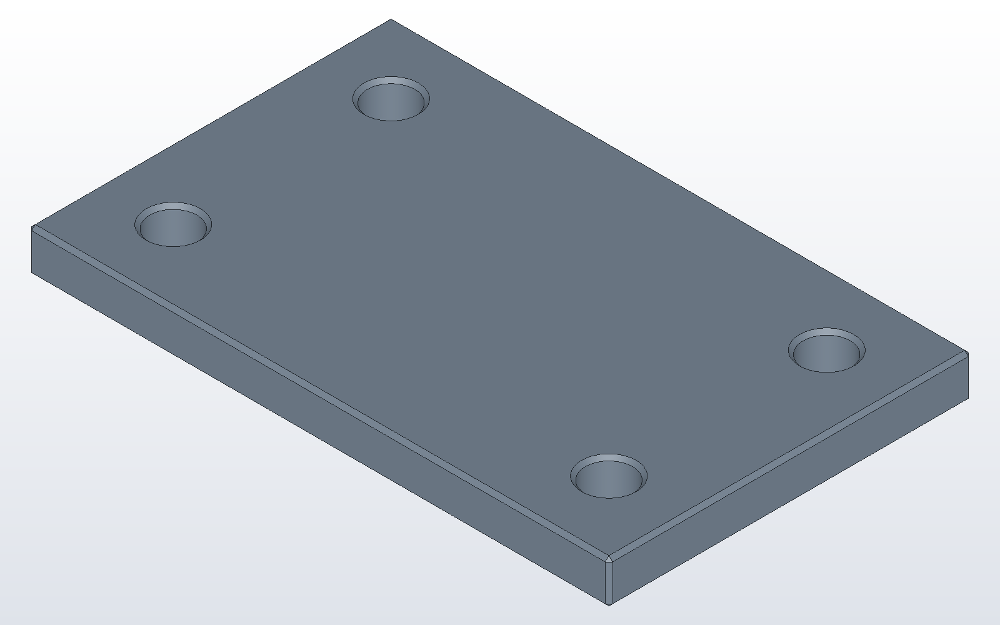

# Your first part

A part in DX-CAD is a short Python file, a model.py, that says how the
part is made. The window draws what the file builds, and the command line
builds the same file with no window at all. This tutorial makes a plate,
then drills it, then exports it for a CAM program. Every model on this page
is a file beside it, and the test suite builds each one and checks that it
is a valid solid.

## A plate

Every model.py has the model language in scope: `make_box`, `cut`, `part`
and the rest, listed in [the model language](../kernel.md). There is
nothing to import. Put the sizes at the top as named numbers, so that
changing the part means changing a number.

```python
# plate.py
LENGTH = 80.0
WIDTH = 50.0
THICK = 6.0

plate = make_box(LENGTH, WIDTH, THICK)
part("plate", plate, color="steel")
```

`part` names the solid and keeps it. Without it the plate is built and then
thrown away. Open it in the window with `dxcad gui plate.py`, or build it
from a terminal:

```
dxcad run plate.py --output plate.dxcprt
dxcad info plate.dxcprt
```

`run` writes plate.dxcprt, a part file that holds the part and the model that
built it. `info` lists its parts with their volume and size.


## Four holes and a chamfer

A hole is a cylinder cut out of the plate. Two loops place one hole
`INSET` in from each corner. `chamfer_all` then breaks every edge by half a
millimetre, holes included.

```python
# plate_holes.py
LENGTH = 80.0
WIDTH = 50.0
THICK = 6.0
HOLE = 6.5
INSET = 10.0

plate = make_box(LENGTH, WIDTH, THICK)
for x in (INSET, LENGTH - INSET):
    for y in (INSET, WIDTH - INSET):
        plate = cut(plate, make_cylinder(HOLE / 2, THICK, (x, y, 0)))
plate = chamfer_all(plate, 0.5)
part("plate", plate, color="steel")
```



In the window, change `HOLE` in the model pane and press `F5`, Run Script.
The part is built again with the new hole. The window's own commands, such
as Fuse or Pattern on the Model menu, write their line into this same file,
so the model stays the record of the part.

## Out to a CAM program

```
dxcad run plate_holes.py --output plate_holes.dxcprt
dxcad export plate_holes.dxcprt plate_holes.step
dxcad render plate_holes.dxcprt plate_holes.png
```

`export` writes STEP, STL, 3MF, BREP, DXF or SVG, chosen by the file's
suffix. `render` draws the part as a PNG with no window. Next:
[sheet metal in 10 minutes](sheet-metal.md).
