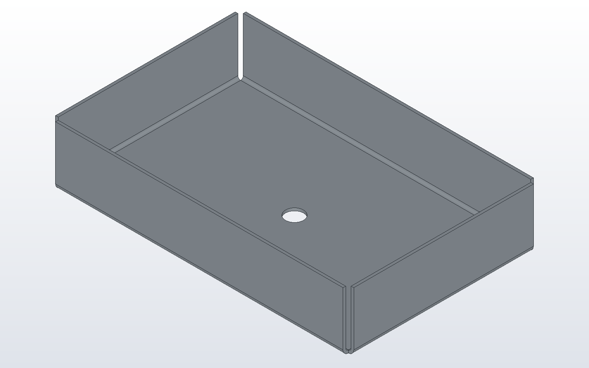

# Sheet metal in 10 minutes

A sheet part is cut from one sheet and bent along the edges of its outline.
DX-CAD&trade; keeps the record of how the part was made: the outline, each
flange, the sheet's thickness, bend radius and K-factor. It unfolds the part
from that record, so the flat pattern sent to a laser comes from the design
itself and not from a guess at the solid. This tutorial makes a tray with a
drain hole, unfolds it, and writes the DXF a laser cuts. The full reference
is [the sheet metal page](../sheetmetal.md).

## The tray

```python
# tray.py
LENGTH = 160.0
WIDTH = 100.0
HEIGHT = 30.0
HOLE = 10.0

spec = SheetSpec.from_gauge("mild steel", 1.5)
outline = [(0, 0), (LENGTH, 0), (LENGTH, WIDTH), (0, WIDTH)]
tray = base_flange(outline, spec, holes=[(LENGTH / 2, WIDTH / 2, HOLE)])
for edge in range(4):
    tray = flange(tray, edge, HEIGHT)

part("tray", tray, color="galvanised")
```

- `SheetSpec.from_gauge` takes the sheet from the stocked gauges: 1.5 mm
  mild steel, bent at a radius of one thickness, with DIN 6935's K-factor.
- `base_flange` is the flat base: a closed outline, here a rectangle, with
  a 10 mm hole in its middle. Edge 0 runs from the first corner to the
  second, edge 1 from the second to the third, and so on.
- `flange` bends one edge up into a 30 mm leg. The loop bends all four
  edges and leaves the corners open, so the tray unfolds flat.



In the window, Sheet Metal > Base Flange... and Sheet Metal > Flange... ask for
the same numbers in one dialog each. Each dialog shows a diagram and a
preview, and adds the same lines to the model.

## The flat pattern

```
dxcad run tray.py --output tray.dxcprt
dxcad flat tray.dxcprt --part tray --output tray.dxf
dxcad flat tray.dxcprt --part tray --output tray.svg
```

`flat` prints the size of the blank and how many bends and holes it has.
The DXF has the outline and the hole on layer CUT and each bend line on
layer BEND, in a dashed linetype, with a note beside each bend such as
`UP 90 R1.5`. The SVG is the same flat as a picture, with the bend lines
dashed:


Change `HEIGHT` and run `flat` again. The blank grows by twice the change
each way, since each leg is longer and the bend allowance stays the same.
Next: [assemblies with mates](assemblies.md).
